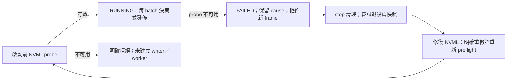

<!-- doc-status: proposed -->
<!-- doc-promotion: none -->
<!-- doc-date: 2026-10-13 -->
<!-- doc-module: cross -->

# 失敗／fallback／降級現況基線（#537 C0）

本稿是 [#537](https://github.com/raylei50653/saccade/issues/537) 的 **C0 checkpoint**：只**固定現況與失敗證據**，分 profile 記下「能力缺失、受控降級、監控 unknown」目前實際會產生什麼結果，並用 repo 內的特徵測試把這些結果釘住。**本稿不修復任何行為，也不選定失敗語義**；已採納的方向只引用 §4 的 owner 裁決，由後續 PR 各自實作。閱讀入口是 [architecture README](README.md)。

**Source baseline**：`main@8350f6f7bc591f313d9a37996b33d7e77f66a61f`（#594 merge，2026-10-13）。§2／§3 標 `reproduced` 的列，都以 §5 的特徵測試在此 baseline 執行過；除 C0-01 需要 CUDA 外都不需要 GPU。標 `source-inspected` 的列只讀過 source（其中 `main.py` 的建構順序另有靜態 AST 測試釘住，但沒有執行），沒有執行完整 service、GPU 或 package。

**本稿不擁有的內容**（只引用）：CAP／REQ 與支持裁決歸 [#535 ledger](capability_requirements_535.md)；節點／邊 ID 與 B0 發現歸 [跨 profile 總覽](system_overview_536.md)；shipping run 狀態值與 completion 接口歸 [CC-536-01-01](ship_export_contracts_536.md#cc-536-01-01)（#537 只擁有它的轉換語義，C0 未重查）；freshness、writer restart 與資源所有權歸 [#538](https://github.com/raylei50653/saccade/issues/538)；tracker public surface 歸 [#441](https://github.com/raylei50653/saccade/issues/441)；requirement↔check 對應與 as-built 驗收歸 [#541](https://github.com/raylei50653/saccade/issues/541)。狀態用語沿用[總覽 §1](system_overview_536.md#1-狀態用語)。

## 1. 要區分的五種結果

#537 要求的五種結果，在 C0 baseline 中能否分辨：

| 結果 | C0 baseline 能否分辨 | 主要缺口（§2 的 ID） |
|:--|:--|:--|
| 真的沒有 tracks（合法空幀） | 不能和「能力缺失」分辨 | C0-01 |
| 能力不可用 | 依路徑不同：回空、拋例外，或延到第一個有 detection 的 batch 才失敗 | C0-01、C0-02、C0-03 |
| 受控降級 | 有四個 level，但轉換和文件不一致 | C0-04 |
| 監控 unknown | 沒有 unknown 狀態，NVML 失敗與 SHM 缺失都表現為 NORMAL | C0-05、C0-06、C0-09 |
| 功能已退役 | 不在本單範圍，歸 #539 | — |

## 2. Capability／failure 矩陣（observed as-is）

| ID | Profile／節點 | 失敗條件 | 觀察到的結果 | 可觀測性 | 驗證 | REQ／下游 |
|:--|:--|:--|:--|:--|:--|:--|
| C0-01 | public-library、eval／SN-PL2 | native 擴充缺失，有 CUDA | facade `GPUByteTracker.update()` 對 3 個或 0 個 detection 都回 `[]` | 只有 `is_cuda == False`；呼叫端若不查就看不出差別 | reproduced（gpu 標記） | REQ-535-02-01、02-03；#441 |
| C0-02 | public-library、eval／SN-PL2 | native 擴充缺失，沒有 CUDA | `update()` 在進入 stub 前就拋 `RuntimeError`；訊息依 driver 環境而不同（例如 `No CUDA GPUs are available` 或 `Found no NVIDIA driver ...`），測試只釘住例外型別 | 例外 | reproduced | REQ-535-02-01 |
| C0-03 | online-service／SN-ON3（B0-F02） | native 擴充缺失 | `AsyncDispatcher` 直接 import 失敗後，名稱綁成 `typing.Any`；`get_tracker()` 拋 `TypeError: Any cannot be instantiated`。`_process_batch` 只在 batch 有 detection 時才建 tracker，所以空幀 batch 不會觸發這個錯誤 | 例外，出現時間依輸入而定 | reproduced（`get_tracker`）；觸發時間為 source-inspected | REQ-535-02-04；**已由 R-1 修復，見 §10** |
| C0-04 | online-service／SN-ON7 | VRAM usage 接近門檻 | 轉換表見 §3：FAST_PATH 實質上沒有遲滯，EMERGENCY 的轉換不單調，在 91～92 會一次跳兩級 | dispatcher `get_stats()["current_level"]`；轉換時 stdout 有一行 print | reproduced | REQ-535-07-02；D-537-2 |
| C0-05 | online-service／SN-ON7 | NVML init 失敗 | `get_stats()` 全部回 0。目前若為 EMERGENCY，連續 3 次決策會依序降為 FAST_PATH → REDUCED → NORMAL | 只有 init 時一行 print「Degradation disabled」；level 顯示 NORMAL | reproduced | REQ-535-07-01；**後續 4A 修復與證據見 §20** |
| C0-06 | online-service／SE-23、SE-24 | 沒有 writer（SHM segment 不存在） | `VRAMLevelReader.read()` 回 NORMAL；writer 之後才建立時，reader 能重新附掛 | 無 | reproduced | REQ-535-07-01；**已由 F07 修復，見 §7** |
| C0-07 | online-service／SE-24 | segment 內的 byte 超出 0～3 | `read()` 拋 `ValueError`。這個呼叫位於 orchestrator `handle_cognitive_event` 內，對事件處理的影響未追 | 例外 | reproduced（reader）；consumer 影響未驗證 | REQ-535-07-01；**已由 F07 修復，見 §7** |
| C0-08 | online-service／SE-23、SE-24（**B0-F07**） | 前次崩潰留下 segment，而且 reader 比 writer 先附掛 | writer unlink 並重建後，舊 reader 一直讀到舊值（測試中為 EMERGENCY）；新建立的 reader 讀得到新值；writer 關閉後，舊 reader 仍讀到最後的值。`main.py --mode full` 把 `PipelineOrchestrator()` 當 `gather()` 的參數，依 source 判讀 reader 會比 `dispatcher.start()` 先建立。卡在 EMERGENCY 時，`handle_cognitive_event()` 對非 anomaly 事件不寫入 ChromaDB 就返回，`process_event_batch()` 仍 ACK 整批，這些事件不會重送 | 無；level 看起來有效 | SHM 行為 reproduced；`main.py` 建構順序為 source-inspected（AST 測試靜態釘住，沒有執行 `run_full()`）；「orchestrator 持續丟棄非 anomaly 事件且仍 ACK」為 source-inspected（`src/saccade/cognition/orchestrator.py` 的 `handle_cognitive_event()`／`process_event_batch()`，沒有端到端測試） | REQ-535-07-01；#538 判準；D-537-3；**已由 F07 修復，見 §7** |
| C0-09 | online-service／SN-ON3 | WorkbenchPool 路徑 | `get_stats()` 固定回 `current_level: "NORMAL"`，這條路徑沒有接 resource manager | stats 看起來健康 | source-inspected | REQ-535-07-02 |
| C0-10 | shipping／SN-SH2、SN-SH4 | run 中途失敗 | 狀態值與 completion journal 由 CC-536-01-01 定義並已實作（source-level）；轉換語義歸 #537，C0 沒有重查 | journal `state`、exit code | 引用原卡 | REQ-535-01-01；**轉換語義已重查，見 §23** |
| C0-11 | online-service／SN-ON3 | native 擴充存在，batch 有 detection（任何 level） | dispatcher 對 tracker 的兩種呼叫都不被支援：level ≥ FAST_PATH 時 `set_degradation_params` 拋 `AttributeError`；低於 FAST_PATH 時 `update(..., frame_tensor=, stream_id=)` 拋 `TypeError`。worker task 隨即結束 | 沒有任何地方記錄；`stop()` 時才把例外拋出 | reproduced（strict fake；native binding 以 gpu 標記測試） | REQ-535-05-\*、07-02；#538 D2；**後補列，見 §9；已由 R-1 修復，見 §10** |

## 3. 降級轉換表：現況與已採納目標

單次 `decide_degradation_level()` 的結果。升級門檻是嚴格大於（85／92／96）；目標欄依 D-537-2（§4）：升級立即生效，可以跨級；恢復時每次決策只降一級，而且 usage 必須嚴格低於目前級別的門檻 −5。

| 目前級別 | usage 範圍 | 現況 | D-537-2 目標 | 是否一致 |
|:--|:--|:--|:--|:--|
| NORMAL | ≤85／(85, 92]／(92, 96]／>96 | NORMAL／REDUCED／FAST_PATH／EMERGENCY | 相同 | 一致 |
| REDUCED | <80／[80, 92]／(92, 96]／>96 | NORMAL／REDUCED／FAST_PATH／EMERGENCY | 相同 | 一致 |
| FAST_PATH | <87 | REDUCED | REDUCED | 一致 |
| FAST_PATH | [87, 92] | **REDUCED** | FAST_PATH | **不一致**（issue 反例 @90） |
| FAST_PATH | (92, 96]／>96 | FAST_PATH／EMERGENCY | 相同 | 一致 |
| EMERGENCY | <91 | FAST_PATH | FAST_PATH | 一致 |
| EMERGENCY | [91, 92] | **REDUCED**（跳兩級） | EMERGENCY | **不一致** |
| EMERGENCY | (92, 96] | **FAST_PATH** | EMERGENCY | **不一致**（issue 反例 @94） |
| EMERGENCY | >96 | EMERGENCY | EMERGENCY | 一致 |

C0 測試釘住的是「現況」欄。「目標」欄只是記錄已採納的方向，不是 C0 的斷言；對應的目標測試和實作屬於後續 C2 PR。

**C2 修復後**（§8）：「目標」欄就是現行行為；「現況」欄保留為修復前（`978e5538`）的基線，不再描述現行程式。

## 4. Owner 裁決（引用）

以下來自 [#537 C0 起步](https://github.com/raylei50653/saccade/issues/537#issuecomment-6139603145)，是 2026-10-13 工作 session 的轉錄；同一天也記入 [#550](https://github.com/raylei50653/saccade/issues/550#issuecomment-6139619832)。

- **D-537-1**：C0 為一條 Draft PR，只含文件矩陣和無 GPU 特徵測試，只固定現況與失敗證據，**不混入修復**；不改 runtime 行為；沒有 merge 授權。
- **D-537-2**：C2 的目標語義採 [degradation 文件 §5](../modules/resource/architecture_degradation.md)，內容如 §3。
- **D-537-3**：第一個修復目標是 B0-F07（C0-08），另開小 PR。具體方案要先給 owner 核准；freshness／restart 判準歸 #538，#537 只選 consumer policy。
- **D-537-4A**：owner 在 2026-10-20 的本次工作 session 明確回覆「核准 4A，實作這個小修復」，批准 §19.2 的 NVML 失敗契約；範圍限 C0-05，不包含 merge、部署或其他 profile 的支持批准。

## 5. 證據

| 測試 | 涵蓋 | 環境 |
|:--|:--|:--|
| [test_resource_degradation_observed_537.py](../../tests/unit/test_resource_degradation_observed_537.py) | C0-04～C0-08：§3 的現況欄（19 個單步案例，含兩個 issue 反例）、NVML 失敗、SHM 缺失／非法值、B0-F07 的 SHM 行為；`main.py --mode full` 的建構順序只以 AST 靜態檢查 | 不需 GPU；NVML 以 mock 取代；SHM 使用每個測試程序私有的 segment 名稱 |
| [test_native_missing_observed_537.py](../../tests/unit/test_native_missing_observed_537.py) | C0-01～C0-03 | 子程序中封鎖 `saccade_tracking_ext`；C0-02／C0-03 隱藏 CUDA；C0-01 標 `gpu`，在 CI 會略過 |

F07 修復後，第一個檔的 SHM 測試（C0-06～08）已改為目標語義，其餘維持現況特徵；F07 的目標測試見 §7。C2 修復後，第一個檔的 7 個不一致單步案例移到 contract 測試（§8），留下的 12 個單步案例在修復前後結果相同。這兩個檔的 function 標籤都是 `diagnostic`：只觀察、不構成正式保證。後續修復 PR 若改變某列的行為，要在同一個 PR 更新對應測試與本稿，並說明這項改變是哪一條裁決授權的。

**限制**：沒有執行完整 online service、Redis／Chroma 或真實 VRAM 壓力；C0-07、C0-08 對 orchestrator 事件的影響、C0-08 的 `--mode full` 建構順序，以及 C0-03 的觸發時間，都沒有執行驗證。C0-01 需要 CUDA，只在本機執行過。沒有新增 runtime／GPU／installed-package qualification 或 equivalence 證據。

## 6. 未裁決項目與下一步

| 項目 | 需要的裁決 | 歸屬 |
|:--|:--|:--|
| C0-01／02 的拒絕點 | public facade 的拒絕點與相容性由 #441／#537 協調；eval entrypoint 的 preflight／結果政策仍歸 #536／#537。online 的 C0-03 已由 R-1 修復（§10） | REQ-535-02-01／02-03／02-04 |
| C0-05 | 4A 已核准（§19）；初始化／probe／無效 sample 明確拒絕，實作與證據見 §20 | REQ-535-07-01；CAP owner：raylei50653 |
| C0-06～C0-08 | 已由 F07 修復（§7）；T 預設值、多 writer、shutdown 仍待 #538 | #538 |
| C0-09 | stats 已改為明列「未接監控」（§21）；WorkbenchPool 是否支援 resource degradation 仍未裁決 | REQ-535-07-02 |
| C2 其他參數 | 重啟初值與決策頻率已裁決（R0、F0，見 §8）；非法 usage（NaN、負值、>100）已改為明確拒絕（O0，見 §22） | D-537-2 未涵蓋；O0 依 #550 §0A 方案紀錄 |
| R-1（C0-11） | 呼叫契約已由 R-1 修復（§10）；worker task 異常終止後的錯誤傳遞、health、stop 與 shutdown 語義依 §10 的切片順序處理 | #537 C0-11；#538 D2-AD、D2-WB-0／1、D2-GPU |
| C0-10 | 轉換表、失敗分類推導與合取判讀已寫定並釘住（§23），不改 shipping 行為 | REQ-535-01-01；證據交 #541 |
| health CLI | 報告 unknown 的方式已改為三態且標示來源（§24）；readiness／exit code 政策仍未選 | REQ-535-07-03 |
| orchestrator 錯誤後的 ACK | ACK 語義 | REQ-535-06-01（#538） |

F07、C2、R-1、D2 的 host lifecycle 切片（§7～§16）與 D2-GPU-0／1（§17～§18）已落地；#538 其餘項目仍 OPEN，不取得 online-service qualification、不部署。C0-05 的 4A 已核准（§19），實作與證據見 §20；C0-09 的「未接監控」回報見 §21，O0 的非法 usage 拒絕見 §22，C0-10 的 run journal 轉換語義見 §23，health CLI 的三態報告見 §24，C0-01／02 的 public facade 相容性與 eval consumer policy 依上表分工裁決。每個修復 PR 只處理一類行為。

## 7. B0-F07 修復（C0-06／07／08 收斂）

本節記錄 C0 之後的 B0-F07 修復 PR，§2 的矩陣保留為修復前的基線。方案經 Codex 獨立審查後，由 owner 在 2026-10-16 的工作 session 授權實作，並授權在審查與檢查都通過時合併（D-537-3）。新契約的完整內容（記錄格式、狀態、freshness、ownership、consumer policy、部署規則）在 [degradation 文件 §6](../modules/resource/architecture_degradation.md#6-vram-level-跨程序快照契約537-b0-f07)；本節只記狀態變化與殘留。

**觸發條件修正**：C0-08 的前提寫成「前次崩潰留下 segment，而且 reader 先附掛」。跨程序探針另外重現了兩個序列（Python 3.12，沒有頻率資料）：

- **S-B**：兩程序部署時，若 orchestrator 的 reader 已附掛而且仍在運作，perception 程序重啟（被 SIGKILL 而 tracker 存活，或正常停止後重啟），reader 會一直停在最後的值。
- **S-C**：orchestrator 程序結束時，它的 `resource_tracker` 會 unlink writer 正在使用的 segment。之後啟動的 reader 找不到 segment，回報 NORMAL，即使 writer 仍處於 EMERGENCY。

**修復後的行為**：

| ID | 修復前（§2） | 修復後 |
|:--|:--|:--|
| C0-06 | 沒有快照時讀為 NORMAL | 讀為 MISSING；所有事件都嘗試持久化，不啟動新的事件觸發 RAG，計入 `unknown_events` |
| C0-07 | 非法 level 拋 `ValueError`，整批中斷而且沒有 ACK | 讀為 INVALID，reader 不拋例外；整批照常持久化並 ACK |
| C0-08／S-A／S-B | 已附掛的 reader 一直讀舊 segment 的值 | 同一個 reader 的下一次讀取就會跟上新 writer：新 writer 啟動時先發佈「尚未決策」（STALE），第一次決策後讀為 FRESH。writer 正常停止時發佈「尚未決策」（STALE）；writer 死亡留下的快照，在上限 T 內仍讀為 FRESH，之後變成 STALE |
| S-C | reader 程序結束時刪除 writer 的 segment | reader 不持有任何資源，結束時不影響 writer |

只有 FRESH EMERGENCY 會卸載非 anomaly 事件，並計入 `shed_events`；其他狀態都不會卸載。`main.py --mode full` 的建構順序沒有改（AST 測試保留），因為 reader 不再持有狀態，這個順序已不會造成問題。

**證據**（都不需要 GPU）：

| 測試 | 涵蓋 |
|:--|:--|
| [test_vram_level_snapshot_contract_537.py](../../tests/unit/test_vram_level_snapshot_contract_537.py) | 四種狀態與邊界、各種不合法記錄（含 pad、FIFO）、reader 不拋例外、重啟與殘留、`close()` 與繼任 writer 交錯、發佈的每個階段失敗、`CLOCK_BOOTTIME`、dispatcher 在決策前取時戳 |
| [test_orchestrator_vram_policy_537.py](../../tests/unit/test_orchestrator_vram_policy_537.py) | 同一個 consumer 依序經過 FRESH EMERGENCY → STALE → MISSING → INVALID → reader 出錯 → FRESH NORMAL，逐步檢查持久化、ACK、卸載、RAG 與計數；狀態轉換 log；storage 失敗仍 ACK（現況） |
| [test_vram_level_snapshot_xproc_537.py](../../tests/integration/test_vram_level_snapshot_xproc_537.py) | 真實子程序：S-C、writer 被 SIGKILL 後先老化再重啟（S-A／S-B，老化以注入的時鐘偏移控制）、SIGKILL 後立即重啟、writer 在暫存檔寫完而尚未 rename 時死亡、舊版 SharedMemory attacher 的 tracker 刪除名稱後恢復、並行發佈與讀取（以 handshake 結束；要求 0 個 INVALID、0 個錯配、0 個倒退、至少 1000 次 FRESH 讀取，而且子程序成功結束）。子程序的等待都有上限（readiness 逐 byte 讀取並共用同一個 deadline），子程序一律回收 |
| [test_resource_degradation_observed_537.py](../../tests/unit/test_resource_degradation_observed_537.py) | C0-06～08 的四個測試改為目標語義 |

負控制的輸出附在 PR 描述：同一個與版本無關的 harness，在修復前的 `c0a29e47` 上 4 個情境都因行為斷言失敗（不是 import 失敗），修復後全部通過；5 個 mutation（忽略 age、沿用上一個 level、把 unknown 當 NORMAL、決策後才取時戳、不經 rename 直接覆寫）都會讓對應的測試失敗。

**殘留與交接**：

- **C0-05**：NVML 失敗時，writer 仍發佈 FRESH NORMAL（REQ-535-07-01）。
- 「嘗試持久化」不保證不遺失資料：storage 失敗時仍會 ACK，PEL 也沒有回收（REQ-535-06-01，#538）。
- 不保證 unknown 狀態下不用 GPU：Chroma 預設 embedding 沒有指定 provider；已經在執行的 RAG task 不受影響。
- T 預設 1 s 是推估值，沒有量測，待 #538 裁決；單一 writer 沒有強制機制；`dispatcher.stop()` 只在 CancelledError 時呼叫。以上都交 #538。
- dispatcher 閒置時讀為 STALE，屬於預期行為（不加 heartbeat）。
- 沒有在真實 Redis、Chroma 或 VRAM 壓力下做端到端驗證。
- 部署：新舊版本不能混用，升級或 rollback 時要先停掉兩端。

## 8. C2 遲滯修復（C0-04 收斂）

本節記錄 C2 修復 PR，§3 的「現況」欄保留為修復前的基線。方案（單行 clamp，即方案 A）由 owner 在 2026-10-16 的工作 session 採納並授權受限實作：只允許 Draft PR，merge 要在提交確切 head、審查結果、CI 與 runtime identity 證據後另行裁決。目標語義是 D-537-2，契約內容在 [degradation 文件 §5](../modules/resource/architecture_degradation.md#5-hysteresis遲滯保護)。

**根因**：`decide_degradation_level()` 的升級判斷只看 usage 所在的區段，直接賦值，所以會把仍應保留的高階狀態改低。恢復鏈判斷的是 `self.current_level`，只在條件成立時覆寫；條件不成立時，被改低的值就直接成為結果。因此 FAST_PATH 在 [87, 92] 掉回 REDUCED，EMERGENCY 在 [91, 92] 一次跳兩級、在 (92, 96] 掉回 FAST_PATH（例如 EMERGENCY@91：升級判斷得到 REDUCED，91 不小於 91，恢復不觸發）。門檻常數、嚴格比較與恢復鏈本身都符合 D-537-2。

**修改**：升級判斷之後、恢復判斷之前加一行 `new_level = max(new_level, self.current_level)`。只要門檻遞增且遲滯寬度不為負，有效升級（clamp 後的結果高於目前級別，也就是 usage 高於上一級門檻）與恢復條件（usage 低於本級門檻 −5）不會同時成立；未 clamp 的升級賦值本身仍可能和恢復重疊（例如 EMERGENCY@88 先得到 REDUCED，再由恢復改為 FAST_PATH），但 clamp 之後不影響結果，所以每次決策只會升級、降一級或維持。

**Owner 裁決**（2026-10-16 工作 session）：

| 項目 | 決定 |
|:--|:--|
| 修復方案 | A（單行 clamp）；與 if/elif 改寫在本契約下等價 |
| EMERGENCY 保留區間 | 接受：進入 EMERGENCY 後，usage 要低於 91 才恢復到 FAST_PATH；事件卸載因此延長，是 D-537-2 的預期效果 |
| 重啟初值 | R0：維持 NORMAL，第一次量測後立即決策；不繼承前一個 writer 的狀態 |
| 非法 usage | O0，只限本 PR：維持既有行為（NaN 維持原級、負值降一級、>100 升到 EMERGENCY），不視為支持契約，仍待後續裁決（後續已改為明確拒絕，見 §22） |
| 決策頻率 | F0：維持每個 batch 決策一次，不加停留時間或 heartbeat |
| R-1 | 獨立的 P1 候選缺口，不併入 C2；要在 online service 端到端驗收前處理 |

**修復後的行為**：§3 的三個不一致區間都改為目標值（FAST_PATH 在 [87, 92] 維持 FAST_PATH；EMERGENCY 在 [91, 96] 維持 EMERGENCY），其餘各列不變。C0-05（NVML 不可用時從 EMERGENCY 逐次衰減到 NORMAL）不變。

**Consumer 影響**（程式不變，出現時間變長）：進入 EMERGENCY 後，usage 在 [91, 96] 期間 orchestrator 讀到 FRESH EMERGENCY，非 anomaly 事件會被刻意卸載並計入 `shed_events`；FAST_PATH 在 [87, 92] 維持，這段期間不啟動新的 RAG，dispatcher 的 batch 上限維持 2。snapshot 記錄格式、freshness 與「決策前取時戳」的順序都沒有改。

**證據**（都不需要 GPU）：

| 測試 | 涵蓋 |
|:--|:--|
| [test_resource_degradation_hysteresis_537.py](../../tests/unit/test_resource_degradation_hysteresis_537.py) | 86 個案例：4 個級別 × 15 個臨界 usage 的單步表（依 D-537-2 手寫）、issue 反例、跨級升級、逐級恢復、遲滯區內來回 100 次不轉換、0.1% 網格（0～100）上的單調性與「每次最多降一級」、兩步路徑對照獨立參考模型；另釘住修復不得移動的 C0-05、R0 與 O0 現況（O0 列只是觀察，不是契約；§22 已改為拒絕契約，案例數隨之改變） |
| [test_resource_degradation_observed_537.py](../../tests/unit/test_resource_degradation_observed_537.py) | 移除 7 個不一致的單步案例，留下修復前後相同的 12 個 |

負控制的輸出附在 PR 描述：同一個與版本無關的 harness 只替換 `resource_manager.py`，以本 PR 的 contract 測試執行。修復前的 `978e5538` 有 17 個行為斷言失敗；6 個有效 mutation（恢復改 `<=`、升級改 `>=`、一次恢復多級、clamp 放在恢復之後、遲滯寬度 4、升級限一級）各自造成 7～23 個失敗。把恢復鏈改成以 `new_level` 判斷的 mutation 是**等價 mutant**：理由同上段的互斥性，它與修復版在所有輸入上結果相同，因此不算測試漏洞。

**Runtime identity**：`resource_manager.py` 是 `decision_relevant`，修改後 implementation 軸會移動，staleness checker 會 fail closed。依 [republication runbook](../reference/runbooks/runtime_identity_republication.md) 在 controlled host 重新捕捉，以 stacked PR 與本 PR 一次合入。probe 相等不代表等價，也不這樣主張。

**殘留與交接**：

- **R-1（C0-11 候選）**：level ≥ FAST_PATH 時，`dispatcher.py` 的 `_process_batch()` 呼叫 `tracker.set_degradation_params(level)`，而 `_worker_loop()` 沒有包住 `_process_batch()` 的例外處理（source 已核對）。原生 `GPUByteTracker` binding 沒有這個方法；這只依 binding 檢查與 repo 內找不到實作來判斷，沒有在真實 service 重現。分工：#537 C0-11 確認 native tracker 的 degradation API 契約，並用無 GPU 的 strict fake 做出能觸發 `AttributeError` 的負控制；#538 D2 處理 worker task 異常終止後的錯誤傳遞、health、stop 與 shutdown。不得以 `hasattr` 檢查後略過呼叫，把缺少的能力偽裝成降級成功。R-1 不阻擋本 PR 的 source-level 修復，但在處理前不能宣稱 online degradation 已完整可用。
- 非法 usage（O0）：NVML 以整數相除，實務上不會產生 NaN 或負值；`total == 0` 會拋 `ZeroDivisionError`，NVML 執行期錯誤也會往外拋，都屬於 C0-05／REQ-535-07-01，本 PR 不處理。
- 遲滯只在 usage 維度，沒有時間維度：從 EMERGENCY 回到 NORMAL 只要 3 次決策，速度取決於 batch 頻率（F0）。
- #538 的 ACK／PEL 資料遺失風險不因本修復而解除。
- 沒有在真實 service、Redis、Chroma 或 VRAM 壓力下做端到端驗證。

## 9. C0-11：dispatcher↔tracker 呼叫契約（R-1 現況）

本節是 C0 之後補上的特徵列，**只固定現況，不修復也不選定目標契約**（比照 D-537-1）。修復記錄在 §10，本節保留為修復前的基線。Source baseline 為 `main@82126e7c`（#598 merge，2026-10-17）。R-1 原本記為「native tracker 沒有 degradation API」（§8）；核對後發現範圍更大：**dispatcher 對 tracker 的整個呼叫形式在 repo 內都沒有實作**，不只缺 FAST_PATH 用的方法。

**呼叫端與實作的落差**：

| 呼叫（`_process_batch()`） | native binding `saccade_tracking_ext.GPUByteTracker` | Python facade `saccade.perception.tracking.tracker_gpu.GPUByteTracker` |
|:--|:--|:--|
| level ≥ FAST_PATH：`set_degradation_params(level)` | 不存在 → `AttributeError` | 不存在 |
| 接著呼叫 `update(boxes, scores, classes)` | 只收 raw pointer 與 `num_dets`、`stream_ptr` 等 int → `TypeError` | 接受 |
| level < FAST_PATH：`update(boxes, scores, classes, frame_tensor=, stream_id=)` | `TypeError` | 沒有這兩個參數 → `TypeError` |
| 把回傳值解包成 `(ids, boxes, classes)` | 回傳 `list[TrackResult]` | 回傳 `list[TrackResult]` |

dispatcher 透過 `_make_tracker()` 直接建立 native binding，不經 facade。目前只有 [test_dispatcher.py](../../tests/extended/test_dispatcher.py) 的 `MagicMock` tracker 符合這個呼叫形式，所以既有測試看不出落差。`set_degradation_params` 與 tensor 版的 `update` 原本屬於 Python `SmartTracker` wrapper；這個 wrapper 在 `317e3c65`（2026-04-30）移除，最後一次與呼叫端相符的時間點沒有追查。

**觸發與後果**（都已用 strict fake 重現）：

- 只要 batch 裡有一幀有 detection，第一次呼叫 tracker 就會讓 `_worker_loop()` 的 task 帶著例外結束；全是空幀時不會呼叫 tracker，worker 會繼續運作。因此任何有 detection 的輸入都會觸發，不限於降級狀態。
- 以下是 #538 D2 範圍的觀察，只記錄現況：worker task 結束後，`_running` 仍為 True；`put_frame()` 不報錯，queue 到 100 筆後新的幀直接被丟掉；`get_stats()` 沒有錯誤或健康欄位，`current_level` 停在最後一次決策的值；失敗那一批沒有 `task_done()`。`stop()` 會把 worker 的例外再拋出來，因此跳過 tracker 清理與 `VRAMLevelWriter.close()`；writer 沒有關閉，快照停在最後一次 FRESH 的值，超過上限 T 後才讀為 STALE（§7）。

**證據**：

| 測試 | 涵蓋 | 環境 |
|:--|:--|:--|
| [test_dispatcher_tracker_contract_observed_537.py](../../tests/unit/test_dispatcher_tracker_contract_observed_537.py) | facade 的簽名與方法（`inspect`）；native binding 沒有 degradation 方法、`update` 的參數與回傳型別（需要 native 擴充，沒有時略過）；在 native tracker 上實際呼叫三種形式（`gpu` 標記）；用與 binding 介面相同的 strict fake，在四個 level 下讓 worker 結束，例外型別依 level 而不同；空幀不觸發；worker 結束後的狀態（上段 D2 觀察）。R-1 修復後，讓 worker 結束與空幀這兩組改為 §10 的契約測試，D2 觀察改由注入的 tracker 錯誤觸發 | strict fake 不需 GPU；native 呼叫只在本機 CUDA 執行過 |

function 標籤是 `diagnostic`。要修復時，必須在同一個 PR 把這些測試改成目標契約，並說明依據哪一條裁決。

**未裁決（待 owner）**：

| 項目 | 選項舉例 | 歸屬 |
|:--|:--|:--|
| dispatcher 的 tracker 契約 | 改用 facade 並調整呼叫與回傳處理；或新增明確的 adapter；或在支持裁決前把 online-service 的 tracking 路徑標為不支援並明確拒絕 | #537 C0-11；REQ-535-05-\*（目前 `undecided`） |
| FAST_PATH／EMERGENCY 對 tracker 的效果 | native 端新增降級參數；或 dispatcher 只調整 batch 上限、不呼叫 tracker；或明確拒絕。不得用 `hasattr` 檢查後略過呼叫，把缺少的能力偽裝成降級成功（§8） | #537 C0-11；REQ-535-07-02 |
| worker 失敗的傳遞、health、stop、shutdown | 由 #538 D2 定義 | #538 D2 |

**限制**：沒有執行 `main.py` 或完整 online service；native 呼叫只確認到 pybind11 的參數檢查，沒有往下執行 tracker。strict fake 只模擬 binding 中與 dispatcher 有關的部分。

## 10. R-1 修復：OnlineTrackerAdapter（C0-11、C0-03 收斂）

本節記錄 R-1 的修復 PR，§9 保留為修復前的基線。Owner 在 2026-10-17 的工作 session 裁決，授權受限實作與 Draft PR，**不授權 merge 或部署**。

**Owner 裁決**（2026-10-17）：

| 項目 | 決定 |
|:--|:--|
| tracker 契約 | 新增內部 `OnlineTrackerAdapter`，底層用既有的 Python facade 連到 native binding。輸入統一為 `boxes／scores／classes`，把 `list[TrackResult]` 轉成 callback 需要的 `(ids, boxes, classes)` tensor。native 不可用時明確拒絕，不讓 stub 回空結果冒充成功 |
| 範圍 | 只修 geometry-only tracking；extractor／ReID 組合沒有驗證過，要明確拒絕。不改 public API、native tracker 演算法或 CUDA kernel，也不重寫 raw pointer 管理 |
| FAST_PATH／EMERGENCY | 只調整 batch：NORMAL／REDUCED 用 `max_batch`，FAST_PATH／EMERGENCY 用 `min(max_batch, 2)`。不新增 `set_degradation_params()`，不改 tracker 參數；resource level 與 tracker 實際套用的降級要分開表示，不得宣稱 tracker 已降級；不得用 `hasattr()` 靜默略過 |
| #538 D2 | 拆成獨立 PR，依序為 R-1 Fix → D2-AD（AsyncDispatcher worker failure、health、錯誤傳遞、queue accounting、stop／finally cleanup）→ D2-WB-0（WorkbenchPool CPU lifecycle 契約與故障注入）→ D2-WB-1（WorkbenchPool 有界停止與資源釋放修復）→ D2-GPU（CUDA stream／event、buffer lifetime、late callback） |
| 限制 | 不改 #465 shipping、既有 MOT parity、runtime identity 或 frozen tracker 行為；本修復不等於 REQ-535-05-\* 的完整支持批准 |

**修改**：

- 新模組 [online_tracker_adapter.py](../../src/saccade/perception/online_tracker_adapter.py)：
  - `OnlineTrackerAdapter.update(boxes, scores, classes)` 呼叫 facade 的 `update()`，再把每個 `TrackResult` 的 `obj_id`、`x1..y2`、`class_id` 轉成 int32／float32／int32 tensor，放回輸入所在的 device。
  - 建構時，`native_unavailable_reason()` 若回報原因（擴充無法 import、facade 綁的是 stub，或沒有 CUDA），就拋 `OnlineTrackerUnavailable`。
  - 輸入不是 CUDA tensor 時拋 `ValueError`，因為 facade 會把 `data_ptr()` 交給 CUDA kernel。
- [dispatcher.py](../../src/saccade/perception/dispatcher.py)：
  - `_make_tracker()` 改為建立 adapter。
  - `_process_batch()` 在任何 level 都只呼叫 `update(boxes, scores, classes)`。
  - batch 上限改為 `min(max_batch, 2)`。修復前固定是 2，所以 `max_batch=1` 時會反而放大。
  - `start()` 在建立 writer 與 worker 之前先做 native preflight，失敗就拋 `OnlineTrackerUnavailable`。
  - 傳入 extractor 時，建構子拋 `ValueError`。
  - `get_stats()` 新增 `tracker_degradation: "none"`。
  - 移除對 `saccade_tracking_ext.GPUByteTracker` 的直接 import。

**修復後的行為**：

| ID | 修復前 | 修復後 |
|:--|:--|:--|
| C0-11 | 有 detection 的第一個 batch 讓 worker 結束（FAST_PATH 以上是 `AttributeError`，以下是 `TypeError`） | 四個 level 都經 adapter 追蹤，callback 收到 `(ids, boxes, classes)` tensor |
| C0-03 | native 缺失時，第一個有 detection 的 batch 才在 `get_tracker()` 拋 `TypeError: Any cannot be instantiated` | `start()` 立即拋 `OnlineTrackerUnavailable`，不建立 writer 與 worker；直接呼叫 `get_tracker()` 或建立 adapter 也拋同一種例外 |
| 降級 | FAST_PATH 以上呼叫不存在的 tracker 方法；batch 上限固定 2 | 只限制 batch 為 `min(max_batch, 2)`；`get_stats()` 的 `current_level` 是 resource level，`tracker_degradation` 固定為 `"none"` |
| extractor | 只決定 `embedding_dim=768`，tracker 從沒收到 embedding | 建構時拒絕 |

**沒有改變的部分**：worker 失敗的語義（§9 的 D2 觀察）保留現況，由 D2-AD 處理（§11）。adapter 不吞 tracker 的錯誤，tracker 拋例外時 worker 仍會結束。facade、native binding、tracker 演算法與 CUDA kernel 都沒有改。`main.py --mode full` 在 SigLIP extractor 載入成功時，會把 extractor 傳給 dispatcher，因此現在會在建構時被拒絕（修復前是在第一個有 detection 的 batch 失敗）。`main.py` 沒有改，要不要改由 owner 決定。

**證據**：

| 測試 | 涵蓋 | 環境 |
|:--|:--|:--|
| [test_dispatcher_tracker_contract_537.py](../../tests/unit/test_dispatcher_tracker_contract_537.py) | adapter 的輸出格式與空結果形狀；adapter 沒有降級方法；strict fake（真實 facade 類別的 `create_autospec`）拒絕修復前的兩種呼叫（負控制）；四個 level 都追蹤成功、worker 存活、`tracker_degradation == "none"`；6 組 batch 上限；空幀不建立 tracker；extractor 被拒絕；tracker 錯誤仍讓 worker 結束；`start()` 在任何副作用之前拒絕；封鎖擴充的子程序中（有／無 CUDA 環境），`start()`、`get_tracker()` 與 adapter 都拋 `OnlineTrackerUnavailable` | host-only：不需 GPU |
| 同一檔，`gpu` 標記 | 真實 native：adapter smoke（device、dtype、形狀；穩定 detection 最後成為一條 track；空輸入；CPU 輸入被拒絕）；dispatcher 在 NORMAL 與 FAST_PATH 下端到端追蹤 5 幀 | GPU-validated：只在本機 CUDA 執行過 |
| [test_dispatcher.py](../../tests/extended/test_dispatcher.py) | mock tracker 改為 adapter 的 `create_autospec`，不再接受不存在的方法；FAST_PATH 測試改為檢查同一個 `update` 呼叫；extractor 測試改為檢查拒絕；host-only 測試以 fixture 略過 preflight | host-only |
| [test_dispatcher_tracker_contract_observed_537.py](../../tests/unit/test_dispatcher_tracker_contract_observed_537.py)、[test_native_missing_observed_537.py](../../tests/unit/test_native_missing_observed_537.py) | 修復後失效的 diagnostic 斷言（§9 的 worker 結束與空幀、C0-03）移到上面的契約測試；facade／native 的介面檢查與 D2 觀察保留 | — |

負控制與 mutation 的輸出附在 PR 描述：同一個 harness 只替換 source，用本 PR 的契約測試與 extended 測試（共 47 個）執行。修復前的 `dispatcher.py`（只補上測試會 patch 的兩個名稱，不改行為）有 21 個行為斷言失敗；7 個 mutation（batch 上限固定 2、移除 preflight、adapter 退回 stub、adapter 加上空的降級方法、接受 extractor、adapter 回傳原始 list、stats 把 level 當成 tracker 降級）各自造成 1～15 個失敗。

**未驗證**：沒有執行 `main.py`、完整 online service、真實 detector 或 RTSP／DALI 輸入；GPU 證據只涵蓋合成的 detection。adapter 每次呼叫都會建立 host tensor 再複製到 device，沒有量測延遲。多條 stream 共用 CUDA stream 的行為沒有驗證（歸 D2-GPU）。

**Runtime identity**：`dispatcher.py` 與新模組都屬於 `decision_relevant`，修改後 implementation 軸會落後，staleness checker 會 fail closed。重新發佈需要 owner 決定，見 PR 描述。

## 11. #538 D2-AD：AsyncDispatcher worker 失敗與停止

本節記錄 D2-AD 修復 PR（stack 在 R-1 修復之上）。§9 的 D2 觀察是修復前的基線。裁決同 §10（2026-10-17）：worker 出現例外後，要立即進入可觀察的 FAILED 狀態；拒絕新工作；保留原始錯誤；`stop()` 必須嘗試完成每一步清理，不能因為例外而跳過。本節內容屬於 #538，暫時寫在這裡，是為了和 §9／§10 的基線放在一起。

**修改**（[dispatcher.py](../../src/saccade/perception/dispatcher.py)）：

- 新增 `DispatcherState`（CREATED／RUNNING／FAILED／STOPPED）與 `DispatcherFailed(RuntimeError)`，`__cause__` 是原始錯誤。`state`、`failure` 為唯讀屬性。
- `_worker_loop()` 從決策、收集 batch 到 `_process_batch()` 的整段都包在 `except Exception` 裡。worker 在自己的 task 內記錄狀態：
  - 狀態改為 FAILED，保留原始錯誤，`_running` 設為 False。
  - 失敗那一批與 queue 中剩下的幀都呼叫 `task_done()` 並計數，然後結束。
  - 狀態在 task 結束前就已設定，所以 task 一結束就看得到 FAILED。
  - task 本身正常結束，不留下 "exception was never retrieved"。
  - `CancelledError` 不算失敗。
- FAILED 狀態下，`put_frame()` 拋 `DispatcherFailed`，`start()` 也一樣（要先 `stop()`）。RUNNING 時再呼叫 `start()` 拋 `RuntimeError`。`stop()` 之後可以重新 `start()`，`failure` 在那時才清除。
- `stop()`：
  - 取消 worker 之後，在 `finally` 依序執行三個步驟：結算 queue、清除 tracker、關閉 writer。每一步各自 try，前一步失敗不影響後面。
  - 狀態改為 STOPPED。
  - 如果這次執行失敗過，拋 `DispatcherFailed`，清理錯誤附在 `__notes__`；否則若有清理錯誤，拋第一個；第二次呼叫 `stop()` 不再報告。
- `get_stats()` 新增以下欄位。`queue_depth` 原本就有，修復前在失敗後會一直停在 100。

  | 欄位 | 內容 |
  |:--|:--|
  | `state`、`failure` | 狀態與原始錯誤的 repr |
  | `dropped_queue_full` | `put_frame()` 因 queue 滿而丟掉的幀（修復前沒有計數） |
  | `failed_batch_frames` | 失敗那一批的幀數，其中部分可能已送到 callback |
  | `discarded_on_failure` | 失敗時仍在 queue 中、沒有處理的幀 |
  | `discarded_on_stop` | `stop()` 時取消的 in-flight 幀與 queue 中的幀 |

**修復後的行為**（對照 §9 的 D2 觀察）：

| 項目 | 修復前 | 修復後 |
|:--|:--|:--|
| worker 例外 | task 帶著例外結束，外部沒有任何記錄 | 立即變為 FAILED，原始錯誤保存在 `failure`，`get_stats()` 看得到 |
| 之後的 `put_frame()` | 不報錯，queue 滿 100 筆後靜默丟棄 | 拋 `DispatcherFailed` |
| queue | 失敗那一批沒有 `task_done()`，`queue.join()` 會永遠等待 | 全部結算並計數，`join()` 立即返回 |
| `stop()` | 再拋原始例外，跳過 tracker 清理與 writer 關閉 | 每一步清理都執行，之後拋 `DispatcherFailed`（`__cause__` 是原始錯誤） |

**證據**：

| 測試 | 涵蓋 | 環境 |
|:--|:--|:--|
| [test_dispatcher_failure_contract_538.py](../../tests/unit/test_dispatcher_failure_contract_538.py) | 四種失敗來源（tracker、detector、resource manager 的 `ZeroDivisionError`、callback）都進入 FAILED 並保留原始錯誤（同一個物件）；失敗後拒絕 `put_frame()`／`start()`；失敗那一批與 queue 的結算與計數，`join()` 不會卡住；queue 滿的計數；`stop()` 取消 in-flight batch 時的結算；失敗後 `stop()` 先清理再拋例外，第二次不拋；清理步驟失敗時後面的步驟仍執行；清理錯誤附在 notes；正常停止不算失敗；`start()` 的規則與重新啟動 | host-only |
| [test_dispatcher_tracker_contract_537.py](../../tests/unit/test_dispatcher_tracker_contract_537.py) | R-1 的「tracker 錯誤不被吞掉」改為檢查 `failure` 與 `DispatcherFailed` | host-only |
| [test_dispatcher_tracker_contract_observed_537.py](../../tests/unit/test_dispatcher_tracker_contract_observed_537.py) | §9 的 D2 觀察已失效，移到上面的契約測試；這個檔只留 facade／native 介面檢查 | — |

負控制輸出附在 PR 描述：同一個 harness 只替換 `dispatcher.py`，執行 D2-AD、R-1 契約測試與 extended 測試（共 60 個）。以 R-1 head 的 `dispatcher.py` 為基準（只補上兩個 class 名稱）有 14 個失敗；7 個 mutation 各自造成 1～10 個失敗（worker 改回往外拋、失敗後仍接受 `put_frame()`、失敗時不結算 queue、`stop()` 吞掉失敗、清理步驟不隔離、`start()` 不清除 failure、queue 滿不計數）。

**沒有處理**：

- 失敗時沒有立即關閉 VRAM writer。snapshot 停在最後一次 FRESH 的值，超過上限 T 才讀為 STALE；`stop()` 會關閉 writer。
- `put_frame()` 在 CREATED／STOPPED 狀態仍會把幀放進 queue（沒有裁決）。
- 呼叫端的影響：`main.py` 只在 `CancelledError` 時呼叫 `stop()`。producer 收到 `DispatcherFailed` 時，`gather()` 往外拋，不會呼叫 `stop()`。`run_8stream_perception.py` 在 `finally` 中呼叫 `stop()`，它現在可能拋 `DispatcherFailed`，使後面的 `resource_manager.close()` 與 `telemetry.stop()` 被跳過。這兩個呼叫端都沒有修改，待 owner 決定。
- 沒有自動重啟、health endpoint 或告警；health 只限於 `state`／`failure`／`get_stats()`。
- WorkbenchPool（D2-WB-0／1）與 CUDA stream／buffer lifetime（D2-GPU）不在本節範圍。
- 沒有執行完整 online service。

## 12. #538 D2-WB-0：WorkbenchPool CPU lifecycle 現況與目標

本節是 D2-WB-0：**只固定現況，不修改 `WorkbenchPool`**，同時寫下 D2-WB-1 要依循的目標。R-1 與 D2-AD 都沒有改動 `WorkbenchPool`，以下現況等同 `main@82126e7c`。依 #538 D2 的要求，每個情境都在獨立子程序中執行，外部 timeout 20～30 s，因為有些情境會永遠卡住。batcher、Workbench 與 pipeline config 都是 CPU fake，所以只證明 host lifecycle；CUDA stream、event 與 buffer lifetime 歸 D2-GPU。

**現況**（[test_workbench_pool_lifecycle_observed_538.py](../../tests/unit/test_workbench_pool_lifecycle_observed_538.py)，13 個情境）：

| ID | 情境 | 觀察到的結果 |
|:--|:--|:--|
| WB-01 | 正常啟動、送 3 幀、停止 | 3 個結果；`stop()` 立即返回；shutdown batcher 時沒有存活的 worker |
| WB-02 | worker 卡在 `process_frame()`，queue 未滿 | `stop()` 用 `join(timeout=5.0)` 等 5 s 後，在 worker 仍存活時 shutdown batcher，並印出「Stopped.」正常返回。worker 之後恢復，又使用了已 shutdown 的 batcher（真實 batcher 的 `submit()` 會永遠等不到結果，屬 source 判讀） |
| WB-03 | worker 卡住，queue 已滿（maxsize 4） | `stop()` 的 `q.put(None)` 沒有 timeout，**永遠卡住** |
| WB-04 | `process_frame()` 拋例外 | worker thread 結束，例外只交給 `threading.excepthook`；`_running` 仍為 True；`put_frame()` 繼續接受（overflow 時清空 queue，計入 `drops`）；`get_stats()` 沒有錯誤欄位 |
| WB-05 | worker 已死，queue 又被填滿 | `stop()` **永遠卡住**（同 WB-03） |
| WB-06 | 第 2 個 Workbench 建構失敗（3 條 stream） | `start()` 拋原始例外；`_running` 仍為 True；第 1 個 worker 仍在執行；建立了 2 個 queue；batcher 沒有 shutdown |
| WB-07 | `PerceptionPipelineConfig` 不可用 | 檢查排在建立 batcher 之後，所以 `start()` 拋例外時 batcher 已建立且沒有 shutdown；`_running` 仍為 True |
| WB-08 | 連續 `stop()` 兩次後再 `start()` | 第二次 `stop()` 會返回；再次 `start()` 會把新的 queue 與 worker 加到舊 list 後面，`stream_0` 仍對到已死的舊 queue，幀不會被處理（舊 queue 中還有第二次 stop 留下的 sentinel） |
| WB-09 | `stop()` 之後再 `put_frame()` | 不報錯，放進沒有 consumer 的 queue；overflow 時清空並計數 |
| WB-10 | event loop 關閉後，worker 才送出結果 | `loop.call_soon_threadsafe` 拋 `RuntimeError`，worker thread 結束 |
| WB-11 | `on_result` 是 coroutine function | `call_soon_threadsafe` 只建立 coroutine，從不 await，callback 從未執行（Python 會發出 "never awaited" 警告） |
| WB-12 | stream id 超出範圍（`stream_9`，只有 1 條） | 靜默丟棄 |
| WB-13 | stream id 沒有 `_`（`cam`） | 對到 index 0 |

**Owner 目標**（2026-10-17）：worker 還沒有真正結束時，不得宣稱正常停止，也不得提前 shutdown 仍在使用的 batcher。D2-WB-1 負責有界停止、worker failure 與資源安全釋放。

**D2-WB-1 依循的契約**（沿用 D2-AD 的形式；裁決以外的選擇已標出，待 owner 確認）：

| 項目 | 契約 |
|:--|:--|
| 停止有上限 | `stop(timeout)` 不能無限阻塞，所有 worker 共用同一個 deadline（WB-02、03、05）|
| 不提前回收 batcher | 有 worker 在 deadline 時仍存活，就不 shutdown batcher，並拋出具名的 stop-timeout 例外，不印出「Stopped.」；之後再呼叫 `stop()` 會重試（WB-02）|
| worker 失敗 | 記錄 FAILED 與原始錯誤；之後 `put_frame()` 拒絕並拋出具名例外；`get_stats()` 顯示狀態與失敗（WB-04）|
| 啟動失敗 | 回收已啟動的 worker 與 batcher 後，才把原始例外拋出；不需要資源的檢查要排在建立 batcher 之前（WB-06、07）|
| 重新啟動 | `stop()` 之後再 `start()` 時，換一組新的 queue 與 worker，或明確拒絕（WB-08）。**選擇：換新的一組** |
| 晚到的 callback | pool 不在 RUNNING 或 event loop 已關閉時，丟棄 callback 並計數，不讓 worker 因此結束（WB-10）。**選擇：丟棄並計數** |
| 不在本切片 | `stop()` 之後的 `put_frame()`（WB-09）、coroutine 型的 `on_result`（WB-11）、stream id 的對應方式（WB-12、13）都沒有裁決，只記錄現況 |

**限制**：只在 CPU fake 上驗證，沒有真實 TensorRT、CUDA 或 Workbench。WB-02 中「真實 batcher 在 shutdown 後讓 worker 永遠等待」屬 source 判讀。8stream `--workbench` 入口仍會用到未定義的名稱（[總覽](system_overview_536.md)），所以 WorkbenchPool 目前只有測試會建構。

## 13. #538 D2-WB-1：WorkbenchPool 有界停止、worker failure 與資源釋放

本節記錄 D2-WB-1 修復 PR，§12 的現況表是修復前的基線。依循 owner 目標（2026-10-17：worker 還沒真正結束時，不得宣稱正常停止，也不得提前 shutdown 仍在使用的 batcher）與 §12 的契約。§12 標為「選擇」的兩項（重新啟動換新的一組、晚到的 callback 丟棄並計數）已在 owner 最終裁決中正式批准，並附帶本節末「驗收補強」的條件。

**修改**（[dispatcher.py](../../src/saccade/perception/dispatcher.py)，只動 `WorkbenchPool` 與 `_WorkbenchWorker`）：

- 新增 `PoolState`（CREATED／RUNNING／FAILED／STOPPING／STOPPED）、`WorkbenchPoolFailed`（`__cause__` 是原始錯誤）與 `WorkbenchPoolStopTimeout`；`state`、`failure` 為唯讀屬性。
- worker：
  - 改用共用的 `stop_event`，搭配 `get(timeout=0.05)` 判斷何時結束。`stop()` 不再對 queue 呼叫可能阻塞的 `put(None)`。
  - 每幀的處理移到 `_process()`。
  - 例外交給 pool 的 `_on_worker_failure()`，pool 記錄第一個失敗（原始錯誤與 stream），並把狀態改為 FAILED。
- `start()`：
  - nv12 kernel 與 `PerceptionPipelineConfig` 的檢查排在建立 batcher 之前。
  - 每次啟動都換一組新的 queue、worker 與 stop event。
  - 建立過程中任何一步失敗，都會先呼叫 `stop()` 回收已啟動的 worker 與 batcher，再拋原始例外；回收時的錯誤附在 notes。
  - RUNNING 時呼叫拋 `RuntimeError`；FAILED 時拋 `WorkbenchPoolFailed`；STOPPING 時拋 `WorkbenchPoolStopTimeout`。後兩者都要先 `stop()`。
- `put_frame()`：FAILED 時拋 `WorkbenchPoolFailed`。其他狀態維持現況（WB-09 沒有裁決）。
- callback：pool 不在 RUNNING／FAILED，或 event loop 已關閉時，丟棄並計入 `late_callbacks`；`call_soon_threadsafe` 在檢查之後才遇到 loop 關閉而拋 `RuntimeError` 時也一樣。FAILED 時，其他仍健康的 worker 的結果照常送出。
- `stop(timeout=5.0)`：
  - 先設定 stop event，所有 worker 共用同一個 deadline。
  - deadline 到時還有 worker 存活：**不 shutdown batcher**，狀態維持 STOPPING，拋 `WorkbenchPoolStopTimeout`（列出存活的 worker），不印「Stopped.」。之後再呼叫 `stop()` 會重試。
  - 所有 worker 都結束後：清空 queue 並計入 `discarded_on_stop`，shutdown batcher，狀態改為 STOPPED。
  - 這次執行如果失敗過，最後拋 `WorkbenchPoolFailed`。第二次呼叫 `stop()` 不再報告。
- `get_stats()` 新增 `state`、`failure`、`failed_stream`、`late_callbacks`、`discarded_on_stop`、`stop_timeouts`。`current_level` 仍固定為 `"NORMAL"`（C0-09 不變；之後由 §21 改為 `"UNKNOWN"`／`not_wired`）。

**修復後的行為**（對照 §12）：

| ID | 修復前 | 修復後 |
|:--|:--|:--|
| WB-02 | `join(5 s)` 之後，在 worker 存活時 shutdown batcher，並回報正常停止 | `stop(timeout)` 到期就拋 `WorkbenchPoolStopTimeout`，batcher 保留；worker 結束後再呼叫 `stop()`，才 shutdown（0 個存活，shutdown 後沒有被使用） |
| WB-03、05 | `stop()` 永遠卡住 | 兩個卡住的 worker 共用 1 s deadline，約 1 s 後返回；之後再停止時，queue 中的 4 幀計入 `discarded_on_stop`。WB-05 的前提已不存在，因為失敗後 `put_frame()` 會拒絕 |
| WB-04 | worker 靜默結束 | 狀態為 FAILED，保留原始錯誤與 stream；拒絕 `put_frame()`／`start()`；沒有交給 `threading.excepthook`；`stop()` 先清理（batcher 在 0 個存活時 shutdown），再拋 `WorkbenchPoolFailed` |
| WB-06 | 已啟動的 worker 與 batcher 沒有回收 | 全部回收，狀態為 STOPPED，可以重試啟動 |
| WB-07 | batcher 已建立且沒有回收 | 在建立 batcher 之前就拒絕，狀態維持 CREATED |
| WB-08 | 重新啟動時，新的 queue 與 worker 加到舊 list 後面，幀被送到已死的 queue | 換新的一組，幀會被處理 |
| WB-10 | worker 因 `RuntimeError` 結束 | 丟棄並計入 `late_callbacks`，worker 繼續運作，之後可以正常停止 |

WB-01、09、11、12、13 不變（[observed 測試](../../tests/unit/test_workbench_pool_lifecycle_observed_538.py)保留）。

**證據**（host-only、CPU fake，每個情境都在獨立子程序中執行，並設外部 timeout）：

| 測試 | 涵蓋 |
|:--|:--|
| [test_workbench_pool_lifecycle_contract_538.py](../../tests/unit/test_workbench_pool_lifecycle_contract_538.py) | 上表 WB-02～08、10 的目標行為，包括 STOPPING 時的重試、共用 deadline、失敗後的拒絕與清理、啟動回滾後重試、重新啟動、晚到的 callback |
| [test_workbench_pool_lifecycle_observed_538.py](../../tests/unit/test_workbench_pool_lifecycle_observed_538.py) | 不變的現況與共用 harness |

負控制輸出附在 PR 描述。

**沒有處理**：

- 卡在 `process_frame()` 中的 worker 無法中斷，`stop()` 只能保留 batcher 並回報 timeout。thread 是 daemon，所以程序結束時會直接消失。
- 沒有裁決的項目維持現況：`stop()` 之後的 `put_frame()`、coroutine 型的 `on_result`（WB-11）、stream id 的對應方式。
- worker 的 queue 改成 50 ms 輪詢，閒置時會多一些喚醒，沒有量測延遲影響。
- 只在 CPU fake 上驗證；真實 TensorRT、CUDA、Workbench，以及 CUDA event 與 buffer lifetime，都歸 D2-GPU。8stream `--workbench` 入口仍然無法使用。

**驗收補強**（owner 最終裁決，2026-10-17）：

裁決正式批准兩項選擇：重新啟動時換新的 queue、worker 與 stop event；晚到的 callback 丟棄並計數。同時要求補上以下兩個邊界。

- **callback 在執行時才檢查**：
  - 修復前只在 worker 呼叫 `call_soon_threadsafe()` 時檢查狀態，所以已經排入、但在 stop 或重新啟動之後才執行的 callback，仍會把舊結果交出去。
  - 現在 pool 有 `_generation`，每次 `start()` 都會遞增。worker 的 callback 帶著建立時的 generation，交由 `_deliver()` 在 event loop 上執行；執行時，generation 不是目前的值、或 pool 不在 RUNNING／FAILED，就丟棄並計數。
- **重新啟動的條件**：只有在 STOPPED 才能重新啟動，而 STOPPED 只在所有 worker 都結束、batcher 已釋放後才會設定。STOPPING（worker 仍存活或 batcher 尚未釋放）時拒絕。
- **batcher shutdown 的時間保證與結果**：
  - `stop(timeout)` 的共同 deadline 只涵蓋 worker 的 join。
  - `batcher.shutdown()` 在 deadline 之後執行，有自己的上限：`BatchingTRTDetector.shutdown()` 最多 join server thread 2 s，現在會回傳 server 是否已結束。
  - shutdown 拋例外，或回傳 False（server 仍存活）時，保留 batcher 的引用，狀態維持 STOPPING，例外照原樣往外拋或改拋 `WorkbenchPoolStopTimeout`；之後再呼叫 `stop()` 會重試。
  - 回傳 `None` 的舊式 batcher 視為已釋放。
  - 修復前，shutdown 失敗時也會無條件設為 STOPPED，並丟掉 batcher 的引用。

| 測試（[contract](../../tests/unit/test_workbench_pool_lifecycle_contract_538.py)） | 涵蓋 |
|:--|:--|
| `test_callback_queued_before_stop_is_dropped_when_it_runs` | worker 已排入 callback，event loop 尚未執行時呼叫 `stop()`：callback 執行時被丟棄，結果數 0，`late_callbacks` 為 1 |
| `test_callback_queued_before_restart_is_dropped_when_it_runs` | 同上，但期間發生 `stop()` 再 `start()`：狀態雖然是 RUNNING，generation 已不同，仍然丟棄 |
| `test_callback_queued_while_running_is_delivered` | 正控制：期間沒有 stop 或重新啟動時照常交付 |
| `test_batcher_not_released_keeps_stopping` | shutdown 回傳 False 或拋例外：維持 STOPPING、保留 batcher、拒絕重新啟動；batcher 釋放後重試，狀態變為 STOPPED |
| `test_stuck_worker_stop_is_bounded_and_keeps_the_batcher` | 新增檢查：STOPPING 時重新啟動被拒絕 |

負控制（41 個測試，只替換 `dispatcher.py`）：

| 變體 | 結果 |
|:--|:--|
| #604 head | 4 個失敗 |
| `_deliver()` 不做任何檢查 | 2 個失敗 |
| `_deliver()` 只檢查狀態、不檢查 generation | 1 個失敗（重新啟動的情境） |
| 忽略 shutdown 的回傳值 | 1 個失敗 |

另有兩個 mutation 是等價 mutant，對應的程式碼已移除，讓實作和測試一致：

- `stop()` 也遞增 generation：狀態檢查已經涵蓋。
- `start()` 另外檢查存活的 worker 或 batcher：由 STOPPED 的不變式涵蓋。

host 層的保證不能取代 D2-GPU 的 buffer lifetime 驗證。

## 14. #538 caller lifecycle：`main.py` 與 `run_8stream_perception.py`

本節記錄 caller lifecycle 修復 PR（stack 在 D2-WB-1 之上），範圍依 owner 最終裁決（2026-10-17）只限於這兩個入口。目的是把 R-1、D2-AD、D2-WB-1 修好的元件接回真正的呼叫端，不重新設計 tracker，也不擴大 online-service 的支持範圍。

**Owner 裁決**（引用）：

- `main.py --mode full` 明確改為 geometry-only tracking：不再傳 extractor 給 AsyncDispatcher，也不保留一套沒有被使用的 SigLIP／EmbeddingDispatcher 初始化流程。
  - 啟動紀錄要寫明 `online tracking = geometry-only`、`ReID = unsupported in this path`。
  - 使用者明確要求 ReID 時要 fail-fast，不得靜默改成純幾何模式。
- `main.py`：正常停止、worker 失敗、producer 例外與取消時，都要嘗試 `dispatcher.stop()`。`run_full()` 在其中一個子任務失敗時，要取消並收斂其他子任務，不能留下 orchestrator 繼續執行。
- `run_8stream_perception.py`：使用完整的 `try/finally`。即使 `dispatcher.stop()` 或 `pool.stop()` 拋例外，也要繼續釋放不依賴存活 worker 的資源（resource manager、telemetry）。
- 例外不能被清理例外覆蓋：保留原始的 worker failure，後續清理錯誤作為附加診斷。
- producer 捕捉例外後只印出錯誤，以及 stats loop 不會因 worker FAILED 而結束，兩者都要修正。
- `WorkbenchPool.stop()` timeout 時，不得強制釋放仍被 worker 使用的 batcher。
- `--workbench` 的 demo 接線可以修正，但沒有實際驗證之前仍標為不支援。

**修改**：

- `main.py`：
  - 移除 `TRTFeatureExtractor`、`EmbeddingDispatcher`、`on_embeddings_ready` 與它們的全域資源（`RedisCache`、`SemanticDriftHandler`）。
  - `run_perception()` 建立 AsyncDispatcher 時不傳 extractor，並印出上述啟動紀錄。
  - 新增 `--reid`：在 `perception`／`full` 模式下以 `parser.error` 退出（exit 2）。
  - `on_detection_finished()` 仍是 no-op，docstring 寫明 `--mode full` 沒有接通 detection→embedding→Redis→cognition。
- `main.py` 的 lifecycle：
  - `supervise(tasks, watchers)`：等待所有 task 結束；任何一個 task 或 watcher 第一次失敗，就取消其他全部，等它們結束後再拋出第一個錯誤。之後的錯誤，只要不是同一個失敗（`__cause__` 相同），都附為 note。
  - `raise_when_failed(dispatcher)`：每 0.1 s 檢查一次，dispatcher 變為 FAILED 就拋 `DispatcherFailed`，讓 producer 閒置時也能察覺失敗。
  - `run_perception()` 在任何結束路徑都會呼叫 `dispatcher.stop()`。有原始錯誤時，清理錯誤只附為 note；`stop()` 重新拋出同一個失敗時不重複記錄，但保留它自己附帶的清理 note。
  - `run_full()` 改用 `supervise()`。
  - 為了在無 GPU 的子程序中測試，`run_perception()`／`run_full()` 加了 keyword-only 參數（detector factory、producer、streams、source、orchestrator factory），預設值都是原本的行為。
- `run_8stream_perception.py`：
  - producer 捕捉例外後改為 log 並重新拋出。
  - stats loop 改成 watcher，另加 `_raise_when_failed()`（dispatcher 或 pool 變為 FAILED 時拋出）。
  - `run_multistream_perception()` 用單一外層 `try/finally`，每建立一項資源就登記它的清理步驟，結束時依相反順序逐一執行（`dispatcher.stop()` → `resource_manager.close()` → `telemetry.stop()`，或 `pool.stop()` → `telemetry.stop()`），每一步各自 try。
  - `pool.stop()` timeout 時，batcher 由 pool 保留（D2-WB-1）；telemetry 照常停止。
  - `--workbench`：補上 `WorkbenchPool` 的 import，`_on_result_workbench` 改為同步函式。help 文字標為 unsupported（沒有端到端驗證）。

**證據**（[test_caller_lifecycle_538.py](../../tests/unit/test_caller_lifecycle_538.py)，16 個情境）：

- 每個情境都在獨立子程序中執行真正的入口函式，並設外部 timeout。
- media、detector、orchestrator 與 VRAM writer 都是 fake，native 檢查被略過，所以不需要 GPU、Redis 或 RTSP。
- WorkbenchPool 的情境沿用 D2-WB 的 fake。

| 入口 | 情境 | 結果 |
|:--|:--|:--|
| `main.py` | 正常結束 | `stop()` 已呼叫（STOPPED，writer 關閉一次），producer 都釋放；啟動紀錄含 geometry-only 與 ReID unsupported，沒有 SigLIP |
| | worker 失敗 | 拋 `DispatcherFailed`（`__cause__` 是 detector 的 `RuntimeError`）；producer 都被取消並釋放；dispatcher 已停止 |
| | worker 失敗，而 producer 閒置 | watcher 察覺失敗，結果同上 |
| | producer 例外 | 其他 producer 被取消；拋原始的 `ValueError`；dispatcher 已停止 |
| | 取消 | dispatcher 已停止；拋 `CancelledError` |
| | producer 例外，同時 `writer.close()` 失敗 | 仍拋原始的 `ValueError`，`OSError('close failed')` 附為 note |
| | `run_full`：perception 失敗 | `run_full()` 返回之前，orchestrator 已被取消 |
| | `run_full`：orchestrator 失敗 | `run_full()` 返回之前，perception 的 dispatcher 已停止 |
| | `--reid` | exit 2，訊息為 ReID unsupported，沒有建立 dispatcher |
| 8stream（AsyncDispatcher） | worker 失敗 | `DispatcherFailed`；dispatcher 已停止、resource manager 已關閉、telemetry 已停止、media 都釋放 |
| | worker 失敗，同時 `dispatcher.stop()` 的清理失敗 | 其餘清理照常執行；原始失敗保留，`close failed` 在 note 中 |
| | worker 失敗，而 stream 閒置 | watcher 察覺失敗 |
| | producer 讀取錯誤 | 錯誤不被吞掉（`OSError`），清理全部執行 |
| | 取消 | 清理全部執行 |
| 8stream（WorkbenchPool） | worker 失敗 | `WorkbenchPoolFailed`；pool 為 STOPPED、batcher 已 shutdown、telemetry 已停止 |
| | 取消時 worker 卡住 | `pool.stop()` timeout 附為 note；pool 維持 STOPPING，batcher **沒有** shutdown；telemetry 仍停止 |

負控制（只替換入口檔案；harness 與輸出在 `results/caller_20261017/`，gitignored）：

| 變體 | 結果 |
|:--|:--|
| 修復前的兩個入口（`bbfd8785`） | 16 個全部失敗。新的 keyword-only 參數不存在，所以失敗以結構性為主 |
| `main.py` 出錯時不呼叫 `stop()` | 7 個失敗 |
| 移除 `main.py` 的 watcher | 1 個失敗（producer 閒置） |
| 清理錯誤覆蓋原始錯誤 | 1 個失敗 |
| `run_full` 改回 `gather` | 2 個失敗（初版測試在 `asyncio.run` 收尾時才檢查，會讓這個 mutation 通過；已改為在返回前檢查） |
| 接受 `--reid` | 1 個失敗 |
| 8stream 的 producer 吞掉例外 | 2 個失敗 |
| 8stream 的清理步驟不隔離 | 5 個失敗 |
| 移除 8stream 的 watcher | 1 個失敗 |
| 8stream 在 `pool.stop()` 之後強制 shutdown batcher | 1 個失敗 |

**沒有處理**：

- 沒有執行真實的 `main.py`、RTSP、DALI、Redis、Chroma 或 GPU，`--workbench` 仍標為不支援。
- `on_detection_finished()` 仍是 no-op，`--mode full` 沒有接通 detection→cognition。
- orchestrator 自己被取消時的清理不在本 PR 範圍。
- 兩個入口各有一份 `supervise` 與 `same_failure`；範圍限定在這兩個檔案，所以沒有抽成共用模組。
- C0-08 的 AST 測試（`test_b0_f07_full_mode_builds_orchestrator_before_dispatcher_start`）改為檢查新的寫法：`run_full()` 改用 `supervise()`，在建立 task list 時同步建構 orchestrator，`create_task()` 只負責排程，所以 orchestrator 仍在 `run_perception()` 啟動 writer 之前建立，順序沒有改變。

**啟動例外補件**（owner merge gate 裁決，2026-10-17）：

owner 讀 #605 的程式碼時，找到兩條測試沒有涵蓋的啟動例外路徑。它們和「所有結束路徑都會清理」的說法不一致：

- `run_full()` 在 `supervise([...])` 的引數中，先建立 perception task，才呼叫 `orchestrator_factory()`。`PipelineOrchestrator.__init__()` 會初始化 Redis、Chroma 等資源；如果它同步拋出例外，`supervise()` 根本不會被呼叫，已經排入的 perception task 就沒有被取消或回收。
- `run_perception()` 把 `dispatcher.start()` 與 producer task 的建立放在清理用的 `try` 外面。啟動到一半失敗，或某個 producer task 建立失敗時，都會繞過 `dispatcher.stop()`，已建立的 task 也不會被取消。

**修正**：

- `run_full()` 在建立任何 task 之前先建構 orchestrator，所以建構失敗時沒有任何東西在執行；它仍然在 perception 啟動 writer 之前建立，C0-08 的順序不變。
- 兩個 task 都用 `spawn()` 建立：建立後先登記，若後面的建立失敗，就取消並等待已建立的 task。無法建立 task 的 coroutine 會被 close，不會留下沒有 await 的 coroutine。
- `run_perception()` 把 `dispatcher.start()`、producer 與 watcher 的建立都移進 `try`。`except` 時先 `cancel_and_wait()` 所有在 `supervise()` 接手之前建立的 task，再呼叫 `stop_after(dispatcher.stop)`；清理錯誤仍然只附為 note。
- `run_8stream_perception.py` 的 producer／watcher 建立改用 `_spawn_and_supervise()`：建立其中一個失敗時（例如 stream URL 錯誤），先取消並等待已建立的 task，再交給外層的 `finally` 清理。`dispatcher.start()`／`pool.start()` 原本就在外層 `try` 之內。
- C0-08 的 AST 測試改為檢查：`orchestrator = orchestrator_factory()` 位於第一個 `spawn()` 之前。

**新增的故障注入測試**（[test_caller_lifecycle_538.py](../../tests/unit/test_caller_lifecycle_538.py)，共 22 個情境）。每個情境結束時，都會檢查目前 task 以外還有沒有殘留的 task：

| 情境 | 結果 |
|:--|:--|
| `run_full`：orchestrator 建構時拋 `ConnectionError` | 拋原始例外；殘留 task 0；沒有建立 dispatcher |
| `main`：`dispatcher.start()` 讓 writer 與 worker 跑起來之後才失敗 | 拋原始的 `RuntimeError`；殘留 task 0；dispatcher 為 STOPPED、writer 關閉一次 |
| 同上，再加上 `writer.close()` 失敗 | 仍拋原始的 `RuntimeError`，`OSError` 附為 note |
| `main`：第二個 producer 建立時拋 `TypeError` | 拋原始例外；殘留 task 0（第一個 producer 在執行前就被取消）；dispatcher 已停止 |
| 8stream：第二個 stream 的 URL 建立失敗 | 拋原始的 `ValueError`；殘留 task 0；dispatcher、resource manager、telemetry 都已釋放 |
| 8stream：dispatcher 啟動到一半失敗 | 拋原始例外；殘留 task 0；全部資源都已釋放 |

負控制（caller 測試 22 個；只替換入口檔案；harness 與輸出在 `results/caller_startup_20261018/`，gitignored）：

| 變體 | 結果 |
|:--|:--|
| 修補前的兩個入口（`78e984d6`） | **5 個失敗**：上表的 orchestrator 建構、兩個部分啟動、producer 建立與 URL 建立 |
| 只替換 `main.py` | 4 個失敗 |
| 只替換 8stream | 1 個失敗（URL）。8stream 的部分啟動在修補前就在 `try` 之內，所以通過 |
| `main.py` 不取消 `supervise()` 接手前建立的 task | 1 個失敗 |
| 8stream 建立 task 失敗時不取消 | 1 個失敗 |
| `run_full()` 改成在第一個 `spawn()` 之後才建構 orchestrator | **全部通過**。建構呼叫仍在 `try` 之內，已建立的 task 會被取消，就「不殘留 task」而言是等價 mutant。先建構的順序由 C0-08 的 AST 測試另外釘住 |

## 15. #538 其餘 lifecycle 契約：拒絕無效狀態的提交、async callback、stream id

本節依 owner 最終裁決（2026-10-17）的第 5 項，另開小 PR 實作（stack 在 caller lifecycle 之上），不擴充 #604。§11、§12、§13 中原本列為「沒有裁決，維持現況」的項目在此收斂。

**Owner 裁決**（引用）：

- CREATED／STOPPED 時的 `put_frame()`：拒絕。AsyncDispatcher 與 WorkbenchPool 只在真正 RUNNING 時接收新工作，FAILED 或 STOPPING 也要拒絕。不可以在沒有 consumer 的狀態下靜默放進 queue，或當成成功。
- WorkbenchPool 的 coroutine callback：目前不支援，啟動前就拒絕，不能在呼叫後產生沒有 await 的 coroutine。要支援 async callback，必須另外訂定 task ownership、completion、failure 與 cancellation 的契約。
- WorkbenchPool 的 stream id：嚴格對應，只接受 `stream_0` 到 `stream_{n_streams-1}`；不合法、負數或超出範圍的都明確拒絕，沒有底線的名稱不得默默對應到 stream 0。這只限 WorkbenchPool，AsyncDispatcher 不需要採用同一套命名。

**修改**（[dispatcher.py](../../src/saccade/perception/dispatcher.py)）：

- AsyncDispatcher：
  - 新增 `DispatcherNotRunning(RuntimeError)`。
  - `put_frame()` 在 FAILED 時仍拋 `DispatcherFailed`；在其他非 RUNNING 狀態，或 `stop()` 進行中（`_running` 已為 False）時，拋 `DispatcherNotRunning`。訊息會指出目前是 created、stopping 或 stopped。
- WorkbenchPool：
  - 新增 `WorkbenchPoolNotRunning(RuntimeError)`。
  - `put_frame()` 在 FAILED 時拋 `WorkbenchPoolFailed`，在其他非 RUNNING 狀態（CREATED／STOPPING／STOPPED）拋 `WorkbenchPoolNotRunning`。
  - stream id 必須完全符合 `stream_(0|[1-9][0-9]*)`，而且小於 `n_streams`，否則拋 `ValueError`（拒絕前導零、負數、空編號與其他名稱）。
  - `start()` 在建立任何資源之前，先拒絕 coroutine function，以及 `__call__` 是 coroutine 的 callable，拋 `TypeError`。

**修復後的行為**：

| ID | 修復前 | 修復後 |
|:--|:--|:--|
| AsyncDispatcher：CREATED／stopping／STOPPED 時的 `put_frame()` | 放進 queue，沒有 consumer | 拋 `DispatcherNotRunning`，queue 不變 |
| WB-09：stop 之後的 `put_frame()` | 放進沒有 consumer 的 queue | CREATED／STOPPING／STOPPED 時都拋 `WorkbenchPoolNotRunning`，queue 不變 |
| WB-11：coroutine 型的 `on_result` | 從不 await，callback 從不執行 | `start()` 拋 `TypeError`；狀態維持 CREATED，batcher 沒有建立 |
| WB-12：stream id 超出範圍 | 靜默丟棄 | `ValueError` |
| WB-13：stream id 沒有底線 | 對應到 index 0 | `ValueError` |

**證據**：

| 測試 | 涵蓋 |
|:--|:--|
| [test_dispatcher_failure_contract_538.py](../../tests/unit/test_dispatcher_failure_contract_538.py) | `test_put_frame_is_refused_outside_running`：CREATED、`stop()` 進行中、STOPPED 都被拒絕，queue 保持空的。queue 滿的計數測試改為先 `start()`，再用卡住的 callback 讓 queue 填滿 |
| [test_workbench_pool_lifecycle_contract_538.py](../../tests/unit/test_workbench_pool_lifecycle_contract_538.py) | CREATED／STOPPING／STOPPED 時拒絕；coroutine function 與 async `__call__` 在建立 batcher 之前就被拒絕；7 種不合法的 stream id（`stream_2`（n=2）、`stream_-1`、`stream_01`、`stream_`、`cam`、`x_0`、`stream_0x`）都被拒絕，而合法的 id 仍可使用 |
| [test_workbench_pool_lifecycle_observed_538.py](../../tests/unit/test_workbench_pool_lifecycle_observed_538.py) | 修復後失效的 WB-09、11、12、13 已移出，只留下正常路徑（WB-01）與共用 harness |

負控制（76 個測試：D2-AD、WB 契約與 observed、caller、extended；只替換 `dispatcher.py`。harness 與輸出在 `results/lifecycle_20261017/`，gitignored）：

| 變體 | 結果 |
|:--|:--|
| 修復前（caller head `78e984d6`，只補上兩個例外名稱） | 8 個失敗 |
| AsyncDispatcher 接受 CREATED／STOPPED | 1 個失敗 |
| AsyncDispatcher 接受 stopping | 1 個失敗 |
| WorkbenchPool 接受非 RUNNING | 1 個失敗 |
| async 檢查只看 function（不看 `__call__`） | 1 個失敗 |
| stream id 接受前導零 | 1 個失敗 |
| stream id 不檢查上限 | 1 個失敗（變成 `IndexError`，不是明確的 `ValueError`） |

**沒有處理**：async callback 的支援（需要另訂契約）；AsyncDispatcher 的 stream 命名不受限制；`--workbench` 仍標為不支援。

## 16. Runtime identity：線上入口的路徑分類與封存驗證

Owner 最終裁決（2026-10-17）批准重新發佈 runtime identity：「不變更 runtime identity」的限制是禁止未經審查地修改既有身分證據，不是禁止實作變更後依程序重新發佈。裁決同時指出，`main.py` 與 `scripts/ops/run_8stream_perception.py` 是可執行的入口，原本落在 `unclassified`，必須先明確納入適當的 `decision_relevant` 分類，並審查分類變更對 `identity_semantics` 軸的影響。

**分類**：

- [h2_path_partition.py](../../scripts/tools/h2_path_partition.py) 新增 `_ONLINE_ENTRYPOINTS`，兩個入口以精確路徑列入 `DECISION_RELEVANT_PATHS`。`src/` 之外沒有 prefix 規則涵蓋它們。
- [test_h2_path_partition.py](../../tests/contract/test_h2_path_partition.py) 釘住兩者為 `decision_relevant`，而 `scripts/ops/` 的其他檔案仍是 `unclassified`。
- 對座標的影響：implementation 軸多了這兩個檔；`h2_path_partition.py` 本身是 ruler 路徑，所以 identity_semantics 軸也會移動。兩者在 stacked publication PR 中重新發佈。
- 其他 `unclassified` 的可執行腳本（`scripts/ops/`、`scripts/benchmarks/`、repo 根目錄，共約 75 個 tracked 檔）不在本次裁決範圍，維持不變。

**對既有封存的影響與修正**：

- 重新分類「原本就存在」的路徑，會讓已 commit 的 H2 Layer-M 封存 `h2_measure_7646f421…` 驗證失敗，3 個 research packet 測試因此失敗。原因：
  - `verify_h2_measurement._commit_content_axes(head)` 重算封存 commit 的各軸時，用的是**驗證端目前的** partition；
  - 那個 commit 中本來就有這兩個入口，所以重算出的 implementation 軸多了它們，和 producer 當時寫下的 checkout witness 不一致。
- 以前加入 `shipping/` 等規則沒有遇到這個問題，因為那些都是新路徑。
- Owner 選擇的修正：驗證器改用**封存 commit 自己的** `h2_path_partition.py`（從該 commit 的 git tree 讀出，在隔離的 module 中載入，每個 head 快取一次）來分類。那正是 witness 當初所用的分類器。分類的變更只對之後生效，舊封存仍可驗證。
- 沒有刪除、skip、xfail 或弱化任何測試。新增的 `test_h2_archive_axes_use_the_partition_of_the_archived_commit` 檢查：
  - 兩個入口在封存 head 為 `unclassified`、在目前為 `decision_relevant`；
  - 重算出的 implementation 軸不含它們。
- 負控制：改回目前的分類器時，原本 3 個封存測試會失敗。這正是修正前觀察到的結果。

**重新發佈**（照 [republication runbook](../reference/runbooks/runtime_identity_republication.md)）：

- 在最終整合 tree 上，用 controlled host、完整 runtime inputs 與獨立的 build 目錄，以 `--run-probe --require-complete` 重新捕捉候選。probe 重跑，不沿用。
- 舊的 canonical 以 append-only 方式封存，再用新候選取代。
- 以獨立的 stacked publication Draft PR 提交，逐軸交代 delta。
- `equivalence.state` 維持 `unproven`；即使 behavior digest 相同，也不主張語義等價。

## 17. #538 D2-GPU-0：CUDA 排序、輸出所有權與 batcher 失敗（現況）

本節是 D2-GPU-0：**只固定現況，不修改 production**。基線是 `main@632d16cc`。修復留給 D2-GPU-1，改動前要先經過證據審核（見本節末）。

**Owner 裁決**（2026-10-22，引用要點）：

- 接受只讀調查的結果與兩階段切片。D2-GPU 納入 WorkbenchPool 的修復，不直接把它永久排除在支援範圍外。
- 修復授權不等於支援資格：
  - 完整驗證之前，8stream `--workbench` 維持 unsupported；
  - D2-GPU 完成之前，不得宣稱 online qualified；
  - 三項修復都通過後，仍要確認端到端 runtime、lifecycle、失敗處理與必要的效能驗證，才能調整資格聲明。
- G2 採用 clone，不接受「結果只在下一幀之前有效」這種短生命週期契約。
- G3 可以修改共用的 `BatchingTRTDetector`，但只限例外處理、失敗狀態與喚醒等待者，不改數值推理路徑。
- 執行順序：D2-GPU-0 → 證據審核 → D2-GPU-1 → GPU／跨路徑回歸 → runtime identity → online qualification 裁決。目前只授權 D2-GPU-0。

**實測前提**（同一環境，見下方「環境」）：

- `torch.cuda.Stream()` 建立的 stream 是 `cudaStreamNonBlocking`（`cudaStreamGetFlags` 回傳 1），和 legacy stream 0 之間**沒有**隱式同步。
- 新 thread 的 current stream 是 legacy stream 0（`cuda_stream == 0`）。
- `Workbench::process_frame_postyolo` 的 host 同步**只在正常路徑上成立**（[workbench.cpp](../../src/tracking/workbench.cpp)，屬 source 判讀）：
  - 第 88 行同步 post-NMS 的計數，第 118 行在成功返回前再同步一次。成功返回時，workbench stream 上排在它之前的工作都已經完成。
  - 第 91～93 行：計數超出範圍時直接 `return 0`。這發生在第 88 行的同步之後，而且之後沒有再排入工作。
  - 第 109～111 行：`update_into` 拋例外時直接 `return 0`，**沒有再同步**。不能未經證明就宣稱，這時所有已排入的 GPU 工作都已完成。這條路徑對 Python 來說也和「0 條 track 的合法空幀」無法分辨（見「沒有處理」）。

**GPU edge 表**（WorkbenchPool 與 AsyncDispatcher 線上路徑）：

| ID | producer → consumer | stream／thread | completion | reuse／free 條件 | 現況 | 證據等級 | 未解義務 |
|:--|:--|:--|:--|:--|:--|:--|:--|
| GE-01（G1） | `_WorkbenchWorker._process` 的前處理（`padded`）→ batcher server 的 `torch.cat` | 前處理在 worker thread 的 legacy stream 0；`Workbench.process_frame` 切到 `workbench.stream`；server 在自己的 stream 與 thread | `submit()` 把 `frame_event` 記在 `workbench.stream`，**涵蓋不到** stream 0 上的前處理；server 只等 `frame_event` | — | D2-GPU-1 修復，見 §18。修復前：**缺口**，server 可能讀到還沒寫完的輸入 | reproduced（GPU，注入延遲） | D2-GPU-1：`workbench.stream.wait_stream(producer_stream)`，並證明 producer stream 涵蓋全部前處理、在同一 device 上、等待發生在輸入被讀之前 |
| GE-02 | `padded` 的記憶體 → caching allocator 重用 | 在 stream 0 配置，由 server stream 讀；沒有 `record_stream` | 同 GE-01 | `_process` 返回時釋放。返回前，`workbench.stream` 已等過 `infer_event`，且在正常路徑上被 host 同步，所以 server 的讀取已經完成 | 正常路徑有上層保障，靠 C++ 的 host 同步；`update_into` 例外路徑（第 109～111 行）沒有這個保證 | source-inspected | 若之後移除 host 同步，需要 `record_stream` 或等價的保障；D2-GPU-1 的修復不得依賴這一點而不聲明 |
| GE-03 | server 的輸出 slice（server stream 上的 `clone()`）→ `workbench.stream` 上的 `raw_boxes` 等複製 | server stream → workbench stream | `infer_event`（`submit()` 讓 worker stream 等待） | view 被丟掉時，記憶體回到 server stream 的 pool。正常路徑上返回前已 host 同步 | 同 GE-02：只有正常路徑有保障 | source-inspected | 同 GE-02 |
| GE-04（G2） | `Workbench.out_*` → `on_result`（`call_soon_threadsafe` → event loop） | worker thread → event loop thread | 正常路徑上返回前已 host 同步，寫入完成 | **沒有釋放訊號**：下一幀的 `process_frame` 直接覆寫 | D2-GPU-1 修復，見 §18。修復前：**缺口**，consumer 拿到的是 view，不擁有資料 | reproduced（GPU，與時序無關） | D2-GPU-1：交給 callback 前 clone。clone 要排在正確的 stream 相依之下；證明 clone 完成前來源不被覆寫、consumer 讀之前結果已寫完；ids、boxes、classes 都要驗證；記錄額外 D2D 複製的延遲與吞吐影響 |
| GE-05（G3） | batcher server 的例外 → 等待中與之後的 `submit()` | server thread → worker thread | **沒有失敗通道**：`_loop` 沒有 try/except，`done.wait()` 沒有 timeout | — | D2-GPU-1 修復，見 §18。修復前：**缺口**，worker 永遠卡住，pool 不會進入 FAILED，`stop()` 每次重試都 timeout | reproduced（GPU） | D2-GPU-1：見本節末的 G3 要求 |
| GE-06 | AsyncDispatcher：queue 中的幀 → `torch.stack` → TRT → decode → adapter → callback | 單一 event loop thread、單一 legacy stream 0 | decode 用 mask 索引，產生新 tensor；adapter 從 host list 重建 tensor（tracker 結果經過 host） | callback 拿到的 tensor 沒有被後續幀重用 | 輸出所有權成立 | GPU-validated（真實 native tracker、fake detector；正控制） | 真實 TRT、DALI 輸入與完整 service 沒有執行 |
| GE-07 | DALI iterator 輸出 → AsyncDispatcher queue | producer task → 同一 event loop | 未知 | 未知：沒有驗證 DALI 是否在下一次 `next()` 重用輸出 buffer | **OPEN** | 未驗證（本機沒有 demo 影片） | 不能用 C++ 的同步保證推論 DALI 自己的 buffer 所有權 |
| GE-08 | MediaMTX → 呼叫端 | C++ 路徑：callback 在 buffer 專屬 stream 上 `clone()`（ADR-009 契約）；Python GStreamer 路徑：每個 sample 都 `.to("cuda")` 成新 tensor | — | 兩條路徑都交出自有的 tensor | 依 source 判讀不重用 | source-inspected | 沒有在 GPU 上執行 |

**證據**（[test_workbench_pool_gpu_observed_538.py](https://github.com/raylei50653/saccade/blob/9c1c821f28fe68d81041175aa3ec2c5ed786a37a/tests/unit/test_workbench_pool_gpu_observed_538.py)，`gpu` 標記；D2-GPU-1 已改寫成 §18 的契約測試，連結指向 #617 的 commit `9c1c821f`）：

G1～G3 用真實的 `WorkbenchPool`、`Workbench` 與 `BatchingTRTDetector`。只有 `TRTYoloDetector` 換成 fake（不需要 engine），由 fake 回報 server 實際讀到的輸入值。每個情境都在獨立子程序中執行，外部 timeout 60 s；hang 視為失敗，不靠 xfail 或 skip。

| 測試 | 斷言 | 20 輪的實測結果 |
|:--|:--|:--|
| `test_g1_…` | 在前處理最後的 interpolate 之前，於 stream 0 注入 `torch.cuda._sleep(200M cycles)`：至少 1 幀讀到舊值。對照組是同樣的延遲之後加 host 同步：0 幀。兩組都是 10 幀全部送達 server；pool 維持 RUNNING、沒有 failure（缺口不會被察覺） | 注入延遲：每輪 **9/10** 幀讀到舊值；對照組每輪 0/10 |
| `test_g2_…` | 第 3 幀（track 已確認）和第 4 幀的 `ids`、`boxes`、`classes` 三者 `data_ptr` 都相同且不為 0。第 4 幀的 boxes 不同，而第 3 幀拿住的 boxes 事後變成第 4 幀的值 | 每輪都成立。`ids`／`classes` 的值沒變，只是因為 track 與類別都延續；共用 storage 才是所有權的證據 |
| `test_g3_…` | 注入 TRT 例外：server thread 結束、worker 仍存活；pool 是 RUNNING、`failure` 為 None；原始例外只進到 `threading.excepthook`；server 結束後的新 `submit()` 也卡住；`stop(timeout=1)` 兩次都拋 `WorkbenchPoolStopTimeout`（各約 1.0 s）、狀態維持 STOPPING、batcher 保留 | 每輪都成立 |
| `test_async_dispatcher_…` | 正控制：連續幀的 boxes 不同；callback 拿住的 `ids`、`boxes`、`classes` 事後都等於當下的快照；已確認的各幀 `data_ptr` 互不相同 | 每輪都成立 |

**證據的界線**：

- G1 只證明**缺少排序**。9/10 是注入延遲下的結果，不能推論自然負載下的發生率；測試只釘住「至少 1 幀」。只讀調查時的 scratch probe（直接驅動 batcher，不經 pool）在注入延遲下看到 11/20，不算正式證據。
- CI 沒有 GPU，`gpu` 標記的測試在 CI 中會被略過。本節的 GPU 證據只在下列本機環境執行過。

**環境與重播**：

- 環境：
  - GPU：NVIDIA GeForce RTX 5070 Ti Laptop（compute capability 12.0），driver 617.42，WSL2 kernel 6.18.33.1；
  - Python 3.12.13，torch 2.11.0+cu130（CUDA 13.0）；
  - 基線 `main@632d16cc` 加上本測試檔。
- 重播（要 checkout `9c1c821f`）：`.venv/bin/python -m pytest tests/unit/test_workbench_pool_gpu_observed_538.py -v`。預期 4 passed，約 17 s。
- 20 輪的原始輸出（每輪每個情境的 `@key=value`、環境與檔案 SHA-256）保存在 repo 外：`~/.local/state/saccade/evidence/538-d2-gpu-0/20261022T230716/`。結果是 80/80 pass。

**D2-GPU-1 的要求**（已裁決的方向；尚未授權合併）：

- **G1**：`workbench.stream.wait_stream(producer_stream)`。要驗證 producer stream 涵蓋全部前處理，而且等待發生在正確的 device 上、enqueue 順序正確、在輸入被讀之前。
- **G2**：worker 交給 callback 之前建立獨立的輸出（clone），要求同 GE-04。
- **G3**：只修改 `detector_trt.py` 的例外處理、失敗狀態與喚醒等待者：
  - server 發生 terminal exception 時，所有已在等待的 `submit()` 都收到失敗；之後的新 `submit()` 立即失敗；
  - batcher 進入明確的 FAILED 狀態，保留原始例外；
  - WorkbenchPool worker 經既有通道傳播 FAILED；
  - `stop()` 在正常、失敗與競態情境下都不得死鎖，並維持既有的 stop-timeout 契約；
  - 失敗狀態轉移與 pending request 的處理要有清楚的同步邊界；
  - concurrent eval 要有回歸測試，確認正常數值與既有 lifecycle 行為不變。
- 三項修復都要有負控制與 mutation，證明缺少必要的同步、所有權隔離或失敗傳播時測試會失敗。
- `dispatcher.py`、`detector_trt.py` 都是 `decision_relevant`，修復後要重新發佈 runtime identity。
- 維持最小變更，不藉機重構 dispatcher 或 detector 架構。

**沒有處理**：

- 沒有修改 production，GE-01、GE-04、GE-05 在 D2-GPU-0 時仍然存在（D2-GPU-1 的修復見 §18）。
- 沒有執行真實 TRT engine、DALI、RTSP 或完整 online service。
- GE-07（DALI buffer 所有權）維持 OPEN。
- `update_into` 例外時，`process_frame_postyolo` 只印 stderr 並回傳 0，Python 端把它當成合法的空幀，不會進入 FAILED。這是 source 判讀，沒有重現，也不在 D2-GPU 的三項缺口內；要不要處理、歸哪個切片，待 owner 決定。
- NV12 模式（`use_nv12=True`）的前處理同樣在 stream 0 上執行，屬於同一個 GE-01 缺口，但沒有單獨測試；目前沒有任何入口開啟 WorkbenchPool 的 NV12 模式，只有 [extended 測試](../../tests/extended/test_dispatcher.py)會用到。

## 18. #538 D2-GPU-1：CUDA 排序、輸出所有權與 batcher 失敗的修復

本節記錄 D2-GPU-1 修復（stack 在 D2-GPU-0 #617 之上），§17 是修復前的基線。依據是 owner 對 #617 的審核裁決（2026-10-22）：D2-GPU-0 的證據有條件通過，允許開始 Draft 實作；合併與 online qualification 都要另外裁決。

**修改**：

- [dispatcher.py](../../src/saccade/perception/dispatcher.py)，只改 `_WorkbenchWorker`：
  - **G1**：前處理之後、`process_frame` 之前，執行 `workbench.stream.wait_stream(current_stream(padded.device))`。RGB 路徑與 NV12 kernel 都在 worker 的 current stream 上執行，所以兩者都涵蓋。
  - **G2**：新增 `_own_result()`，在交給 callback 之前 clone ids、boxes、classes。clone 排在 worker 的 current stream 上：
    - 這條 stream 已經等過 `wb_done`，所以 clone 一定在 Workbench 的寫入之後；
    - 下一幀的 `wait_stream` 讓 Workbench 對 `out_*` 的寫入排在 clone 之後；
    - consumer 若在同一條 stream（event loop 的 legacy default stream）上讀取，會依序在 clone 之後。
- [detector_trt.py](../../src/saccade/perception/detector_trt.py)，只改 `BatchingTRTDetector`。數值路徑沒有改（`git diff -w` 只有一層縮排）：
  - 新增 `BatcherState`（RUNNING／FAILED／SHUT_DOWN）、`BatchingDetectorFailed`（`__cause__` 是原始例外）、`BatchingDetectorShutDown`。
  - server 中任何例外都視為 terminal：在 `_cv` 之下設為 FAILED、清空 pending，再喚醒執行中那一批與所有 pending 的 `submit()`。
  - shutdown 結束時同樣喚醒 pending 的 `submit()`，狀態設為 SHUT_DOWN。
  - `submit()` 在 `_cv` 之下檢查狀態，不是 RUNNING 就立即拋例外。
  - **同步邊界**：狀態轉移與清空 pending 在同一個 `_cv` 臨界區內完成。所以 `submit()` 只有兩種結果：在關閉之前排入，然後被喚醒；或在關閉之後看到狀態，立即失敗。
  - WorkbenchPool 不需要修改：worker 收到 `BatchingDetectorFailed` 後，走 D2-WB-1 既有的 worker failure 通道進入 FAILED。

**修復的性質與依賴**（聲明，不是新保證）：

- 每個 worker thread 的 current stream 都是**同一條** legacy stream 0（§17 實測前提）。G1 的 `wait_stream` 因此讓每個 Workbench stream 等待 stream 0 上**所有** worker 已排入的前處理與 clone，不只自己的。這是過度同步，不影響正確性，但有吞吐成本（見下方「clone 與 G1 的成本」）。改成每個 worker 專屬的前處理 stream 可以消除，但會改變 G2 對 consumer stream 的假設，不在本切片的最小變更內。
- GE-02、GE-03 維持 §17 的狀態：`padded` 與 server 輸出 slice 的記憶體重用仍依賴 C++ 正常路徑上的 host 同步。G1、G2 的排序不依賴這個 host 同步；`update_into` 例外路徑仍沒有保障。

**修復後的行為**（對照 §17）：

| ID | 修復前（§17） | 修復後 |
|:--|:--|:--|
| GE-01（G1） | 注入延遲時，每輪 9/10 幀讀到舊值 | RGB 與 NV12 都是 0/10 |
| GE-04（G2） | ids、boxes、classes 跨幀共用 storage，被下一幀覆寫 | 每幀都是獨立的 storage；event loop 被阻塞、clone 被延遲時，每個結果仍是自己那一幀的值 |
| GE-05（G3） | server 結束、worker 永遠卡住；pool 停在 RUNNING；`stop()` 只會 timeout | 所有等待者都收到 `BatchingDetectorFailed`（`__cause__` 是原始例外）；之後的 submit 立即失敗；pool 進入 FAILED；`stop()` 完成，狀態 STOPPED，拋 `WorkbenchPoolFailed` |

**證據**（[test_workbench_pool_gpu_contract_538.py](../../tests/unit/test_workbench_pool_gpu_contract_538.py)，12 個測試，`gpu` 標記，在本機 GPU 上執行；pool 情境在子程序中執行，外部 timeout 60 s）：

| 測試 | 涵蓋 |
|:--|:--|
| `test_g1_rgb_…`、`test_g1_nv12_…` | 注入延遲後 server 沒有讀到舊值。NV12 用 fake kernel，在 kernel 收到的 stream 上延遲寫入 |
| `test_g2_delivered_…` | ids、boxes、classes 的 storage 都不同；交付後的值在之後的幀不變 |
| `test_g2_results_queued_behind_a_blocked_event_loop_…` | callback 全部排隊時，每個結果仍對應自己那一幀 |
| `test_g2_the_next_frame_waits_for_the_previous_copies` | clone 被延遲時，下一幀不會在 clone 完成前覆寫來源 buffer |
| `test_g3_server_failure_wakes_every_waiter_…` | 執行中那一批的 2 個加上 pending 的 1 個都被喚醒並拿到原始例外；之後的 submit 在 0.5 s 內失敗（20 輪實測都 < 0.01 s）；不經 excepthook |
| `test_g3_shutdown_wakes_pending_…` | 執行中那一批正常完成，pending 收到 `BatchingDetectorShutDown`，新的 submit 立即失敗 |
| `test_g3_pool_reports_failed_and_stop_completes` | 2 條 stream 的 pool 進入 FAILED，原始例外在 cause 鏈上，`stop()` 在 3 s 內完成 |
| `test_g3_failure_while_stop_waits_ends_the_stop` | `stop()` 等待期間發生失敗時，`stop()` 結束並拋 `WorkbenchPoolFailed` |
| `test_batcher_normal_path_…` | 6 條 thread、每條 25 次 submit，每次都拿回自己的結果。只用修復前就有的介面，修復前後都通過 |
| `test_batcher_reports_running_then_shut_down` | 正常使用後是 RUNNING、`failure` 為 None；shutdown 後是 SHUT_DOWN |
| AsyncDispatcher 正控制 | 同 §17 |

- 修復後連跑 20 輪：**240/240 pass**。
- `test_g2_the_next_frame_waits_…` 的成立條件是 `ok >= 2`，20 輪中最少是 2；`mismatched` 每輪都是 0。

**負控制與 mutation**（同一個 harness，只替換 source；每個變體至少 1 個測試失敗）：

| 變體 | 結果 | 失敗的測試 |
|:--|:--|:--|
| 修復前（#617 head `9c1c821f`） | 10 failed／2 passed | 只有 batcher 分流與 AsyncDispatcher 正控制通過，符合預期 |
| M1 不呼叫 `wait_stream` | 3 failed | G1 的 RGB、NV12；G2 的「下一幀等 clone」 |
| M2 不 clone | 2 failed | G2 的逐幀交付、event loop 被阻塞 |
| M3 clone 改排在 workbench stream | 1 failed | G2 的「下一幀等 clone」 |
| M4 失敗時不喚醒等待者 | 4 failed | G3 的多等待者、shutdown、pool FAILED、stop 期間失敗 |
| M5 `submit` 不檢查狀態 | 2 failed | G3 的多等待者（late submit）、shutdown（拒絕新的 submit） |
| M6 不清空 pending | 2 failed | G3 的多等待者（pending 的 c 卡住）、shutdown（pending 卡住） |
| M7 丟掉 `__cause__` | 2 failed | G3 的多等待者、pool 的 cause |
| M8 shutdown 時不呼叫 `_close` | 2 failed | shutdown、`test_batcher_reports_running_then_shut_down` |

M2 沒有讓「下一幀等 clone」失敗：該測試檢查的是排序（M1、M3），不是所有權。

**clone 與 G1 的成本**（owner 要求記錄，不預設可以忽略）：

- `_own_result` 本身（CUDA event 量 GPU 時間、`perf_counter` 量 host 時間，各 2000 次）：每次約 25～60 µs（p50），n = 2／64／256／2048 之間沒有隨 n 增加；成本來自三次 kernel launch，不是資料量（n = 2048 也只有 48 KiB）。
- WorkbenchPool 端到端，fake TRT（每幀 64 個偵測、約 56 條 track，1080p 輸入，每條 stream 300 幀，修復後與 M2 交錯各 3 輪，取中位數；三輪範圍很窄）：

| | 1 stream fps | 4 streams fps | 4 streams p50 延遲 |
|:--|:--|:--|:--|
| M2（G1，無 clone） | 272.8 | 175.2 | 22.3 ms |
| 修復後（G1 + clone） | 256.5（−6%） | 154.9（−12%） | 25.5 ms |

- 4 streams 的成本比 clone kernel 本身大得多，與「所有 worker 共用 stream 0」的過度同步一致（見上方「修復的性質」），但沒有做歸因實驗。
- 真實 engine（`yolo26s_960_batch4.engine`，同一張 MOT17-04 frame 預先放在 GPU 上，不含 JPEG 解碼）：**沒有量到可用的數字**。這台主機的吞吐在不同 process 之間是雙峰的：同一個 source、同一設定，連續 4 次是 62.6／200.9／30.6／200.6 fps。SM clock 取樣（0.2 s）分不開兩種狀態，把 harness 的 busy poll 改成 `asyncio.Event` 之後仍然雙峰。
  - 慢的狀態本身很穩定。在這個狀態下交錯各 5 輪的中位數：1 stream 修復前 19.6、M2 19.1、修復後 17.5 fps；4 streams 修復前 17.6、M2 17.0、修復後 15.5 fps（修復後 5 輪是 15.2～15.5，每輪都最低）。
  - 慢狀態每幀約 50 ms，是正常狀態的 8 倍以上，這些比例不能外推到正常負載。真實 engine 下的吞吐影響要在穩定的機器上重量。
- fake TRT 幾乎沒有推理負載，會放大固定成本，不代表 production 負載。

**真實 engine 回歸**（owner 2026-10-23 選定：`concurrent_mot17.py` 加 WorkbenchPool 實跑）：

- `mot17.py --workbench --threads N` 已經不經過 `BatchingTRTDetector`：`e8d3c737`（2026-05-26，v1 cleanup）移除了這個分支，`--threads` 現在只被解析、沒有 runtime 讀取。[concurrent_eval.md](../reference/concurrent_eval.md) 的 4-thread 數字來自被移除的程式碼。
- `concurrent_mot17.py --preset speed --detector SDP`（`BatchingTRTDetector` + 每序列 proxy，engine `yolo26s_960_batch4.engine`）：
  - 4 workers 在修復前與修復後**都** segfault（exit 139），位置是 `stages._run_nms` 的 NMS CUDA graph capture（`torch.cuda.graphs.capture_begin`），多個 thread 同時 capture。與本修復無關，不在本切片處理。
  - 改用 `--max-workers 1`：修復前 2 次、修復後 2 次，7 個序列的 MOT 輸出**位元相同**（IDF1 52.2%、MOTA 41.8%、HOTA 44.2%）。batcher 的正常數值路徑不變。
- WorkbenchPool 實跑（evidence 目錄的 `wbpool_mot17.py`：真實 `WorkbenchPool` + `yolo26s_960_batch4.engine`，MOT17-02／04／09／10-SDP 各一條 stream，每條 stream 同時只有 1 幀在處理，不觸發 latest-wins 丟幀；修復前與修復後交錯各 4 次）：

| 序列 | 修復前 4 次 | 修復後 4 次 |
|:--|:--|:--|
| MOT17-02、MOT17-09 | 全部相同，且等於修復後 | 全部相同 |
| MOT17-10 | 3 次等於修復後，1 次不同 | 全部相同 |
| MOT17-04 | 4 次互不相同，都不等於修復後 | 全部相同 |

  - 「相同」= 每列 (frame, id) 相同且 box 差 ≤ 0.03 px（前 2 次輸出經過 2 位小數的重新縮放，見下）。
  - 指標：修復前 IDF1 38.5～39.3%、MOTA 27.4～28.1%、HOTA 34.8～35.7%；修復後 4 次都是 39.0%、28.0%、35.7%，落在修復前的 run-to-run 範圍內。
  - 結論只到這裡：修復前的輸出在這個負載下不確定，修復後 4 次確定。不確定性的來源**沒有歸因**到 G1 或 G2；這與兩個缺口一致，但沒有做歸因實驗。
  - Workbench 回傳的 box 在 960×960 letterbox 輸入座標（左上對齊），harness 自行 ×2 換回 1920×1080；前 2 次在評分後補做這個換算。這組設定沒有調參，Recall 約 31.6%，不是精度基準。

**Runtime identity**：`dispatcher.py`、`detector_trt.py` 都是 `decision_relevant`。本 PR **沒有**重新發佈 runtime identity；依 [runbook](../reference/runbooks/runtime_identity_republication.md) 重新發佈（比照 #609 的 stacked publication PR）待 owner 決定。

**環境與重播**：

- 環境同 §17：RTX 5070 Ti Laptop、driver 617.42、WSL2 6.18.33.1、torch 2.11.0+cu130、Python 3.12.13。
- 重播：`.venv/bin/python -m pytest tests/unit/test_workbench_pool_gpu_contract_538.py -v`。預期 12 passed，約 30 s。CI 沒有 GPU，會略過。
- 原始輸出（變體、20 輪、成本、回歸的腳本與輸出）保存在 repo 外：`~/.local/state/saccade/evidence/538-d2-gpu-1/20261023T082839/`。

**沒有處理**：

- `update_into` 例外時回空幀（§17）、GE-07（DALI）維持原狀。
- 真實的 NV12 kernel 沒有驗證（這台機器的 build 沒有它）。
- 修復假設單 GPU：worker 的 current device 就是幀所在的 device。
- consumer 若在 legacy default stream 以外的 stream 讀取結果，要自己先等待 legacy default stream。
- `concurrent_mot17.py` 多 worker 的 CUDA graph capture segfault；`mot17.py --threads` 是沒有作用的參數。
- 不宣稱 online qualified；8stream `--workbench` 維持 unsupported。

## 19. C0-05：NVML 失敗的重現與核准方案

**狀態：4A accepted（2026-10-20），實作與驗證見 §20。** 本節在 `main@d6724f11301ed737f2370694111ea1e16b730ca6` 重新檢查 C0-05，重現與原始提案另固定於 `6cb6d121`。#537 要求「實作期望必須先核准」；CAP owner raylei50653 在本工作 session 明確批准 4A（§4）。4B 仍未批准，本次裁決也不代替 ledger 中其餘 REQ 的正式指派或 profile 支持決策。

### 19.1 現況與重現範圍

實際路徑是 `ResourceManager.get_stats()` → `decide_degradation_level()` → `AsyncDispatcher._worker_loop()` → `VRAMLevelWriter.write()` → orchestrator。`main.py` 在模組載入時建構 resource manager，orchestrator-only 模式也會經過該建構；因此不能直接把 constructor 改成拒絕而不檢查 caller。

| 情境 | 現行行為 | 問題／控制組 |
|:--|:--|:--|
| 初始化失敗 | `get_stats()` 回四個 0；決策從 EMERGENCY 逐次降為 NORMAL；dispatcher 為每次決策發佈新的 FRESH level | 零值不是有效測量；init 失敗後不再重試，即使下一次 NVML init 本可成功也不能自動恢復 |
| 初始化成功，真正的 used=0、total>0 | 回報 0% 與非零 capacity，正常依 hysteresis 恢復 | 合法的空閒 GPU，必須與 unavailable 分開 |
| 初始化成功，之後取得 handle／memory info 失敗 | 原始例外往外拋；dispatcher 依 D2-AD 進入 FAILED，保留 cause；該次沒有新的快照 | 已有明確失敗通道，不能宣稱所有 NVML 故障目前都被吞成 NORMAL |
| NVML 回 total=0 | `ZeroDivisionError`，同樣走 dispatcher FAILED | 不是合法的 0% 控制組；尚無具名的 monitor error |
| 單獨重試 manager，後續 probe 恢復 | 已初始化的 manager 能在下一次成功讀取後繼續決策 | 不等於 FAILED dispatcher 自動復原；後者仍須照 lifecycle 契約 stop／start |

原始重現測試固定於 `6cb6d121:tests/unit/test_resource_monitor_observed_537.py`，**9 個案例通過**。使用假的 NVML、detector、writer 與 CPU frame；不呼叫真實 GPU、不寫正式 `/dev/shm/saccade_vram_level`。當時標為 `diagnostic`，斷言的是上表**修復前**的現況。4A 修復將相關測試轉成目標契約（§20）；D2-AD 的 failure／queue／cleanup 契約測試仍是其 authority。

本切片另跑既有 resource observed／hysteresis／snapshot／orchestrator policy 與 D2-AD／caller lifecycle 測試（六個檔，`-m 'not gpu'`）：176 passed。這些是 regression 核對，不是對待決方案的驗收，也不是完整 service／GPU qualification。

### 19.2 D-537-4A：建議採明確拒絕，沿用 D2-AD 的錯誤通道

此方案只裁決 online `AsyncDispatcher` 的 NVML 監控依賴，**不批准整個 online-service profile**。

| 邊界 | 4A 核准的精確目標 |
|:--|:--|
| import／construct | 保留可 import／construct；constructor 記下 NVML init 的錯誤，不回傳虛構的 healthy stats，也不因此讓 orchestrator-only 模式在 import 時失敗 |
| `ResourceManager.get_stats()` | 初始化不可用或 NVML probe 失敗時，拋具名 `ResourceMonitorUnavailable(RuntimeError)`，保留原始 cause；成功才回 `VRAMStats`。不以四個 0 代表 unavailable |
| probe 的有效域 | total 必須為有限正數，used 必須為有限值且 0 ≤ used ≤ total，free 必須為有限非負數；不要求 free+used==total。無效 sample 也屬 monitor unavailable，以 `ValueError` 保留 sample 驗證原因，不捏造 NVML 例外；由 stub 直接注入 `usage_percent` 的 O0 仍不構成支持契約 |
| `AsyncDispatcher.start()` | 在建立 writer／worker、接受 frame 之前先做一次 probe；失敗拋 `ResourceMonitorUnavailable`，維持原 CREATED／STOPPED，不建立新 task／writer，不接受 frame。這是測量 preflight，不做 hysteresis 決策，也不改 F0「每 batch 決策一次」 |
| 執行中失敗 | 以原有 D2-AD 通道進入 FAILED，拒絕新 frame；`stop()` 清理後拋 `DispatcherFailed`，cause 是具名 monitor error，其 cause 保留 NVML 原始例外或 sample 驗證的 `ValueError`。不得吞掉後繼續推論 |
| level／可觀測性 | `ResourceManager.current_level` 只保留最後的 hysteresis 狀態，不因無效 sample 恢復。dispatcher stats 新增 `resource_monitor_status`（初始 `unprobed`；成功 probe 為 `available`；失敗為 `unavailable`）與 `resource_monitor_error`（初始／成功時空字串，失敗時具名錯誤）；startup 錯誤記在 monitor 欄位，不覆寫 D2 的 worker failure 欄位。`current_level` 在初始、本次 start 嘗試後尚未有效決策或 monitor 失敗時回 `"UNKNOWN"`，有效決策後才回 level 名稱。caller 的文字報告須保留 unknown 與錯誤原因，不由最後的 level 推定健康 |
| 跨程序 consumer | 不為失敗 probe 發佈 FRESH level。現存快照在既有 T 內仍可 FRESH，其後 STALE；啟動 preflight 拒絕時不改任何既存快照，其中可能包含舊版 init-failure 產生的 level。正常 stop 按 [degradation §6](../modules/resource/architecture_degradation.md#6-vram-level-跨程序快照契約537-b0-f07) 嘗試退役自己的快照；replacement 成功才立即 STALE，失敗則靠 T 老化。保留此有界殘留，不宣稱兩程序即時同步知道 monitor failure |
| 恢復／告警 | 沒有背景或自動 init 重試。init 失敗後須換新 manager；已初始化後的 probe 故障，可沿用 D2-AD 的 stop／start：重新 preflight 成功才接受 frame，保留該 manager 的 hysteresis。若換新 manager 則按 R0 從 NORMAL 開始。每次失敗保留一次診斷，health/stats 可重複讀，不按 frame 洗版；兩種恢復與再次失敗都須測試 |

圖與表都是 **accepted target**；實作與相應證據另列於 §20。

**另一個可選方案 D-537-4B**：監控 unavailable 時繼續 geometry tracking，但明確回報 unknown、停止發佈 FRESH 決策，讓 orchestrator 按 unknown policy 持久化並抑制新 RAG。這還需要裁決 batch cap、舊 EMERGENCY 的立即失效方式、重試頻率與恢復時是否保留 hysteresis；也會改變目前 runtime probe error → FAILED 的行為。相較之下，4A 能沿用已核准的 D2-AD failure／cleanup 通道，變更較小，故建議先採 4A。不得把尚未決定的 4B 寫成 approved fallback。

### 19.3 實作、驗收與分工

4A 核准的修復範圍是 `resource_manager.py`、`dispatcher.py` 及兩個具名 online caller 的報告／cleanup 接合；C0 特徵測試在同一修復中轉成對應目標，原始失敗證據留在本節與 `6cb6d121`。

必要驗收包括：有效 0% 的正控制、init／handle／memory／無效 sample 的負控制、啟動失敗沒有 writer／worker、RUNNING → FAILED 的 cause 與 queue accounting、沒有假 FRESH 發佈、保留與退役舊快照的 T 邊界（含 retirement 失敗）、init 故障後新 instance 成功、已初始化的 manager 在 stop／start 後保留 hysteresis、重複故障的診斷節流。以 mutation 證明測試會攔住「init 失敗再回零」「失敗仍發佈」「失敗仍接受 frame」；host-only 證據與 GPU smoke 分開。

兩個 runtime 檔與 online 入口都是 `decision_relevant`；實作後須依 [republication runbook](../reference/runbooks/runtime_identity_republication.md) fresh capture，再用獨立 stacked review surface 更新 publication，原子落地。原始重現／提案 `6cb6d121` 不改 runtime coordinate；4A 實作會移動 implementation 軸。修復的 rollback 亦須照當時 blob 重新檢查座標，不直接恢復舊 publication 冒充 current。

其餘殘留的 owner／下一步：

| 項目 | 保留的邊界與下一切片 | Owner／入口 |
|:--|:--|:--|
| C0-01／02 | ADR 025 與 README 仍允許 constructible stub；不能把 R-1 的 internal preflight 套到 public facade。public API 相容性與 eval entrypoint 的拒絕政策分開裁決 | raylei50653；#441／#537（public）、#536／#537（eval）；REQ-535-02-01、02-03 |
| C0-09 | WorkbenchPool 沒有 resource manager／writer，stats 的固定 NORMAL 不構成監控證據。另提「明列未接監控」的回報切片（已落地，見 §21）；不在此接上降級 controller | raylei50653；#537／REQ-535-07-02；`--workbench` 仍不支援（#538） |
| O0 | 直接注入非法 usage 的決策語義仍待裁決；4A 僅驗證 NVML 原始 sample，不放寬 C2 契約（已收斂為明確拒絕，見 §22） | raylei50653；#537 |
| freshness／ACK／ownership | T 預設、單一 writer 強制、storage 失敗仍 ACK 與 PEL 回收仍交 #538；4A 不替這些項目結案 | raylei50653；#538／REQ-535-06-01、07-01 |
| health CLI／telemetry | 另有直接 NVML／nvidia-smi probe，不是此 ResourceManager consumer；4A 不能推廣成全 profile 的 healthy 保證（health CLI 的 unknown 回報已收斂，見 §24；telemetry 未處理） | raylei50653；#537／REQ-535-07-03 |
| C0-10 | shipping 的 run-state／completion 已有 CC-536-01-01 實作；C0 尚未重查轉換。另以既有契約檢查完成／部分完成／失敗的狀態與診斷，證據交 #541（已重查，見 §23） | raylei50653；#537／#536／#541；REQ-535-01-01 |

#537 保持 OPEN；本節不提供 merge／部署授權。

## 20. C0-05／4A 實作與驗證

依 D-537-4A（§4、§19）的核准範圍，將 NVML init 失敗的全零 fallback 改成具名錯誤，沿用 D2-AD 的 worker failure 與 cleanup 通道。原始失敗重現固定於 `6cb6d121`；實作不改 hysteresis 門檻、快照 v1、事件／ACK／RAG policy、public tracker facade 或 WorkbenchPool 的 C0-09。

**實作**：

- `ResourceManager` 可 import／construct，保存 init 的原始錯誤；`get_stats()` 對 init／probe／無效原始 sample 拋 `ResourceMonitorUnavailable` 並保留 cause，成功才回測量。對已初始化的 manager，失敗不推進 hysteresis，後續有效 probe 可恢復；init 失敗不自動重試。
- `AsyncDispatcher.start()` 先做測量 preflight，成功後才建立 writer／worker；拒絕時維持 CREATED／STOPPED，沒有新 frame／task／writer。啟動測量不做 hysteresis 決策。
- dispatcher stats 加上 `resource_monitor_status`／`resource_monitor_error`；未決策或監控失敗時 `current_level="UNKNOWN"`。執行中 monitor error 進入 FAILED，保留具名錯誤與其原始 cause，拒絕新 frame、結清 queue，不發佈新 FRESH。其他 worker 故障保留其既有分類。
- 8stream 的 dispatcher report 顯示 monitor status／error 與 UNKNOWN。main 沿用既有例外傳遞與清理，不增加重複 log；它的 process-global manager 所有權不變。8stream 的 per-run manager 仍由 cleanup stack 關閉。

**驗收與負控制**（host-only）：

| 證據 | 涵蓋 |
|:--|:--|
| [test_resource_monitor_contract_537.py](../../tests/unit/test_resource_monitor_contract_537.py) | 28 個案例：有效 0／100%、單位轉換、free 不必與 used 加總為 total、init 不重試／換新 instance、handle／memory 失敗的 cause 與恢復、零／負數／NaN／無窮／非數字／缺欄位的 sample 驗證；重複讀取不洗版 |
| [test_resource_monitor_dispatcher_contract_537.py](../../tests/unit/test_resource_monitor_dispatcher_contract_537.py) | 13 個案例：preflight 無副作用、尚無決策的 UNKNOWN、初始化與 runtime 故障、queue 與 cause、同 instance stop／start 保留 hysteresis、非 monitor 故障的控制組；真實 reader／writer 路由至私有 tmp_path，驗證舊快照 byte 不變、T 等號邊界、stop 退役成功及 OSError 後靠 T 老化 |
| [test_caller_lifecycle_538.py](../../tests/unit/test_caller_lifecycle_538.py) | 新增 7 個情境：兩個 caller 的 monitor startup／runtime 失敗與清理、main 的 orchestrator-only import 容忍 init 失敗、dispatcher 文字 report 保留 UNKNOWN／status／原因。共用 harness 在 import 前攔住 NVML，避免讀真實監控 |
| 既有 C2／C0 測試 | init 失敗的舊零值／衰減斷言在同一修復中改為具名錯誤與保留 level；直接注入非法 `VRAMStats.usage_percent` 的 O0 行為保留 |

RM 契約對修復前 `6cb6d121` 執行時，僅加缺少的例外名稱以通過 import，仍有 **21 個行為斷言失敗**（7 passed；不是 collection error）。五個隔離 mutation 都被攔住：回全零（1 failed）、允許 used>total（1）、移除 finite guard（3）、強制未批准的 free+used==total（3）、自動 init retry（1）。控制程式、變體來源與逐次輸出在本機 gitignored `results/537_c0_05_4a/`；執行前後確認共享 runtime source 的 SHA-256 相同。

dispatcher 的四個隔離 mutation 也都被攔住：移除 preflight（10 failed）、monitor 故障後繼續（5）、隱藏 UNKNOWN（9）、略過重啟 preflight（3）。同樣只在獨立來源副本上執行，不改共享 runtime。RM 加既有 C2／C0 三檔測試 133 passed；dispatcher 相關六檔 104 passed／4 gpu deselected；caller 完整檔案 29 passed。

**基線**：上面的 mutation 與計數，以及下面的 NVML smoke，都是 2026-10-20 在 `main@d6724f11`（#621 D2-GPU-1 之前）執行的。實作 cherry-pick 到 `main@50aad5bd` 後，`dispatcher.py` 與 #621 的改動不重疊（#621 只改 `_WorkbenchWorker`，4A 只改 `AsyncDispatcher`），mutation 沒有在新基線重跑。新基線上重跑的是：resource／dispatcher／caller／WorkbenchPool lifecycle 相關十檔 265 passed（3 gpu deselected）、`pre_push` 6006 passed／0 failed，以及 `gpu` 標記的 R-1 native smoke 與 D2-GPU-1 GPU 契約共 15 passed。

**GPU 與實際 NVML smoke**：在本機選定的新 build 上跑 R-1 的 native adapter／dispatcher smoke，3 passed／20 deselected。另以真實 NVML、假 detector 及私有 tmp_path 快照確認 startup preflight 成功、stats 是 `available`／`UNKNOWN`、hysteresis 未因 preflight 改變、快照仍是尚未決策的 STALE。這不等於真實 VRAM 壓力故障注入，也不驗收 D2-GPU 的 stream／buffer lifetime。

**Runtime identity**：2026-10-20 在 `d6724f11` 基線的捕捉（`8b89ca8f… → e75f0067…`）因 #621 改了 `dispatcher.py`、`detector_trt.py` 而作廢，沒有出版。rebase 後在實作 head `791d85d8` 的乾淨 tree 重新捕捉（之後只改文件，不動任何已出版軸的 blob）：本工作樹的獨立 `build/runtime_identity` 重新 build，`--run-probe --require-complete` 在 gpu0 lease 下 fresh capture 到 scratch，沒有沿用舊 probe。只有 implementation 改變：`583ede47… → d04e0183…`，317 個成員不增不減，只改 `resource_manager.py`、`dispatcher.py` 與 `run_8stream_perception.py`。其餘四軸重算後相同，probe digest 仍為 `2dabed0b…`；`equivalence=unproven`，probe 相同不構成 online monitor policy 或整體語義等價。promote 後 `--mode attested` exit 0。canonical／archive 以獨立的 stacked publication branch 提交，與實作原子落地。

**邊界**：這些測試沒有執行完整 online service、Redis／Chroma 或 VRAM 耗盡，亦不提供 GPU stream／buffer lifetime 的 D2-GPU qualification。失敗 probe 不會立即撤銷別的程序仍可讀到的舊快照，正常 retirement 也可能失敗；兩者在既有 T 後變成 STALE。health CLI、獨立 telemetry、C0-09、C0-01／02、C0-10、O0 與 #538 的其餘工作保持 §19.3 的分工。

## 21. C0-09：WorkbenchPool stats 明列未接監控

方案依 #550 §0A 的開工條件記錄於 [#537 comment](https://github.com/raylei50653/saccade/issues/537#issuecomment-6362121273)（選 B），範圍沿用 §19.3 的分工：只修正回報，不接上降級 controller。修復前的現況見 §2 C0-09 與 §13。

**實作**：

- `WorkbenchPool.get_stats()` 的 `current_level` 由固定的 `"NORMAL"` 改為 `"UNKNOWN"`，並新增 `resource_monitor_status="not_wired"` 與 `resource_monitor_error=""`。欄位名稱與 UNKNOWN 語義沿用 §20 的 AsyncDispatcher；`not_wired` 表示這條路徑沒有 resource manager 或 VRAM writer，與「監控失敗」的 `unavailable` 不同。所有 pool 狀態（CREATED／RUNNING／FAILED／STOPPING／STOPPED）回同一組值。
- `run_8stream_perception.py --workbench` 的文字報告加印 `monitor=<status>`。
- 不改 AsyncDispatcher、hysteresis、快照 v1、`_WorkbenchWorker` 或 batcher；WorkbenchPool 不讀 NVML、不發佈快照。

**驗收與負控制**：[test_workbench_pool_monitor_contract_537.py](../../tests/unit/test_workbench_pool_monitor_contract_537.py) 3 個案例。host：CPU fake 的 pool 在 CREATED、RUNNING、STOPPING（batcher 未釋放）、STOPPED、FAILED 及失敗後 STOPPED 都回 `UNKNOWN`／`not_wired`／空錯誤；`--workbench` caller 的單次報告含 `level=UNKNOWN monitor=not_wired`，且不出現 `level=NORMAL`，結束時 pool STOPPED、batcher 已回收、沒有殘留 task。`gpu`：沿用 D2-GPU-1 harness，真實 WorkbenchPool／Workbench／BatchingTRTDetector 在 CUDA 上送出 3 個結果時與 stop 後都回 `UNKNOWN`／`not_wired`（只有 TRT engine 是 fake）。五個隔離 mutation 都被 host 案例攔住：level 改回 `NORMAL`（2 failed）、移除 `resource_monitor_status`（2）、報告移除 `monitor=`（1）、status 改為 `available`（2）、只在 STOPPING 回 `NORMAL`（1；Codex r1 指出後補上 STOPPING 案例）。

**Runtime identity**：`dispatcher.py` 與 `run_8stream_perception.py` 是 `decision_relevant`，依 [republication runbook](../reference/runbooks/runtime_identity_republication.md) fresh capture 後以 stacked publication 原子落地；座標變化與證據記在 PR。

**邊界**：WorkbenchPool 仍沒有任何 resource degradation 能力；`--workbench` 仍 unsupported（#538），不取得 online-service qualification、不部署。`not_wired` 只說明沒有監控，不是健康判定。C0-01／02、C0-10、O0、health CLI 與 #538 的其餘工作不變。

## 22. O0：拒絕非法 usage

方案依 #550 §0A 的開工條件記錄於 [#537 comment](https://github.com/raylei50653/saccade/issues/537#issuecomment-6363972851)（選 A）。修復前，`decide_degradation_level()` 不檢查 `VRAMStats.usage_percent`：NaN 維持原級、負值降一級、>100 升到 EMERGENCY，三者都被當成一次有效決策（§8 O0、§19.3）。4A 之後 production `get_stats()` 只回傳 0～100 的有限值，所以這條路徑只在 `get_stats()` 被替換時可達（測試替身、子類別、未來的其他 telemetry 來源），目前沒有 production 觸發點。

**實作**：`decide_degradation_level()` 決策前要求 `usage_percent` 是 `numbers.Real`，而且 `0 <= usage_percent <= 100`。非實數型別（字串、None、`Decimal`）在比較前就拒絕，因為它們的比較可能丟出別種例外（`Decimal("NaN")` 會丟 `InvalidOperation`）；範圍比較本身就會拒絕 NaN 與 ±inf。不合法時拋 `ResourceMonitorUnavailable`，cause 是 `ValueError`，訊息含 GPU 與原值；`current_level` 不變，也不算一次決策。這是把 4A「無效 sample 也屬 monitor unavailable」（§19.2）套到決策輸入上，dispatcher 走 §20 的既有錯誤通道：monitor 回報 `unavailable`、level 為 UNKNOWN、worker FAILED、不寫新快照。不採夾到 [0, 100]：負值會被當成 0% 而降級，等於把壞資料當成資源充足。

**不改**：`get_stats()` 的 sample 驗證、門檻、D-537-2 遲滯、R0／F0、快照 v1 與 `dispatcher.py`。dispatcher 的啟動 probe 直接呼叫 `get_stats()`，所以被替換的 `get_stats()` 回傳非法 usage 時，啟動仍會成功，第一次 batch 決策才失敗；production `get_stats()` 不會產生這種值，本節不處理。

**驗收與負控制**（host-only）：

| 測試 | 涵蓋 |
|:--|:--|
| [test_resource_degradation_hysteresis_537.py](../../tests/unit/test_resource_degradation_hysteresis_537.py) | T7 的三個 O0「觀察」列改為 T8 契約（86 → 133 個案例）：4 個級別 × 11 個非法值（NaN、±inf、-1、-1e-9、100.0001、101、`"50"`、None、`Decimal("NaN")`、`Decimal("50")`）都拒絕並保留 level；連續拒絕不推進遲滯，之後的有效 0% 從保留的 EMERGENCY 逐級恢復；其他實數型別（int 0／100、`np.int64`、`np.float64`、`Fraction`）有效。浮點端點 0.0／100.0 仍由 T1 表涵蓋 |
| [test_resource_monitor_dispatcher_contract_537.py](../../tests/unit/test_resource_monitor_dispatcher_contract_537.py) | 新增 2 個案例（13 → 15）：真實 manager 與 fake NVML 先決策出 EMERGENCY，再把 `get_stats()` 換成回傳 -1 或 `Decimal("NaN")`；worker FAILED、cause 為 `ValueError`、stats 為 UNKNOWN／`unavailable`，快照只寫過第一次的 EMERGENCY，manager 仍是 EMERGENCY |

修復前這兩檔有 47 個案例失敗（101 passed）。六個隔離 mutation 都被攔住：移除驗證（47 failed）、上界改成 `< 100`（15）、移除下界（14）、改拋 `ValueError`（47）、驗證移到改寫 `current_level` 之後（36）、移除 `numbers.Real` 檢查（17）。審查過程的兩點修正：第一版另加 `math.isfinite`，移除它的 mutation 全部通過（範圍比較本身就會拒絕 NaN 與 ±inf，是等價 mutant），因此拿掉；Codex r1 指出第一版只 catch `TypeError`／`ValueError`，`Decimal("NaN")` 的 `InvalidOperation` 會漏出去，dispatcher 進入 FAILED 但 stats 仍報 `available`，因此改成先檢查 `numbers.Real`，第一版在現行測試下有 9 個案例失敗。

**Runtime identity**：`resource_manager.py` 是 `decision_relevant`，依 [republication runbook](../reference/runbooks/runtime_identity_republication.md) fresh capture 後以 stacked publication 原子落地；座標變化與證據記在 PR。

**邊界**：沒有真實 GPU 的非法 sample（production 無觸發點），不跑完整 online service，不取得 online-service qualification、不部署。C0-01／02、C0-10、health CLI 與 #538 的其餘工作不變。

## 23. C0-10：shipping run journal 的轉換語義

方案依 #550 §0A 的開工條件記錄於 [#537 comment](https://github.com/raylei50653/saccade/issues/537#issuecomment-6366371335)（選 A）。[CC-536-01-01](ship_export_contracts_536.md#cc-536-01-01) 定義了 journal 的 state 值（`running`／`failed`／`complete`），並把「state 之間怎麼轉換、失敗怎麼分類」交給 #537；C0 當時沒有重查（§2 C0-10）。本節在 `main@1f18cf76` 重新讀過 `run_completion.cpp`、`preflight.cpp`、`track_driver.hpp` 與 `saccade_track.cpp`，把轉換、分類與判讀規則寫下來，並用測試釘住。**本節只重查與釘住**：不改 `shipping/**`、journal／report format、exit code、lock、作廢範圍或 reader 邏輯，所以不移動 runtime coordinate，也不影響 package pin。轉換語義以本節為準，卡上只放連結。

### 23.1 轉換表

同一個 run_id 的 journal 只有 `running` 一個中間狀態；`failed` 與 `complete` 是終態。下一次 run 以新的 run_id 取代整份 journal。「已提交」是指 journal 記為 `written`、且 sha256 等於檔案的 sequence（CC-536-01-01 的 caller 規則）。

| 事件 | 本輪 journal：state／`identity.level`／`load_verification`／`failure.sequence`／已提交 | exit | 證據 |
|:--|:--|:--|:--|
| 參數被拒、sequence 重複、輸出路徑碰撞 | 沒有本輪 journal；`<out>` 內的舊 journal 不動。碰撞在建立 `<out>` 之前就拒絕 | 2 | `collisions`（碰撞）；[schedule CLI](../../tests/unit/test_saccade_track_schedule_cli.py)、[completion CLI](../../tests/unit/test_saccade_track_completion_cli.py)（本機） |
| `<out>` 的 lock 被持有 | 沒有本輪 journal；journal 仍是持有者的，沒有任何 byte、名稱或 mtime 改變 | 2 | `lock_busy` |
| 作廢舊產物失敗（例如 `--report` 是目錄） | `failed`／null／null／null／無 | 2 | `collisions`（目錄） |
| Gate A 拒絕（尚未呼叫 CUDA） | `failed`／null／null／null／無；先前同名產物已作廢 | 2 | `gate_a_refused`（新增） |
| level 低於 `--require-identity` | `failed`／封存的 level（低於 `identity.required`）／null／null／無 | 2 | `identity_below_required`（新增） |
| Gate B 偵測器載入失敗（`DetectorLoadError`） | `failed`／level／`failed`／null／無 | 2 | `load_verification_failed` |
| Gate B 其他錯誤（runtime 建構、GPU 初始化） | `failed`／level／null／null／無 | 2 | `load_failure` |
| 第 k 個 sequence 失敗 | `failed`／level／`verified`／k／前 k−1 個 | 2 | `failed_rerun` |
| report 產生或發布失敗 | `failed`／level／`verified`／null／全部 | 2 | `report_failure` |
| 被捕捉的錯誤，但 journal 寫不進去 | 停在最後寫成功的版本（測試中是 `running`、`failure` 為 null、前 k−1 個已提交）；`fail()` 是 best effort | 2 | `failure_journal_unwritable`（新增；root 下略過） |
| commit 之前被 kill、abort，或 auditor exit 127（F3） | `running`；已提交的只有最後一次 journal 更新時記為 `written` 的 sequence。rename 之後、journal 更新之前中斷的 txt 是本輪完整輸出，但仍是 `pending` | signal／127 | `killed_*`、`killed_during_load` |
| commit 之後 abort（runtime teardown） | `complete`／level／`verified`／null／全部 | signal 或非零 | `aborted_after_commit`（新增，protocol 層） |
| 正常結束 | `complete`／level／`verified`／null／全部 | 0 | `fresh` |

**commit 在 teardown 之前**：`complete` 是 `RunCompletion::run()` 的最後一次寫入。`saccade_track` 的 `run()` 在它回傳後才解構 runtime（CUDA stream、nvJPEG、TRT、torch），process 結束時還有 static 與 driver 的 teardown；這段若 abort 或被 kill，結果就是 `complete` 加上非零 exit。真 binary 的這個時點是 source-inspected；protocol 測試只釘住順序：`run()` 回傳後 SIGABRT，journal 仍是 `complete`。

**只讀過 source 的兩個邊界**（沒有重現，需要只出現一次的寫入失敗）：
- `complete` 的 rename 成功、目錄 fsync 失敗時，例外會讓 `fail()` 把它改寫成 `failed`，exit 2。
- 第 k 個 sequence 的 txt 已 rename、journal 更新失敗，之後 `fail()` 寫成功時，同一份 journal 會同時把 k 記為 `written`（帶 sha256）和 `failure.sequence`＝k。依 caller 規則，hash 相符的 `written` 仍算已提交；`failure.sequence` 指的是失敗發生在哪個 sequence 的步驟裡，不代表那個 sequence 沒有輸出。

### 23.2 失敗分類（從 journal 推導）

journal 不加分類欄位；需要的分類都能從既有欄位推出。`state=failed` 時依序判斷：

1. `load_verification.status == "failed"` → Gate B 偵測器載入失敗。
2. `failure.sequence` 不是 null → 失敗在該 sequence 的計算或提交（見 §23.1 的邊界）。
3. `load_verification` 是 `verified`、`failure.sequence` 是 null → 所有 sequence 之後：report 或 commit 寫入失敗。
4. `load_verification` 是 null、`identity.level` 不是 null → level 低於 `identity.required` 時是 `--require-identity` 拒絕；否則是 Gate B 的其他錯誤（runtime 建構、GPU 初始化，或寫入載入紀錄失敗）。
5. `load_verification` 與 `identity.level` 都是 null → Gate A 拒絕或作廢舊產物失敗，兩者都沒有呼叫 CUDA，由 `failure.message` 區分。

`state=running`：`<out>/saccade_track.lock` 仍被持有，表示 run 還在執行（caller 可以用非阻塞的 `flock` 探測，探測本身不建立任何檔案）；lock 已釋放，表示 run 中斷了（kill、abort、127，或 `failed` 紀錄寫不進去），exit code 是唯一的補充線索。沒有本輪 run_id 的 journal：在取得 `<out>` 之前就被拒（參數、碰撞、lock 衝突），exit 2。

### 23.3 Caller 判讀：合取

- **完整成功**：exit 0，**而且** journal 的 run_id 是這次 invocation、state 是 `complete`。exit 0 一定伴隨 `complete`（`run_sequences` 只在 `completion.run()` 之後回傳 0），反方向不成立（§23.1）。這是 CC-536-01-01 第 5 項「非零代表本輪未完成」與卡上 journal 判讀規則的合取，比只看 journal 嚴格；[native_track_parity](../../scripts/eval/diagnostics/native_track_parity.py) 早就同時要求 log 以 `exit=0` 結尾與 `journal_problems()` 為空。
- **`complete` 加非零 exit**：輸出都已提交（hash 可驗），但 process 沒有正常結束；保守的 caller 判為未完成，輸出只能當診斷。
- **部分完成**：`failed` 或 `running`，且至少一個 sequence 已提交。
- **沒有輸出**：`failed`／`running` 且沒有已提交的 sequence，或沒有本輪 run_id 的 journal。

### 23.4 驗收與負控制

| 測試 | 涵蓋 |
|:--|:--|
| [completion 協定測試](../../tests/native/test_shipping_run_completion.cpp)（`shipping-config-loader` ctest，CI） | 新增 4 個案例（329 → 407 checks）：`gate_a_refused`（先有一次完整 run，再以缺少的 sequence 目錄讓真實 Gate A 拒絕）、`identity_below_required`、`failure_journal_unwritable`（第二個 sequence 丟例外前先把 `<out>` 改成唯讀）、`aborted_after_commit`（`run()` 回傳後 SIGABRT，關閉 core dump）。§23.1 其他列對應既有案例 |
| [reader 測試](../../tests/unit/test_native_track_parity.py) | 新增 `test_complete_journal_with_nonzero_exit_is_unresolved`（CI）：`complete` journal 加上以 `exit=134` 結尾的 log，判 `UNRESOLVED`，problem 是 exit code 而不是 journal state；`test_reader_on_the_writer_s_files`（本機，需要 build 好的協定測試）判讀四個新案例留下的檔案，`aborted_after_commit` 的 journal 本身判讀為完整 |

五個隔離 mutation 都被攔住，只在獨立的來源副本上執行，執行前後共享的 `run_completion.cpp`、`preflight.cpp` SHA-256 相同：
- `complete` 延到 `RunCompletion` 解構時才寫：18 failed；只跑 `aborted_after_commit` 時 3 failed（未 mutate 時 0）。
- 拿掉 `--require-identity` 檢查：7 failed，全部在 `identity_below_required`。
- `fail()` 寫不進 journal 時改成 abort：1 failed，在 `failure_journal_unwritable`。
- `fail()` 只在 sequence 階段標 `failed`：6 failed，包括 `gate_a_refused`、`identity_below_required`，以及既有的載入、report、碰撞案例。
- reader 忽略 exit code：1 failed，在新的 reader 測試。

**邊界**：真 binary 在 teardown 時 abort 的頻率與時點沒有量測，只釘住 protocol 層的順序；§23.1 兩個只讀過 source 的邊界沒有重現。斷電 durability、網路檔案系統或 WSL 掛載的 Windows 磁碟上的 flock／rename，以及 F3 的 127 落在哪個時點，仍未驗證。沒有 installed／package 驗證，V5、installed、equivalence 的狀態不變。requirement↔check 對應交 #541。C0-01／02、health CLI 與 #538 的其餘工作不變。

## 24. health CLI：取不到的不算健康（REQ-535-07-03）

方案依 #550 §0A 的開工條件記錄於 [#537 comment](https://github.com/raylei50653/saccade/issues/537#issuecomment-6367964691)（選 A）。對象是 [health.py](../../src/saccade/pipeline/health.py)：`saccade_ctl.sh health` 會執行它，orchestrator 啟動時也會在 process 內執行一次並印出報告（[總覽](system_overview_536.md) SN-ON8、SE-48）。它直接探測 `systemctl --user`、NVML 與 Redis，不是 §20 `ResourceManager` 的 consumer。REQ-535-07-03 仍是 candidate，本節不批准它。

**修復前**（`main@5aa63ee5`，本機執行加上 mock 重現）：
- NVML 失敗時 `check_vram()` 回 `None`，`overall_ok` 把 `None` 當成通過；mock `nvmlInit` 失敗、其餘檢查正常時，報告是 `Saccade Status — OK`。
- Redis 連不上時 queue depth 回 0，報告印 `L3 Queue Depth: 0 items`。
- 不存在的 user unit（`LoadState=not-found`）顯示成 `inactive/failed`。setup_services 安裝的是 system units，ctl 與 health 查的卻是 `--user`（[ledger](capability_requirements_535.md) 部署段）。systemctl 本身不存在或逾時時，則把例外字串當成 failed。
- Loop Latency 量的是 health process 自己的 event loop；VRAM Fragmentation 讀的是 health process 自己的 torch allocator，本機印出 0.0%。報告沒有標示這兩項的 scope。
- 報告為 DEGRADED 時 exit 仍是 0。

**實作**：
- 每項檢查有三種狀態：`ok`、`degraded`（觀察到但不健康）、`unknown`（無法觀察）。
  - **systemd**：改用 `systemctl --user show -p LoadState,ActiveState`。`loaded`＋`active` 是 ok；其他已知狀態（`loaded/inactive`、`loaded/failed`、`loaded/activating`、`masked/…`）是 degraded。`not-found`（這個 user scope 沒有該 unit，服務可能以 system unit 執行）、systemctl 不存在、逾時、非零 exit 或輸出缺欄位，都是 unknown。
  - **VRAM**：NVML GPU 0 的整張卡用量（所有 process）。取不到時是 unknown，並保留錯誤類型與訊息；達到 `VRAM_WARN_PCT`（含等號）時是 degraded。只有 `nvmlInit` 成功後才呼叫 `nvmlShutdown`，查詢失敗也會呼叫。
  - **Redis**：連不上是 degraded，queue depth 是 `None`，報告印 unknown，不印 0。
- **整體狀態**：任一項 degraded 為 `DEGRADED`；否則任一項 unknown 為 `UNKNOWN`；全部 ok 才是 `OK`。`overall_ok` 只在 `OK` 時為真。
- **報告標示來源**：`systemctl --user`、`NVML GPU 0, all processes`、`REDIS_URL`。URL 的顯示採 allowlist：
  - 只去掉 netloc 裡的 userinfo；其餘部分（host、port、path、query、fragment）照原文保留，所以 IPv6 的方括號與不合法的 port 都原樣顯示，不會讓報告失敗。
  - 去掉 userinfo 後的整段 URL 必須全是純 ASCII 的 scheme／host／port／path 字元（英數與 `+-._~:/[]`）才顯示，否則印 `<unparseable URL>`；無法拆解的 URL 也一樣。檢查前不丟棄任何部分，所以帶 query 或 fragment 的 URL、拆不開的 userinfo（沒有 `scheme://`、`redis:///u:pw@h`、`redis://u:pw/x@h`，或密碼中未跳脫的 `?`／`#` 把 `@host` 推出 netloc）、`%` 編碼，以及全形 `＠` 之類的非 ASCII 字元，都不會顯示。代價是合法但帶 query 的 URL（例如 `unix:///tmp/redis.sock?db=0`）也只印 `<unparseable URL>`。
  - `REDIS_URL` 本身不是純字元時，Redis 的錯誤訊息只印例外類型，因為 redis-py 的 URL 解析錯誤會引用整段 netloc。

  stress metrics 標為「不計入狀態」：Loop Latency 與 Fragmentation 註明是本 process 的數值；沒有 CUDA 或本 process 沒有配置時，Fragmentation 印 n/a，不印 0。

**不改**：exit code（維持 0；改 exit code 等於選定 readiness policy，REQ 未選，`saccade_ctl.sh` 也有 `set -e`）、systemd unit 清單（仍不含 ctl 有的 `yolo-api`）、user／system scope 的部署落差（只在報告標示）、`VRAM_WARN_PCT`、orchestrator（SE-48 仍只印報告、不擋啟動），也不新增 JSON 輸出。

**驗收與負控制**（host-only）：

| 測試 | 涵蓋 |
|:--|:--|
| [test_pipeline_health_contract_537.py](../../tests/unit/test_pipeline_health_contract_537.py) | 85 個案例（模組 fixture 固定 `REDIS_URL`，不受環境變數影響）： • 整體狀態的優先序（8 組，含 NVML 缺失、其餘 ok 時為 UNKNOWN） • systemd 的 9 種輸出（含屬性順序顛倒、缺欄位）、3 種例外與非零 exit • NVML 的 init／查詢失敗與 shutdown、device 0、門檻含等號（測試內固定門檻，不受環境變數影響） • Redis 失敗時 depth 為 `None`、Fragmentation 不回 0 • 端到端：NVML 失敗而其餘正常時報告為 UNKNOWN；報告的來源標示、URL 去掉帳密、不出現 `0 items`、三種標記 • `redacted_url` 的 28 種 URL（帳密、query、fragment、IPv6、unix socket、不合法 port、無法拆解、沒有 `scheme://`、拆不開的 userinfo、密碼含 `?`／`#`（含全形 `＠` 的組合）、`%` 編碼、非 ASCII、大寫 scheme），以及 URL 不合法時報告仍能產生 • 完整報告：16 種帶密碼的 `REDIS_URL`，Redis 錯誤訊息原樣引用 URL 時，整份報告都不出現密碼 • 真實 redis-py 解析器拒絕全形 `／` 與 `＠` 的 URL 時不印密碼（依賴目前的解析器在連線前就拒絕）；URL 不是純字元時只印例外類型，否則保留原訊息 |
| [test_pipeline_health.py](../../tests/unit/test_pipeline_health.py) | 既有的「xlen 失敗時 depth == 0」改為 `None`；加 fixture 固定 `REDIS_URL` |

修復前的實作只補上三個常數名稱讓測試能 import，結果是 86 failed／2 passed；其中多數失敗來自介面改變（`ServiceStatus` 改用 `status` 欄位、`check_vram()` 改回傳 tuple），行為上的重現以上面「修復前」的直接執行為準。

17 個隔離 mutation 都被攔住，只在獨立的來源副本上執行，執行前後共享的 `health.py` SHA-256 相同：

| mutation | failed |
|:--|:--|
| VRAM `None` 又算 ok | 3 |
| Redis 失敗回 depth 0 | 4 |
| `not-found` 當成 degraded | 1 |
| `not-found` 當成 ok | 1 |
| UNKNOWN 優先於 DEGRADED | 2 |
| systemctl 例外當成 degraded | 3 |
| 報告不去掉 URL 帳密（印原始 `REDIS_URL`） | 20 |
| 沒有配置時 Fragmentation 回 0 | 1 |
| 查詢失敗時不 shutdown | 2 |
| 恢復第一版的 `redacted_url`（解析 port） | 30 |
| 檢查前先丟掉 query／fragment | 11 |
| Redis 錯誤訊息不隱藏 | 20 |
| 顯示前不檢查是否為純字元 | 26 |
| 恢復 r1 版的 `redacted_url` | 24 |
| 恢復 r2 版的 denylist（只看 `@?#`） | 3 |
| 不去掉 userinfo | 10 |
| 恢復 r4 版的 `redacted_url`（`@` 計數＋先丟 query） | 6 |

Codex r1（`2b120bf6`）判 NOT-READY：第一版的 `redacted_url` 會解析 port，port 不合法時報告本身丟 `ValueError`，orchestrator 啟動時的那次呼叫也會跟著失敗（MAJOR）；IPv6 host 的方括號被拿掉（MINOR）；門檻測試依賴環境變數 `VRAM_WARN_PCT`（MINOR）。三項都已修正，並加上對應的測試與 mutation。Codex r2（`1368913b`）再判 NOT-READY，兩項 MAJOR：沒有 `scheme://` 的 `user:pw@host:6379/0` 被拆成 scheme `user`、path `pw@host…`，密碼照樣印出；redis-py 解析失敗的 `ValueError` 訊息含有帶帳密的 netloc，經 `redis.detail` 印出。Codex r3（`3486a7be`）第三次判 NOT-READY，兩項 MAJOR、一項 MINOR：`redis://u:pw/x@h` 與 `redis:///u:pw@h` 的帳密沒有被拆開而照印；全形 `＠` 繞過 `@?#` 檢查，解析錯誤又把密碼帶出；兩個測試讀到環境中的 `REDIS_URL`。逐一補 denylist 已經三輪仍有漏洞，因此改為上述 allowlist，並固定測試中的 `REDIS_URL`。Codex r4（`bc8e3780`）判 NOT-READY，一項 MAJOR：密碼中未跳脫的 `?` 或 `#` 會把 `@host` 推進 query 或 fragment，剩下的 `user:pw` 通過 allowlist 而被印出；第一次修正只檢查 netloc 以外的 `@`；Codex r5（`60c2ddb2`）再以全形 `＠` 加 `?`／`#` 的組合指出同一類漏洞（MAJOR）：丟掉 query／fragment 之後才檢查，被丟掉的部分正好藏著可疑字元。現在改為只去掉 userinfo、不丟棄任何部分就檢查整段，`@` 計數檢查因此多餘而移除。

本機真實執行（Redis 未啟動、沒有安裝 user units）的報告是 `DEGRADED`：三個 unit 為 `? unknown: no such user unit`，Redis 為 degraded，queue depth 為 unknown，Fragmentation 為 n/a，exit 0。

**Runtime identity**：`health.py` 是 `decision_relevant`，依 [republication runbook](../reference/runbooks/runtime_identity_republication.md) fresh capture 後以 stacked publication 原子落地；座標變化與證據記在 PR。

**邊界**：
- 沒有在真實部署上驗證：system 或 user units 實際執行中、Redis 有資料時都沒有跑過。
- 沒有 orchestrator 的端到端驗證；多 GPU 只看 device 0。
- 報告是給人讀的文字，不是相容 API；exit code 不代表 readiness。
- 不取得 online-service qualification、不部署。
- C0-01／02、WorkbenchPool 是否支援資源降級，以及 #538 的其餘工作都不變。
