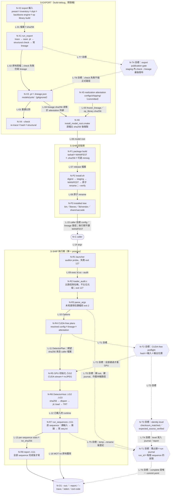

<!-- doc-status: active -->
<!-- doc-promotion: none -->
<!-- doc-date: 2026-10-18 -->
<!-- doc-module: cross -->

# S-SHIP／S-EXPORT 架構圖與接口契約（#536 第一批）

本稿是 [#536](https://github.com/raylei50653/saccade/issues/536) B0／B1 的第一批設計，只處理三列已批准的需求：[REQ-535-01-01](capability_requirements_535.md#req-535-01-01)、[REQ-535-01-02](capability_requirements_535.md#req-535-01-02)、[REQ-535-08-02](capability_requirements_535.md#req-535-08-02)。適用範圍是 ledger 的 [S-SHIP](capability_requirements_535.md#scope-535-shipping) 與 [S-EXPORT](capability_requirements_535.md#scope-535-export)，決策邊界依 [第一切片決策](capability_requirements_535.md#decision-535-first-slice)；本稿不重述也不擴大。

**狀態用語**：`observed as-is` 是在 source baseline `c45a24da953ffd16d3b98478cae79954a45204f4` 讀原始碼得到的現況，沒有跑 runtime、GPU 或 package；`accepted target` 是依[設計決策](#decision-536-first-slice)批准的目標設計。`implemented` 只有下列幾項，驗證範圍逐項列在各卡的實作狀態：

- [CC-536-08-02](#cc-536-08-02)；
- [CC-536-01-01](#cc-536-01-01)；
- CC-536-01-02 的四部分，皆 source-level：
  - Gate A（N-T2）；
  - legacy N-T3 `checksum_matched`（見 [CC-536-01-02 實作狀態](#cc-536-01-02-status)）；
  - #549 S2-1 的 manifest 模式 N-T3。這包括 `expected_source_verified` 的判定機制（只有 manifest 模式、且 production allowlist 有 approved entry 時可達；production allowlist 是空的）、`--require-identity` flag（預設 `none`），以及 Gate B `load_verification`（整體 `byte_scope` 最多 `hashed_before_load`）。見 [CC-536-01-02 S2-1 實作狀態](#cc-536-01-02-status-s2-1)。
  - #549 S2-2 的 Gate B 強化：engine、head、N03 operator 各自從核對過的 bytes 載入（逐物件 `loaded_buffer`），以及 manifest 模式的版本、SM 與 TRT I/O gate。S2-2 仍是 **PARTIAL**。見 [CC-536-01-02 S2-2 實作狀態](#cc-536-01-02-status-s2-2)。

CC-536-01-02 其餘部分仍只是 `accepted target`，整張卡沒有完成：

- 正式 shipping policy，也就是 installed launcher 預設（S2-3）。原本的目標是 `expected_source_verified`，已由 [ADR 028 #610 R1](../decisions/028-model-bundle-runtime-separation.md#decision-610) 改成 `checksum_matched`，VL2 改為明確 opt-in；
- S2-2 的其餘部分（S2-2 仍 PARTIAL）。MB-41 已依 [#590 Owner 最終裁決](https://github.com/raylei50653/saccade/issues/590#issuecomment-6123060172) 的有界宣告結案：[#591](https://github.com/raylei50653/saccade/pull/591) F-1＋F-2 合併後，manifest 模式整體 `load_verification.byte_scope` 在三項物件 scope 都成立時為 `loaded_buffer`，見下方 [canonical 段落](#cc-536-01-02-status-s2-2)。

source-level implemented 不代表 runtime、GPU、installed package 或 production qualification 已完成。需求批准不等於設計批准，設計批准也不等於實作已驗證。

**第一批設計決策（2026-10-09，Asia/Taipei）**：`owner=raylei50653; decision=accepted; scope=#536 B0/B1 S-SHIP × S-EXPORT 第一批`。Decision source：[#558 owner design decision](https://github.com/raylei50653/saccade/pull/558#issuecomment-6080588466)（權威來源；comment 可編輯，因此具體內容以本段的版本控制紀錄保存）。審查的 PR head 是 `9709c3e127ab57bc377d9daf3b815cd6b8d13ae9`。

- **批准的內容**：第 1 節總圖的目標節點與邊、第 4 節三張契約卡，以及三項決策：CC-536-01-01 取得 `<out>` lock 並建立新 journal 後，只作廢本輪會覆寫的產物，並記錄失敗重跑的行為；CC-536-01-02 現階段允許 `checksum_matched`，不宣稱可信來源或 publisher authentication，可信來源與日後的 `expected_source_verified` 要求由 #549 S1 決定；CC-536-08-02 保護 frozen stem，只有 `--overwrite` 不能覆寫，預設改用新 stem。
- **本決策的邊界（全文唯一陳述，其他段落引用此處）**：只批准架構與接口設計，不認證實作、runtime／GPU／package 證據、完整 #535 A3、發行權利或公開發行，也不是 merge 授權。#537 的狀態語義、#541 的檢查與 as-built 驗收不因此改變。
- **授權的下一步**：第一個實作 PR 限於 Export safety；Completion、Preflight、Identity integration 依 §6 分開進行。
- **實作層的後續事項**（不是設計阻擋項，由對應的實作 PR 處理）：`<out>` 原本不存在時，先建立目錄再取 lock；新 journal 以 rename 取代舊 journal，之後的作廢不得刪到新 journal（CC-536-01-01 第 4 步已依此釐清）；半發布的 export 配對要以 hash 驗證強制拒絕；`<out>` 以外的 `--report`／`--trace` 的並行問題。負控制與 runtime 證據仍未完成。

**本稿不擁有的內容**（只引用）：CAP／REQ 與支持裁決歸 [#535 ledger](capability_requirements_535.md)；run 狀態的 transition 語義與 failure／degradation 狀態機歸 [#537](https://github.com/raylei50653/saccade/issues/537)；模型 bundle schema、trusted expected identity 的來源、ABI／SM／TRT pairing 歸 [#549](https://github.com/raylei50653/saccade/issues/549) S1；requirement↔check 對應與 as-built 驗收歸 [#541](https://github.com/raylei50653/saccade/issues/541)；發行權利歸 #547。既有 #465 契約（[shipping boundary](../reference/native_runtime_shipping_boundary.md)、[resolved config](../reference/native_runtime_resolved_config.md)、[closeout](../reference/native_runtime_closeout.md)）不重開。

## 1. 總圖

同一個圖源同時畫現況和目標。圖例不只靠顏色：

| 標記 | 意思 |
|:--|:--|
| 方框 `N-…`、實線 `L-01…L-16` | observed as-is（source-inspected） |
| 六角框 `N-T…`、虛線 `L-T…`、標籤以「目標」開頭 | accepted target（[設計決策](#decision-536-first-slice)）；N-T4 已實作（[CC-536-08-02 實作狀態](#cc-536-08-02-status)），N-T1 已實作（[CC-536-01-01 實作狀態](#cc-536-01-01-status)），N-T2 已實作；N-T3 的 legacy `checksum_matched` 與 manifest 模式（含 `expected_source_verified` 判定，production allowlist 空）已實作，S2-2 的 Gate B 強化已部分實作，皆 source-level（[CC-536-01-02 實作狀態](#cc-536-01-02-status)、[S2-1](#cc-536-01-02-status-s2-1)、[S2-2](#cc-536-01-02-status-s2-2)）；其餘未實作、未驗證 |
| 標籤中的 `⚠G1`／`⚠G2`／`⚠G3` | 第 3 節的現況差距落在這裡 |

**為什麼這樣分**：執行期的判斷全部在一個 process 裡，所以總圖按「安裝期／執行期／export 期」三個信任與時間邊界切，不按目錄切。三個目標節點都是在現有路徑上加檢查點，不新增層或框架：N-T2 把已存在的 CUDA-free plan 階段（N-R4）擴成完整 preflight；N-T1 只是替 N-R7／N-R8 已在產生的資料加上 run identity、逐檔 temp→rename 與單一 commit point（整個 run 仍不是原子交易）；N-T4 把 exporter 已有的 check 改成發布條件。Python library、eval、online-service 的路徑不在本圖，也不從本圖繼承任何保證。

## 2. 現況追查（observed as-is）

### 2.1 S-EXPORT

本節是 baseline `c45a24da` 的現況，保留不改。第 1–3 點的寫檔與 `--check` 行為已由 #559 改變，現行行為見 [CC-536-08-02 實作狀態](#cc-536-08-02-status)。

1. [`run_export`](../../scripts/model/export_headline_mamba_head_torchscript.py)：`.pt` 或 `.lineage.json` 已存在且未給 `--overwrite` 就拒絕。之後依序載入 `build/libsaccade_scan_torchop.so`（DT_NEEDED 有 libpython／libtorch_python 即拒絕），經 [`resolve_inputs`](../../scripts/model/export_headline_mamba_head.py) 把 preset 與 inventory 綁定（ckpt sha256 不符就拒絕；backbone 不符只記成 `backbone_engine_sha256_match=false`），trace（遇到 Python op 或不在 allowlist 的 tracer warning 就拒絕）。
2. `save` 以 `torch.jit.save` 直接寫到正式路徑，然後跑 structural check（合成輸入，與 eager head 逐位元比對；不是 parity）。**不論 check 結果都寫 lineage**，check 失敗時 exit 1。
3. `--check` 重新 trace，比對 `content_sha256`、檔案 sha256、op library sha256、ckpt sha256，再跑一次 structural check，不寫任何檔案。
4. Shipping 取用 export 產物的唯一入口是 [install_model_root.cmake](../../shipping/cmake/install_model_root.cmake)：lineage 的 sha256 必須等於 committed [attestation](../../configs/shipping/mamba_head_realization.attestation.json) 的 `frozen_lineage.sha256`；head、engine 比對 lineage 記的 sha256，op library 比對 attestation 記的 sha256，都相符才複製。所以實際上的「shipping 接受」紀錄是那份 committed attestation，exporter 本身沒有接受狀態。

### 2.2 S-SHIP

1. **安裝期**：[install.sh](../../shipping/package/install.sh) 依序檢查 digest、在 staging 解開、比對 MANIFEST 的完整清單、size、sha256、mode，最後原子 rename；`--verify` 用 tree 內的 MANIFEST 重新檢查。digest 不是簽章，minisign 由使用者在安裝器之外驗證（[package README](../../shipping/package/README.txt)）。
2. **launcher**：[saccade_track.sh](../../shipping/launcher/saccade_track.sh) prefix 含 `:`／`;` 時 exit 2；清掉 `LD_PRELOAD`／`LD_AUDIT`／`LD_LIBRARY_PATH`；auditor probe 沒有回 ready 就 exit 127；之後 exec 系統 loader，帶 `--library-path lib/vendor --audit`。
3. **auditor**：[loader_audit.c](../../shipping/src/loader_audit.c) 在 `la_objsearch`／`la_objopen` 執行。bundled 名稱只能來自 `lib/vendor/`，operator library 只能來自 `<prefix>/share/saccade/build/`，否則 `_exit(127)`。它比的是路徑和 SONAME family，不比位元組，而且在**任何**後續的 object load 都可能觸發。
4. **CLI**：[saccade_track.cpp](../../shipping/tools/saccade_track.cpp) `parse_args` 在讀任何檔案前拒絕未知選項或不完整的介面；`run` 先 `require_distinct_sequences`，再用 strict loader 讀 resolved config，然後建立 Serial／DoubleBuffer runtime。`main` 把所有 `std::exception` 轉成 stderr 訊息與 exit 2。
5. **Runtime 建構順序**（[serial_runtime.hpp](../../shipping/include/saccade_shipping/serial_runtime.hpp)、[double_buffer_runtime.hpp](../../shipping/include/saccade_shipping/double_buffer_runtime.hpp) 的成員宣告順序）：
   - ingest／detector／output／schedule plans 都不碰 CUDA。[`plan_detector_files`](../../shipping/src/detector_plan.cpp) 在這一步讀 lineage 與 attestation，檢查欄位與 config 是否一致、attestation 是否綁到這份 lineage 的 sha256；
   - 接著 `Stream` 成員呼叫 `cudaStreamCreateWithFlags`，`JpegDecoder` 建立 nvJPEG handle（**GPU 初始化**）；
   - 再來是 [`DetectorHost`](../../shipping/src/detector_host.cpp)：先算三個檔案的 sha256，再 `dlopen`，設定 runtime requirements 並讀回，`torch::jit::load`，檢查 graph，最後建 TRT engine 並檢查 I/O。
   這些檢查都在第一個 sequence 之前完成，但檔案 hash 是在 GPU 初始化**之後**才做。（本點是 baseline 的現況；#565 起 hash、sequence 輸入與輸出位置先在 CUDA-free 的 Gate A 檢查，runtime 改由 Gate A 的 detector plan 建構，見 [CC-536-01-02 實作狀態](#cc-536-01-02-status)。）
6. **Sequence loop**（本點是 baseline 的現況；`<out>`、txt 與 report 的寫法已由 #562 改變，見 [CC-536-01-01 實作狀態](#cc-536-01-01-status)）：[track_driver.hpp](../../shipping/tools/track_driver.hpp) `run_sequences` 先 `create_directories(out)`，再逐個 sequence 執行 `read_sequence_input`（seqinfo.ini／img1 的檢查在**這時**才做）→ 推論 → `write_text(<out>/<seq>.txt)`。`write_text` 用 `ofstream` 直接截斷正式路徑再寫入，不經 temp 檔。全部 sequence 完成後才寫 `--report`（`saccade.native_track_report/v2`，內容有 plan bindings、load report、每個 sequence 的 stats 與 `txt_sha256`），寫完回傳 0。
7. **期望值從哪裡來**：DetectorHost 比對的期望 sha256 全部來自 caller 指定的 `--lineage`／`--attestation`；`--attestation` 在 CLI 上是可選的。執行期不讀 MANIFEST，也不比對 committed attestation 或簽章。report 只記錄 `lineage`／`attestation` 的路徑字串，沒有記錄這兩個檔案本身的 sha256。

## 3. 差距與發現

三項差距沿用 [ledger](capability_requirements_535.md) requirement matrix 下「三列 delta 的現況差距」段的記錄，這裡只補上 source 位置：

| ID | 差距 | 落點 | 對應卡 |
|:--|:--|:--|:--|
| G1 | 沒有 completion 關聯：run 沒有 identity；MOT txt 原地覆寫；report 只在成功時寫。nonzero 結束後，已完成、寫到一半、上一輪留下的 txt 和舊 report 無法區分。舊 report 和舊 txt 的 `txt_sha256` 彼此吻合，看起來就像一次完整的成功 | N-R7、N-R8、L-16 | [CC-536-01-01](#cc-536-01-01)；[#562](https://github.com/raylei50653/saccade/pull/562) 已實作 |
| G2 | artifact hash 在 CUDA stream 與 nvJPEG 建立之後才做；sequence 輸入與 `--out` 在 GPU 初始化之後、甚至前面的 sequence 已寫出之後才檢查 | N-R5、N-R6、N-R7 | [CC-536-01-02](#cc-536-01-02)、[CC-536-01-01](#cc-536-01-01)；Gate A 由 [#565](https://github.com/raylei50653/saccade/pull/565) 實作，殘留限制（F4、frame 解碼）見 [實作狀態](#cc-536-01-02-status) |
| G3 | 輸出沒有區分「與 supplied checksum 相符」和「已對認可的 expected 來源驗證」；目前執行期最多只能證明前者 | N-R6、L-11、L-15 | [CC-536-01-02](#cc-536-01-02) |

本次追查另外找到幾點，依 #536 B3 分類（都是 source-inspected，沒有重現）：

| ID | 發現 | 分類 | 去向 |
|:--|:--|:--|:--|
| F1 | exporter 在 structural check 失敗時仍把 lineage 寫到正式路徑；對預設 stem 使用 `--overwrite`，會覆蓋 attestation 綁定的那份 frozen lineage。`models/yolo/` 是 gitignored，被覆蓋後無法從 git 取回 | contract-gap | CC-536-08-02；[#559](https://github.com/raylei50653/saccade/pull/559) 已實作 |
| F2 | 不給 `--attestation` 時，installed tree 的 op library（attested build）與 lineage 記的 sha256 不同，會在 N-R6 失敗。結果是 fail-closed，但失敗點在 GPU 初始化之後 | already-covered（fail-closed）＋G2 | CC-536-01-02；#565 起在 Gate A 拒絕，不呼叫 CUDA（本機 CLI 負控制） |
| F3 | auditor 的 exit 127 可能在任何後續的 object load 發生；有沒有任何 load 發生在第一個 txt 寫出之後，沒有追查（[resolved config](../reference/native_runtime_resolved_config.md) §17 的 N3 曾觀察到執行中 lazy `dlopen` `libnvrtc`） | unverified | CC-536-01-01 limit；#541 |
| F4 | sha256 檢查與實際載入分開開檔（hash 之後才 `dlopen`／`jit::load`／讀 engine），兩次開檔之間檔案可能被換 | unverified（known limit） | #549 S1 trust boundary |
| F5 | `run_sequences` 是 shipping 與 `saccade_track_measurement` 共用的程式碼；改 completion 行為也會改到 measurement build | contract-gap（實作範圍注意） | 實作 PR 須保留 [measurement surface](../../tests/unit/test_shipping_measurement_surface.py) 檢查 |

## 4. 接口契約卡（accepted target）

以下三張卡依[設計決策](#decision-536-first-slice)批准為目標設計。CC-536-08-02 與 CC-536-01-01 已實作（狀態見各卡內），CC-536-01-02 已實作 Gate A（N-T2）、legacy N-T3 `checksum_matched`，以及 manifest 模式 N-T3（認可 expected 來源＝TR-1b runtime allowlist、`expected_source_verified` 判定、`--require-identity`），皆 source-level，見[實作狀態](#cc-536-01-02-status)與 [CC-536-01-02 S2-1 實作狀態](#cc-536-01-02-status-s2-1)；S2-2 的 Gate B 強化也已部分實作（source-level，PARTIAL，見 [CC-536-01-02 S2-2 實作狀態](#cc-536-01-02-status-s2-2)）。正式 shipping policy（installed launcher 預設要求 `expected_source_verified`）仍未實作；production allowlist 是空的。整張卡尚未完成。欄位依 #536 B1。

### CC-536-01-01：completion／diagnostic

- **REQ／scope／owner**：[REQ-535-01-01](capability_requirements_535.md#req-535-01-01) × shipping／S-SHIP；decision owner 依 ledger。
- **Producer → consumer**：`saccade_track`（N-R3…N-R8）→ caller 或 caller 的工具（讀 `--out` 內的 txt、report、exit code）。
- **現況**：exit 0 代表所有 sequence 已寫出、report（若有要求）已寫出；exit 2 代表 launcher prefix 不合法、參數被拒，或任何被捕捉的錯誤；exit 127 代表 auditor 沒有初始化或拒絕載入；signal 結束是 128+N；未捕捉的 abort 沒有定義。沒有 run identity，沒有逐 sequence 的狀態紀錄，txt 不是原子寫入。
- **目標接口**：
  1. **Run identity**：解析參數後立刻產生 `run_id`（每次 invocation 都不同的隨機值），stderr 第一行印出，journal 與 report 都帶它。MOT txt 的位元組不變，所以既有的 MOT parity 證據不受影響。
  2. **`<out>` 的獨占權**：建立或改寫任何東西之前，先對 `<out>` 內一個固定的 lock 檔取得非阻塞的獨占 `flock`。已經被另一個 process 持有時，立刻 exit 2，不建 journal，也不作廢或改寫任何檔案。lock 由 process 一直持有到結束（被 kill 時由 kernel 釋放），lock 檔本身不刪除，避免刪檔與重建之間的 race。這是同一 `--out` 並行執行時的明確拒絕機制，不是通用的交易框架。
  3. **Run journal（N-T1）**：`<out>` 內一個小 JSON 檔（名稱在實作 PR 定，有自己的 format 字串），每次都用 temp 檔加 rename 改寫。內容：`run_id`、`state`（`running`／`failed`／`complete`）、依 argv 順序列出每個 sequence 的 `pending`／`written`（`written` 帶 txt 路徑與 sha256）、`identity`（見 CC-536-01-02），失敗時另記失敗的 sequence（可為 null）與 stderr 的同一則訊息。這只是逐 run 的完成紀錄，不是統一的 failure-report schema。各 state 之間怎麼轉換、失敗怎麼分類，由 #537 擁有，本卡只要求這些值可以被觀察到。
  4. **順序**：解析參數 → 建立 `<out>`（原本不存在時）→ 取得 `<out>` 的 lock → 以 temp 加 rename 安裝新 journal（`state=running`、所有 sequence `pending`、`identity.level=null`），這一步本身就取代了舊 journal → 作廢本輪會覆寫的其他路徑，**只限** `--report` 路徑、本輪各 sequence 的 `<seq>.txt` 與 trace 檔，不包括剛安裝的新 journal，`<out>` 內其他檔案也不動 → CUDA-free preflight（N-T2）→ GPU 初始化與載入 → 每個 sequence 寫 temp 檔、rename 成 `<seq>.txt`，再把 journal 的該 sequence 改成 `written` → 全部完成後，report 一樣用 temp 加 rename 寫出（沿用「全部完成後才寫」）→ journal 改成 `complete`，**這是唯一的 commit point**。被捕捉的錯誤會盡力寫成 `failed` 後 exit 2；被 kill 或 abort 時 journal 會停在 `running`，caller 應視為未完成。
  5. **Exit code**：沿用 0／2／127／128+N，不新增。exit 0 必須同時有 `state=complete` 的 journal；非零代表本輪未完成，哪些 sequence 已確認提交以 journal 為準。
  6. **Report schema**：report 加上 `run_id` 與 `identity` 後，format 改成新版本（例如 `saccade.native_track_report/v3`），不在 v2 名下改語義。[native_track_parity](../../scripts/eval/diagnostics/native_track_parity.py) 把 format 釘死在 v2，所以要在同一個實作 PR 更新；已歸檔的 v2 report 維持原本的意思。
- **Caller 判讀規則**：只有 journal 的 `run_id` 等於這次 invocation、而且 `state=complete`，才算本輪完整成功。只有 `written`、且檔案 sha256 等於 journal 所記值的 txt，才算本輪已提交的輸出。`pending` 的意思是**尚未確認提交**，不是「沒有本輪檔案」：rename 成功、journal 還沒改成 `written` 時被中斷，`<seq>.txt` 可能已經是本輪的完整檔案，但它不能當作本輪完成的證據。
- **取捨**：
  - *作廢舊產物 vs 保留舊檔、只靠 journal 判斷*：作廢。下游計分工具是按檔名讀 txt，不會讀 journal。代價是：重跑如果失敗，先前同名的輸出也會沒有；要保留舊輸出，caller 應換一個 `--out`。這是行為變更，實作 PR 要把它寫進 CLI 說明與 package README。
  - *並行保護用 lock vs 不處理*：沒有 lock 時，兩個 process 會互相作廢、改寫 journal 與 txt，`run_id` 擋不住，所以需要 lock。
  - *要求 `--out` 必須是空目錄*：比較簡單，但會破壞「重跑到同一個目錄」的既有用法，而且失敗時仍然沒有診斷檔，所以不建議。
  - *新增 exit 3 表示部分完成*：會改到 inherited 的 exit 契約，ledger 已把這類 schema 列為非目標，所以不建議。
- **State writer**：`RunCompletion` 是唯一的 journal writer；`run_sequences` 透過 `run()` 提交，`main` 透過 `fail()` 記錄失敗，其他元件不得寫。
- **允許的依賴**：只用 C++ std filesystem、POSIX `flock`／`rename`，以及既有的 `strict_json`／`sha256`，不新增第三方依賴。
- **副作用**：`<out>` 會多一個 journal 檔與一個 lock 檔；開頭會刪除本輪會覆寫的舊產物（範圍見順序第 4 步）。
- **Evidence（現有 check pointers）**：[saccade_track schedule CLI](../../tests/unit/test_saccade_track_schedule_cli.py)（在載入模型前拒絕）、[serial](../../tests/native/test_shipping_serial_runtime.cpp)、[double-buffer](../../tests/native/test_shipping_double_buffer_runtime.cpp)。completion 的正控制與負控制（在第 k 個 sequence 注入失敗、mid-write kill、rename 與 journal 更新之間 kill、舊 report 存在時的失敗 run、同一 `--out` 的第二個 process）由 [completion 協定測試](../../tests/native/test_shipping_run_completion.cpp)、[reader 測試](../../tests/unit/test_native_track_parity.py)、[completion CLI](../../tests/unit/test_saccade_track_completion_cli.py) 涵蓋，`saccade_track_measurement` 的介面由 [measurement surface](../../tests/unit/test_shipping_measurement_surface.py) 檢查（F5）；哪些在 CI、哪些只在本機，見下方實作狀態。requirement↔check 對應交 #541。
- **Known limits**：rename 只在同一個檔案系統內是原子的；`flock` 是 advisory lock，只約束同樣會取 lock 的 `saccade_track`，在網路檔案系統或 WSL 掛載的 Windows 磁碟上的行為沒有驗證；放在 `<out>` 以外的 `--report`／`--trace` 不受這個 lock 保護，實作 PR 要決定是否也鎖它們，或把這點寫成限制；拿不到 lock 或 `<out>` 無法寫入時，只能 exit 2，此時目錄內若有舊 journal，它的 `run_id` 不會等於本輪；F3 的 127 可能發生在任何時點，這時 journal 會停在 `running`；不提供 whole-run rollback／resume（ledger 非目標）。
- **實作狀態（2026-10-10）**：`implemented`（source-level），[#562](https://github.com/raylei50653/saccade/pull/562) merge `781472dc8d904c196914d3c3035b76bcadc97543`（head `789eace0`，含 runtime coordinate republication [#563](https://github.com/raylei50653/saccade/pull/563)，依 runbook §3.2 stacked 進同一個 head）。實作在 [run_completion.hpp](../../shipping/include/saccade_shipping/run_completion.hpp)／[run_completion.cpp](../../shipping/src/run_completion.cpp) 與 [track_driver.hpp](../../shipping/tools/track_driver.hpp)，reader 在 [native_track_parity](../../scripts/eval/diagnostics/native_track_parity.py)。**Package 證據**：新 pin 的本機驗證見 [package re-pin](../reference/native_runtime_package_repin_536.md#3-重播入口與證據)，與這裡保留的 source-level 證據分開認定。
  - **實作內容**：CC-536-01-01 的 Completion 機制已實作，包括 run identity、lock、journal、逐檔發布、commit point、exit code 與 report v3。第 4 項順序所引用的 CUDA-free Preflight（N-T2）屬 CC-536-01-02，仍是 accepted target，不在本次完成範圍（之後由 #565 實作，見 [CC-536-01-02 實作狀態](#cc-536-01-02-status)）。`run_id` 是 `getrandom` 的 128 bit（32 hex），參數被拒時不產生、也不建立任何檔案。lock 檔是 `<out>/saccade_track.lock`（`flock(LOCK_EX|LOCK_NB)`，不刪除）；journal 是 `<out>/saccade_track.journal.json`，format `saccade.native_track_journal/v1`，另外記每個 sequence 的 trace sha256 與 `report {path, sha256}`。txt、trace、report、journal 都寫 temp（`.<name>.<run_id>.tmp`）→ fsync → rename → fsync 目錄。report 是 `saccade.native_track_report/v3`。作廢範圍是 `--report`、本輪的 `<out>/<seq>.txt` 與 `<trace>/<seq>/detector.bin`；輸出路徑（含經 `..` 的別名）撞到 journal、lock 或其他輸出時，在建立 `<out>` 之前就被拒。`saccade_track_measurement` 共用同一個 completion（F5），介面與 surface 不變。作廢的行為變更寫在 CLI 說明（[saccade_track.cpp](../../shipping/tools/saccade_track.cpp)），package README 在 [re-pin 切片](../reference/native_runtime_package_repin_536.md)補上此行為與限制。
  - **驗證（CPU，CI）**：merge 前整合 head `789eace0` 的 [PR CI](https://github.com/raylei50653/saccade/actions/runs/38017197737)（C++ build 在[另一個 run](https://github.com/raylei50653/saccade/actions/runs/38017197753)）8/8 SUCCESS，pytest 5231 passed、0 failed；merge 後 `781472dc` 的 [main CI](https://github.com/raylei50653/saccade/actions/runs/38018459089)（C++ build 在[另一個 run](https://github.com/raylei50653/saccade/actions/runs/38018459018)）8/8 SUCCESS，pytest 5231 passed、0 failed。CI 實際跑到的 completion 檢查：(1) [completion 協定測試](../../tests/native/test_shipping_run_completion.cpp)（`shipping-config-loader` ctest，181 checks），每個 case 在 fork 出的子 process 跑真正的 `RunCompletion::run`，中斷是真的 `SIGKILL`，第二個 run 是真的第二個 process；涵蓋失敗重跑、舊 report 殘留、同一 `<out>` 雙 process、sequence 中途 throw／SIGKILL、rename 後 journal 更新前 SIGKILL（txt 已是本輪完整輸出但仍 `pending`，不算提交）、`<out>` 不存在、作廢不刪新 journal、輸出路徑碰撞；kill point 只在測試 target 編入；(2) [reader 測試](../../tests/unit/test_native_track_parity.py) 的合成 journal 負控制（錯誤 run_id、`running`／`failed`、`pending` 但檔案存在、sha 不符、trace／report 被替換、identity 升級、損壞或型別錯誤的 journal、run id 不在 log 第一行）。這些都不需要 GPU。
  - **只在本機跑（CI 會 skip，沒有 build）**：真 binary 的 [completion CLI](../../tests/unit/test_saccade_track_completion_cli.py) 與修改後的 [schedule CLI](../../tests/unit/test_saccade_track_schedule_cli.py)、以 `--keep` 讓 reader 判讀 writer 真正留下的檔案。2026-10-10 以 `789eace0` 重新 build 的 binary 跑：這幾個檔案加 [measurement surface](../../tests/unit/test_shipping_measurement_surface.py) 143 passed、沒有 skip，協定測試 181 checks、0 failures。
  - **負控制的 mutation 檢查（本機，非 CI）**：在 `006007d3` 做 12 個 mutant（journal 在 rename 之前寫、直接寫正式路徑、不取 lock、不作廢、保留舊 report、`complete` 寫在 report 之前、作廢在 journal 之前、作廢時刪掉新 journal、拿掉碰撞檢查、`fail` 不記 sequence、lock 衝突時仍寫 journal、建構子失敗不記錄），每個都至少讓一項檢查失敗。「作廢時刪掉新 journal」一開始沒被抓到，因此加了 `killed_in_first_sequence`。reader 的修正（#562 審查 P2／P3，`7d79256d`）新增的負控制中，有 18 項在修正前的 reader 上失敗。raw 輸出在 repo 外的 gitignored `results/536_completion/mutation_006007d3/`。
  - **驗證（GPU，本機，非 CI）**：在 `006007d3` 以乾淨工作樹、gpu0 lease 依序執行（gitignored `results/536_completion/runtime_006007d3/`），binary 是 `build-release/shipping/`。shipping double buffer 7 序列含 trace 的 parity 為 EXACT，`--against` PR-C2 正式 run 時 txt、trace hash 與 graph 計數完全相同（MOT txt 位元組不變）；measurement `none` 與 `--schedule serial` 也是 EXACT；7 個 parity 負控制 7/7 CAUGHT；shipping binary 的 surface 檢查通過。真 binary 的 completion 情境：complete、同一 `<out>` 失敗重跑（`failure.sequence` 正確，先前的 txt 與 report 已作廢，不在本輪的 txt 未動）、持有者執行中啟動第二個 process（exit 2，它的 run_id 不出現在任何檔案）、第一個 sequence `written` 後 SIGKILL（`running`，只有一個 committed）。`006007d3` 之後 `shipping/**` 沒有再改（`7d79256d` 只改 reader 與測試，`8240ea27` 只重新發布座標），所以沒有重新 capture。
  - **Package 驗證（本機）**：[re-pin 切片](../reference/native_runtime_package_repin_536.md#3-重播入口與證據)已核對新 pin、README、安裝後 Completion 正負控制與正式七序列 GPU parity；舊 PR-C2 的 v2／無 journal 證據保持歷史語義。**仍未驗證**：斷電 durability、網路檔案系統或 WSL 掛載的 Windows 磁碟上的 flock／rename（證據都在 WSL2 ext4）、F3 的 127 落在哪個時點。runtime coordinate 的 probe equality 不是行為等價的證明（equivalence 仍是 `unproven`）。完整 #535 A3 與 as-built 驗收屬 #541。
  - **Known limits（實作層）**：`<out>` 以外的 `--report`／`--trace` 不受 lock 保護：用不同 `<out>`、共用 report 或 trace 的兩個並行 run 不會被排除，後 rename 者勝出，另一個只能由 journal 的 hash 不符偵測到；kill 留下的 `.<name>.<run_id>.tmp` 不會自動清理；torn config、缺 lineage（以及 measurement build 不合法的 mutation 名稱）現在會在 `<out>` 留下 lock 與 `failed` journal；F3 的 127 會讓 journal 停在 `running`；reader 讀 `track_report.json` 仍是直接 `json.loads`，損壞的 report 會讓 reader 拋例外，而不是回報 problem 並判 `UNRESOLVED`（不會誤判為 `EXACT`；#562 owner 判為非阻擋的 P3 診斷缺口，以小型修正處理，驗證義務交 #541）。

### CC-536-01-02：identity 與 fail-closed 點

- **REQ／scope／owner**：[REQ-535-01-02](capability_requirements_535.md#req-535-01-02) × shipping／S-SHIP；decision owner 依 ledger。trusted identity 的來源與 pairing 歸 #549 S1。
- **S2-1a legacy binding 契約釐清（2026-10-10，Asia/Taipei）**：`owner=raylei50653; decision=accepted; scope=CC-536-01-02 N-T3 legacy observability only`。Decision source：[#549 owner clarification acceptance](https://github.com/raylei50653/saccade/issues/549#issuecomment-6098552167)；實作授權另見 [#549 S2-1a authorization](https://github.com/raylei50653/saccade/issues/549#issuecomment-6098363082)，source baseline 是 `15e819502e4d5ea581792a3a16f97857435fc585`。本段保存接受的 nullable binding、SHA status、expected-source location、promotion 與格式語義，僅釐清既有 legacy Gate A 的觀測，不改其拒絕規則或 Gate B，不啟動 S2-1 完整模式、不認證實作／驗證，也不是 merge 或 installed package re-pin 授權。
- **Producer → consumer**：caller 給的 config、lineage、attestation、model root（L-14）→ N-R4／N-R6 的檢查 → journal 與 report 的 `identity` 欄位 → caller 或 reviewer。
- **現況**：config 走 strict loader；lineage 與 config 的欄位一致性、attestation 是否綁到這份 lineage 的 sha256，都在 CUDA-free 階段檢查；三個 artifact 的 sha256 在 GPU 初始化之後才比對；期望值全部來自 caller 檔案（2.2 第 7 點）。report 沒有「驗證等級」欄位。
- **目標接口**：
  1. **兩級驗證輸出（N-T3）**：journal 與 report 都帶 `identity.level`，再加上每個 bound 檔案（config、lineage、attestation、op library、head、engine）的 `{path, expected_sha256, observed_sha256, status}`，其中 `status` 是 `matched`／`mismatch`／`missing`／`unchecked`。
     - `null`：journal 建立時的初值，代表還沒驗證，不代表任何等級。Gate A 失敗時，level 維持 `null`，但各 binding 的 `status` 保留已經檢查到的範圍。
     - `checksum_matched`：legacy 模式中，operator、head、engine 的位元組與 supplied lineage／attestation 提供的 expected sha256 相符，有提供 attestation 時其對 lineage 的 sha256 binding 也相符，且 Gate A 的其餘既有檢查全部通過後，才寫入此等級。沒有 supplied expected sha256 的檔案只記錄觀測結果，不宣稱 `matched`。此等級只描述 Gate A 的 checksum 核對，不保證來源認證、載入、相容性或行為等價；Gate B 失敗不改 identity，run 仍為未完成（可捕捉失敗記 `failed`，無法捕捉的中斷可能維持 `running`）。manifest 模式的定義歸 [#549 契約 4.1](model_bundle_contract_549.md)，不在 S2-1a 實作範圍。
     - `expected_source_verified`：此外，supplied 的 config、lineage、attestation 的 sha256 也等於某個**認可 expected 來源**的值，並在 `identity.expected_source` 寫出來源名稱。哪個來源算數由 #549 S1 決定，本卡不定義判準；判準至少要回答，那個來源能不能和模型被同一個 caller 一起替換。例如 installed MANIFEST 和模型在同一個 caller 可寫的 tree 裡時，它本身不構成獨立的 trust anchor。在 #549 S1 決定之前，這一級不可能出現。**後續狀態（不改變本項判準）**：#549 S1 已選定 TR-1b runtime allowlist（[ADR 028 D2](../decisions/028-model-bundle-runtime-separation.md#decision-549-s1)），manifest 模式的定義見 [#549 契約 4.1](model_bundle_contract_549.md)。S2-1 起這一級在 source level 可以產生，`identity.expected_source="runtime_allowlist"`，但只限 manifest 模式、且 manifest sha256 在 production allowlist 中是 approved。production allowlist 是空的，所以目前任何 shipping bundle 都達不到；legacy 模式永遠達不到。見 [CC-536-01-02 S2-1 實作狀態](#cc-536-01-02-status-s2-1)。
     - 兩級都要固定寫出 `publisher_authentication: not_checked_by_runtime`。執行期不驗簽章，任何一級都不得寫成「原 bundle」、「authenticated」或「signed」。
     - **Legacy binding record（S2-1a）**：`identity.bindings` 固定且只包含 `config`、`lineage`、`attestation`、`op_library`、`head`、`engine` 六項。每項維持 `{path, expected_sha256, observed_sha256, status}`，另加 nullable `expected_source: {path, json_pointer}`，指出實際提供 expected hash 的 caller metadata 檔案與 JSON 欄位；這是 claim 的位置，不是獨立可信來源，尚無可用來源時為 `null`，不另建 registry。binding 的 `path` 是既有 legacy 路徑解析實際使用的路徑，尚未解析的 artifact 路徑與選用 attestation 未提供時為 `null`。expected 與 observed hash 都是 nullable；不得把 observed 值回填為 expected。observed 必須描述 Gate A 實際消耗的 bytes，metadata 的 hash 與既有 parser 使用同一份已讀取 bytes。
     - **Legacy expected sha256 的實際來源**：`config` 與 `attestation` 本身沒有 supplied expected hash，兩者的 `expected_sha256` 與 per-binding `expected_source` 都為 `null`；`lineage` 的 expected 值只在提供且可讀取 attestation 時來自其 `/frozen_lineage/sha256`，否則為 `null`；`op_library` 在提供且通過既有 attestation 一致性檢查時來自其 `/op_library/sha256`，否則來自 lineage 的 `/op_library/sha256`；`head` 來自 lineage 的 `/torchscript/sha256`；`engine` 來自 lineage 的 `/companions/backbone_engine/sha256`。每個有來源的 binding 用上述 metadata 的實際路徑與 JSON pointer 記錄 `expected_source`。尚未成功解析／驗證的 expected 欄位不是可用值；config 的 `source.preset_sha256` 是 preset 的記錄，不是 resolved config 檔案的 expected sha256。
     - **Legacy status**：沿用 `matched`／`mismatch`／`missing`／`unchecked`。`matched` 必須有非 null 的 expected 與 observed hash，且已完成比對、兩者相等；`mismatch` 是已完成比對但兩者不相等；`missing` 表示指定的必需檔案不存在，或不符合既有一般檔案要求；`unchecked` 是尚未完成 SHA 比對，包括有 observed 但無 expected、無法讀取或尚未檢查的 binding。選用 attestation 未提供固定記為 `{path:null, expected_sha256:null, observed_sha256:null, status:"unchecked", expected_source:null}`，不拒絕；caller 有指定 attestation 但檔案缺失則為 `missing`，Gate A 拒絕。
     - **Legacy metadata 診斷與 promotion**：status 只描述 SHA 比對，不能代替 JSON schema 或 metadata 欄位一致性結果。schema／欄位不一致由既有 failure message 記錄，`identity.level` 維持 `null`；即使個別 SHA 已 `matched`，也不代表語意檢查通過。Gate A 失敗保留所有已取得的觀測／比對，不把未完成診斷偽裝為成功；全部既有 Gate A 檢查完成後才一次提升，不能由個別 `matched` 提前提升。
     - **Legacy authority 與格式**：`identity.expected_source=null` 表示沒有認可的獨立 expected-source authority，不表示各 binding 沒有 caller metadata 提供的 expected hash。固定寫 `publisher_authentication:"not_checked_by_runtime"`，S2-1a 永不產生 `expected_source_verified`。journal 初始化時 `level=null`，Gate A 結束後的紀錄固定，所有後續 journal／report 更新（含可捕捉失敗與 process 中斷）不得改寫 identity。新紀錄使用 `saccade.native_track_journal/v2` 與 `saccade.native_track_report/v4`；historical journal v1／report v3 的 `{level:null}` 語義保持原樣，不升級歷史證據。reader 交叉核對當前 format pair、run_id 與完整 identity 相等，保留既有 completion／output hash 檢查；不合法或損壞的輸入為 `UNRESOLVED`，不能成為 `EXACT`。
  2. **Fail-closed 點**：
     - **Gate A（N-T2，CUDA-free，第一個 CUDA API 呼叫之前）**：strict config、lineage 與 attestation 的一致性（沿用 N-R4）、三個 artifact 的存在性與 sha256（從 N-R6 移過來）、所有 sequence 的 seqinfo.ini 與 img1 frame 清單（從 N-R7 移過來）、`--out`／`--report`／`--trace` 可以寫入。任何一項失敗：exit 2，journal 記 `failed`，不呼叫 CUDA。
     - **Gate B（N-R6，GPU，第一個 sequence 之前）**：`dlopen`、runtime requirements 讀回、`jit::load` 與 graph 檢查、TRT engine 的反序列化與 I/O。這些本質上需要 GPU，所以留在原地；它們已經在任何推論之前。
     - **分階段強制**：現階段允許以 `checksum_matched` 執行，但輸出不得宣稱可信來源；#549 S1 批准 expected 來源之後，正式 shipping policy 才要求 `expected_source_verified`，那是另一個實作 PR。**後續狀態**：S2-1 實作了 policy flag `--require-identity`，預設 `none`，現行行為不變；正式 shipping policy（installed launcher 預設）屬 #549 S2-3，未實作（[CC-536-01-02 S2-1 實作狀態](#cc-536-01-02-status-s2-1)）。**2026-10-18 修訂**：依 [ADR 028 #610 R1](../decisions/028-model-bundle-runtime-separation.md#decision-610)，這個預設改成 `checksum_matched`，`expected_source_verified` 改為明確 opt-in，指定了就 fail closed；本卡「現階段允許 `checksum_matched`、不宣稱可信來源」的判準不變。
- **取捨**：把 hash 移到 Gate A 的代價，是在 CUDA 初始化之前同步讀完整個 engine 與 head 檔（現在也會讀，只是順序不同）。移動 sequence 輸入檢查的代價，是在開頭多走訪一次各個 img1 目錄；frame 的解碼錯誤仍然只能在執行時發現。不在 runtime 內驗 minisign，因為那會引入新的 crypto 依賴，而且 local-only package 不要求簽章（#546）。
- **State writer**：`identity` 只由 Gate A 寫入（`null` → 各 binding 的 status → level），之後不再改變；Gate B 的結果記在 run 的 `state`，不改 identity。
- **Evidence**：[detector plan](../../tests/native/test_shipping_detector_plan.cpp)、[resolved config](../../tests/unit/test_resolved_shipping_config.py)、[bundle](../../tests/unit/test_shipping_bundle_checks.py)、[package](../../tests/unit/test_shipping_package.py)、[signature](../../tests/unit/test_package_signature.py)。新的負控制（替換 head、替換 lineage 但仍自洽、缺 attestation、不可讀的 sequence）都應該在 Gate A 失敗，而且不呼叫 CUDA；#565 以 [preflight 協定測試](../../tests/native/test_shipping_preflight.cpp) 與 [preflight CLI](../../tests/unit/test_saccade_track_preflight_cli.py) 涵蓋（哪些在 CI、哪些只在本機，見下方實作狀態），requirement↔check 對應交給 #541。
- **Known limits**：F4 的 TOCTOU；auditor 只比路徑與名稱（F3）；`checksum_matched` 不保證來源，一份自洽但被換掉的 lineage＋attestation 也能達到這一級；本卡不定義 bundle schema。
- **實作狀態（2026-10-12）**：下列四部分 `implemented`，皆 source-level：

  - **Gate A（N-T2）**：本段以下先記。
  - **legacy N-T3 `checksum_matched`**：見下方 [legacy identity（S2-1a）](#cc-536-01-02-status-n-t3)。
  - **manifest 模式 N-T3**：包括認可 expected 來源（TR-1b runtime allowlist）、`expected_source_verified` 判定、`--require-identity`，以及 Gate B `load_verification`。見下方 [S2-1](#cc-536-01-02-status-s2-1)。
  - **Gate B 強化（S2-2，PARTIAL）**：engine、head、N03 各自從核對過的 bytes 載入；manifest 模式的版本、SM 與 TRT I/O gate。見下方 [S2-2](#cc-536-01-02-status-s2-2)。

  **main 尚未合併**的部分：

  - installed launcher 的預設 policy（#549 S2-3）。依 [ADR 028 #610 R1](../decisions/028-model-bundle-runtime-separation.md#decision-610)，預設是 `checksum_matched`，`expected_source_verified` 改為明確 opt-in；

  production allowlist 是空的，所以目前沒有任何 shipping bundle 能達到 `expected_source_verified`。CC-536-01-02 整張卡仍是 `accepted target`。

  以下先記 Gate A：[#565](https://github.com/raylei50653/saccade/pull/565) merge `d075f1dbe169c5618bafed0d26dffa1018a69ac7`（head `814441dc`，含 runtime coordinate republication [#566](https://github.com/raylei50653/saccade/pull/566)，依 runbook §3.2 stacked 進同一個 head；實作 head `7c24b9e3`）。#565 本身不含 N-T3。實作在 [preflight.hpp](../../shipping/include/saccade_shipping/preflight.hpp)／[preflight.cpp](../../shipping/src/preflight.cpp) 與 [track_driver.hpp](../../shipping/tools/track_driver.hpp)。**Package 證據**：新 pin 的本機 Gate A 控制見 [package re-pin](../reference/native_runtime_package_repin_536.md#3-重播入口與證據)，不構成 N-T3 的實作或驗證。
  - **實作內容**：`saccade_track` 與 `saccade_track_measurement` 在取得 `<out>` 之後、建立任何 runtime 之前跑 Gate A，依序檢查：(1) strict config 與由它建出的每個 CUDA-free plan（ingest、sequence output、post-detector、pipeline、schedule，含開發用的 serial override），以及由 lineage 與 attestation 建出的 detector plan（沿用 N-R4）；(2) 每個 sequence 的 `seqinfo.ini` 與 `img1` 清單，讀法與 runtime 相同（同一個 `--max-frames`）；(3) 在 `<out>`、`--report` 所在目錄（必須已存在）與每個 `--trace/<seq>/` 建立再刪除一個 probe 檔（`RunCompletion::check_writable`）；(4) operator library、head、backbone engine 是 model root 下的一般檔案，sha256 等於 plan 所記。任何一項失敗：exit 2，journal 記 `failed`，訊息以 `preflight: ` 開頭，不呼叫 CUDA；通過時 stderr 在 run-id 那一行之後印 `<entrypoint>: preflight passed`。Gate A 在 `saccade_shipping_preflight`，這個 library 不 link 任何 CUDA library。`SerialRuntime`／`DoubleBufferRuntime` 多了接收 `DetectorPlan` 的建構子，Gate B 載入的就是 Gate A hash 過的那組 binding，不再重讀 lineage；載入時仍會再比一次 hash。#565 切片中 journal 與 report 的 `identity` 維持 `{"level": null}`，不寫任何 `checksum_matched` 或 `expected_source_verified`；N-T3 由 #572 加上。
  - **驗證（CPU，CI）**：merge 前 head `814441dc` 的 [PR CI](https://github.com/raylei50653/saccade/actions/runs/38025579617)（C++ build 在[另一個 run](https://github.com/raylei50653/saccade/actions/runs/38025579624)）8/8 SUCCESS，pytest 5233 passed、0 failed；merge 後 `d075f1db` 的 [main CI](https://github.com/raylei50653/saccade/actions/runs/38028910732)（C++ build 在[另一個 run](https://github.com/raylei50653/saccade/actions/runs/38028910715)）8/8 SUCCESS，pytest 5233 passed、0 failed。CI 實際跑到的 Gate A 檢查是 [preflight 協定測試](../../tests/native/test_shipping_preflight.cpp)（`shipping-config-loader` ctest，237 checks）：自洽的替身 bundle 通過；config ×2、lineage ×2、attestation 綁到另一份 lineage、sequence ×2、`--max-frames` 超過清單、report 目錄、trace 目錄、model 檔缺少 ×3、替換 ×3 各自被拒，而且每個拒絕都留下 `failed` journal（訊息帶 `preflight:`、`identity.level` 為 null）且沒有殘留 probe 檔。這個測試不需要 GPU，也沒有觀察 CUDA 呼叫。
  - **只在本機跑（CI 會 skip，沒有 build）**：真 binary 的 [preflight CLI](../../tests/unit/test_saccade_track_preflight_cli.py) 直接觀察「沒有 CUDA 呼叫」：CUDA driver 在 `cuInit` 內 dlopen `CUDA_INJECTION64_PATH`，`LD_DEBUG=files` 會記下這次 dlopen。不以載入 `libcuda.so.1` 當訊號，因為 `libcublasLt` 的 constructor 在每次執行的 `main` 之前就會 dlopen 它。正控制：替身 bundle 通過 Gate A、觀察到 `cuInit`，然後在 Gate B 被拒（替身 operator library 無法 `dlopen`）。負控制：替換 head（兩個 binary 都跑）、自洽的 lineage 配上 committed attestation、真 model 檔但缺 attestation（即 F2）、不可讀的 sequence、`--report` 目錄不存在，都在 Gate A 被拒且沒有 `cuInit`。2026-10-10 以 `7c24b9e3` 的 release binary 跑 7/7 PASS（gitignored `results/536_preflight/runtime_7c24b9e3/gate_a.log`）。
  - **負控制的 mutation 檢查（本機，非 CI）**：9 個 mutant（拿掉 artifact 檢查、拿掉 sequence 檢查、拿掉輸出檢查、忽略 attestation、忽略 `--max-frames`、錯誤訊息不帶前綴、probe 檔留下、不檢查 report 目錄、runtime 在 preflight 之前建立）都至少讓一項檢查失敗；最後一個只由 CLI 測試透過 `cuInit` 抓到。「忽略 `--max-frames`」在 `35bdcd80` 一開始沒被抓到（測試保留了舊的 `img1` 項目），`7c24b9e3` 修正測試後重跑抓到。raw 輸出在 gitignored `results/536_preflight/mutation_35bdcd80/`。
  - **驗證（GPU，本機，非 CI）**：在 `7c24b9e3` 以乾淨工作樹、gpu0 lease 執行（gitignored `results/536_preflight/runtime_7c24b9e3/`，`run.sh` 與 #562 相同），binary 是 `build-release/shipping/`。shipping double buffer 7 序列含 trace 的 parity 為 EXACT，`--against` #562 正式 run 與 PR-C2 正式 run 時 txt、trace hash 與 graph 計數完全相同（MOT txt 位元組不變）；measurement `none` 與 `--schedule serial` 也是 EXACT；7 個 parity 負控制 7/7 CAUGHT；shipping binary 的 measurement surface 與 link surface 檢查通過，measurement binary 上預期的失敗存在；attested operator library 的 sha256 在執行前後不變（`aa84cccd…`），執行後工作樹乾淨；GPU native 測試（`serial_runtime`、`double_buffer_runtime`、`detector_s2`、`post_detector_host`、`ingest_host`、`native_build`）6/6。`7c24b9e3` 之後 `shipping/**` 沒有再改（`ea619545` 只重新發布座標）。
  - **Package 驗證（本機）**：[re-pin 切片](../reference/native_runtime_package_repin_536.md#3-重播入口與證據)已在 installed launcher 上核對 Gate A 正控制、五項拒絕控制及 CUDA observer，完整 package parity 另有七序列證據。**仍未驗證**：Gate A 的 CPU 開銷沒有量測；runtime coordinate 的 probe equality 不是行為等價的證明（equivalence 仍是 `unproven`）。完整 #535 A3 與 as-built 驗收屬 #541。
  - **Known limits（實作層）**：Gate A 只檢查位元組，不檢查來源：一份自洽的替換 lineage 不帶 attestation 時會通過 Gate A、進到 Gate B（即上方的正控制，也是本卡 known limit 的實例）。Gate A 之後的變更只有一部分會 fail-closed，而且發生得比較晚：三個 model artifact 在載入時重新 hash（N-R6），hash 不符會被拒；sequence 的 `seqinfo.ini` 與 `img1` 清單在 runtime 重讀，重讀後若違反同樣的規則（例如清單少於要消耗的 frame 數）會被拒。沒有涵蓋的 TOCTOU 邊界：Gate A 與 runtime 都不 hash frame 內容，也不比對 Gate A 看到的清單，所以 Gate A 之後把同名 JPEG 換成另一張尺寸正確、格式合法的圖片，runtime 會照常處理，不會因為檔案變更而拒絕；model artifact 在載入時 hash 之後與實際開檔之間被換（F4）也一樣沒有涵蓋。Gate A 不解碼任何 frame，損壞的 JPEG 仍在該 sequence 執行時才失敗。輸出檢查途中被 kill 可能留下 `.saccade_track.preflight.<run_id>.tmp`（與其他 temp 檔相同，不自動清理）。measurement build 不合法的 mutation 名稱在 Gate A 之後才檢查。
- **Legacy identity（N-T3，#549 S2-1a）`implemented`（source-level）**：[#572](https://github.com/raylei50653/saccade/pull/572) merge `56540bf93a8988b546535f480e5123d8f8e97c52`（parents `15e81950`＋reviewed head `2b2b45aa`，merge commit），依[已接受的 legacy binding 釐清](#decision-536-s2-1a-legacy-binding)與 [owner source-level merge authorization](https://github.com/raylei50653/saccade/pull/572#issuecomment-6099188257)。實作、格式與逐層證據不在此重述，見 [S2-1a evidence summary](../reference/native_identity_observability_549.md)。
  - **實作內容**：只限既有 legacy CLI 的 Gate A。`run_preflight` 觀測六項 binding 與實際 caller expected-source 位置，全部既有 Gate A 檢查通過後經 `RunCompletion::record_gate_a_identity` 一次提升為 `checksum_matched` 並封存；journal v2／report v4，reader（`native_track_parity.py`）交叉核對並保留 v1／v3 歷史 `{level:null}`。Gate A 拒絕規則與 Gate B loader 不變；不產生 `expected_source_verified`，`publisher_authentication` 固定 `not_checked_by_runtime`，沒有 `load_verification`。（以上是 #572 切片的狀態。S2-1 起 legacy 模式改寫 journal v3／report v5，並由 Gate B 寫 `load_verification`；v2／v4 成為歷史格式，照原樣讀。見 [CC-536-01-02 S2-1 實作狀態](#cc-536-01-02-status-s2-1)。）
  - **PR CI**：指定 head `2b2b45aa` 8/8 SUCCESS（[CI](https://github.com/raylei50653/saccade/actions/runs/38062411798)＋[C++ build](https://github.com/raylei50653/saccade/actions/runs/38062411843)）。
  - **獨立審查**：Codex read-only review 於最終 head 無 findings；不是 GitHub APPROVED review。
  - **Runtime coordinate**：[#573](https://github.com/raylei50653/saccade/pull/573)（head `fe4b83f1`）獨立 coordinate-only review 無發現；為 #572 祖先、隨其 atomic co-land，未單獨 merge，本身無 CI checks。只有 implementation digest 改變，其餘四軸不變，`equivalence.state=unproven`。
  - **Main CI（`56540bf9`）**：8/8 SUCCESS——[CI run](https://github.com/raylei50653/saccade/actions/runs/38102304284)（lockfile、shipping-config-loader、contracts、pytest、ruff、mypy、lint-typecheck；run headSha 即 merge SHA）＋[C++ build](https://github.com/raylei50653/saccade/actions/runs/38102304320)；pytest 5347 passed、220 skipped、105 deselected、4 xfailed。此結果在 #549／#536 checkpoint comment 發布之後才完成，那兩則 comment 依其發布時的狀態註明 main CI 未計入。CPU CI 不驗 GPU。
  - **未驗證**：qualified GPU parity（V5）**`UNRESOLVED`**——本機七序列重播在 driver `617.42`，V5 要求 `616.92`，負控制 `caught=false`；raw equality 只是本機診斷，不構成 EXACT／CAUGHT，歷史 EXACT 也不重新認證新 binary。Installed package **`UNVERIFIED`**（未 re-pin）。Runtime equivalence `unproven`。重驗需在 `616.92` host，或另經 owner 核准的版本化 V5 protocol 變更。
  - **Known limits**：同本卡 known limits——`checksum_matched` 只證 Gate A 的 checksum 核對，不證來源、載入、相容性或行為等價；F4 TOCTOU 未修。
- **Manifest-mode identity（N-T3，#549 S2-1）`implemented`（source-level）**：
  - **Merge**：[#576](https://github.com/raylei50653/saccade/pull/576) 合併為 merge commit `c5ddf51c62c382b8f6851c57bb07b2b72d18d083`。parents 是 `f06c90627e2a1dfa48615e9643f1d0a2c97b5a44` 和 reviewed head `f294459efd77ff939c262ebd9de65db54396fd9b`，merge tree 與 head tree 相同。
  - **依據**：
    - 設計：[ADR 028 D1–D7](../decisions/028-model-bundle-runtime-separation.md#decision-549-s1)、[#549 契約](model_bundle_contract_549.md)；
    - 實作授權：[#549 S2-1 implementation authorization](https://github.com/raylei50653/saccade/issues/549#issuecomment-6104733886)，source baseline `f06c9062`；
    - merge 授權：[指定 head 的 owner merge authorization](https://github.com/raylei50653/saccade/pull/576#issuecomment-6105974376)。
  - **記錄位置**：實作細節、格式與逐層證據見 [S2-1 evidence page](../reference/model_bundle_s2_1_549.md)；MB 列到測試的對應見 [S2-1 coverage](../reference/model_bundle_s2_1_coverage_549.json)。本段不重述這些內容。
  - **實作內容**：
    - **CLI**：`--model-bundle DIR` 與四個 legacy 參數互斥，在讀任何檔案、產生 run id 之前就 exit 2（MB-54）。`--require-identity {none,checksum_matched,expected_source_verified}` 在兩種模式、兩個 entrypoint 的預設都是 `none`。
    - **Gate A（CUDA-free）**：
      - VL0：v1 schema 加 R-01..R-08。
      - VL1：兩個 root 各解析一次，用 `openat2(RESOLVE_BENEATH|RESOLVE_NO_SYMLINKS|RESOLVE_NO_MAGICLINKS)` 開檔，kernel 不支援就 exit 2。size 在 hash 之前比對，sha256 取自實際讀到的 bytes，attestation 必填。
      - VL2（TR-1b）：`share/saccade/trusted_model_bundles.json` 的 sha256 必須等於建置時編入 entrypoint 的值，否則一律 exit 2（MB-32）。manifest 的精確 sha256 對到 `state: approved` 的 entry，level 才提升為 `expected_source_verified`，並寫 `expected_source: "runtime_allowlist"`。`example`、`revoked` 或未列入的 manifest 停在 `checksum_matched`。
      - Policy：Gate A 封存 identity 之後才比對 policy。level 不足時 exit 2、不呼叫 CUDA，並記錄 `identity.required`。
    - **Identity**：仍只由 Gate A 寫入，寫入後不再改變。manifest 模式多一個 `bundle_manifest` binding，共七個。legacy 模式的 level 上限是 `checksum_matched`（MB-57）。
    - **Gate B**：只從經 `DetectorPlan` 傳入的 resolved bindings 取路徑，不再重新解析。全部載入、檢查成功後寫 `load_verification={status: verified, byte_scope: hashed_before_load}`；`DetectorLoadError` 寫 `failed`；無法捕捉的結束讓它維持 `null`。沒有任何 API 能寫入 `loaded_buffer`。
    - **格式**：journal v3／report v5，legacy 模式也一樣。reader 照原樣讀 v1–v4 歷史格式，不升級。
    - **Production allowlist 是空的**（[trusted_model_bundles.json](../../shipping/trusted_model_bundles.json)）：沒有任何 N01–N06 manifest 被批准。approved 路徑只在測試 fixture 中執行，fixture 有自己的 pin。
    - `publisher_authentication` 固定為 `not_checked_by_runtime`。
  - **PR CI**：指定 head `f294459e` 8/8 SUCCESS（[CI 38114298315](https://github.com/raylei50653/saccade/actions/runs/38114298315)＋[C++ 38114298365](https://github.com/raylei50653/saccade/actions/runs/38114298365)）。
  - **Main CI（`c5ddf51c`）**：8/8 SUCCESS，run 的 headSha 就是 merge SHA。
    - [CI 38115253152](https://github.com/raylei50653/saccade/actions/runs/38115253152)：lockfile、shipping-config-loader、contracts、pytest、ruff、mypy、lint-typecheck；pytest 5393 passed。
    - [C++ Core Build 38115253145](https://github.com/raylei50653/saccade/actions/runs/38115253145)。
    - CI 會執行 coverage 中標為 `ci_ctest` 的測試。C++ build 會編譯 `saccade_track`，但不執行它。真 binary CLI（`local_cli`）與 GPU（`local_gpu`）的測試只在本機跑，在 CI 的 pytest job 會 skip。
  - **獨立審查**：都是 read-only review，都不是 GitHub APPROVED review。
    - Codex review `9f899ec3`：3 項，於 `8748566e` 修正。
    - owner review `8748566e`：1 項，於 `c0b7d8f1` 修正。
    - 最終 head `f294459e`／`a36f229b`：Codex 與 owner 再審，都沒有 findings。
  - **Runtime coordinate**：[#578](https://github.com/raylei50653/saccade/pull/578) r3（head `a36f229bcc307a0b91de6ef49efb8c976ff89f61`）。
    - 它是 #576 的祖先，隨 #576 落地，沒有單獨 merge；stacked review 不是 remote CI pass。
    - 只有 implementation 軸改變（`1f50133baa82…`），其餘四軸不變，`equivalence.state=unproven`。
    - [#575](https://github.com/raylei50653/saccade/pull/575)、[#577](https://github.com/raylei50653/saccade/pull/577) 已被取代。
  - **Checkpoint**：[#549](https://github.com/raylei50653/saccade/issues/549#issuecomment-6105978500)、[#536](https://github.com/raylei50653/saccade/issues/536#issuecomment-6105978725)。
  - **未驗證**：
    - Qualified GPU parity（V5）**`UNRESOLVED`**。本機最終 binary 的七序列重播在 driver `617.42` 上跑，V5 要求 `616.92`；負控制 `caught=false`。raw 比較 EXACT／DIFFERS 只是本機 diagnostic，見 evidence page 的 SHA256SUMS。
    - Manifest 模式七序列的 MOT text 與 legacy 相同，只是 diagnostic，**不構成正式 parity**。
    - Installed package **`UNVERIFIED`**。`entrypoint_pin.json` 仍指向 `e0eab2f7` 建置的 entrypoint，它不認得 `--model-bundle`；auditor `_exit(127)` 路徑也沒有驗證。
    - Runtime equivalence `unproven`。`distribution.status=local-only`。
  - **Known limits**：
    - Gate A hash 與 Gate B 開檔是兩次開檔，F4 TOCTOU 到 S2-2 前仍在。
    - 沒有 SM、TRT、LibTorch、CUDA 版本 gate，也沒有 TRT I/O dtype 比對（S2-2）。
    - （以上兩項是 #576 merge 時的狀態，不改寫；S2-2 之後見 [S2-2 實作狀態](#cc-536-01-02-status-s2-2)。）
    - 不偵測 hardlink。
    - caller 若能寫 runtime prefix，就能連 entrypoint 一起換掉，這只能靠 package digest 與簽章發現（ADR 028 §3）。
    - F3、durability、網路／WSL 的限制照舊。
- **Gate B loaded bytes 與相容性 gate（#549 S2-2）`implemented`（source-level），S2-2 仍為 PARTIAL**：
  - **Merge**（四個 PR 依序合併，皆為 merge commit，merge tree 與 head tree 相同）：
    1. [#582](https://github.com/raylei50653/saccade/pull/582)：engine／head 從 buffer 載入與相容性 gate。merge `74f2f5cb1a3db8a1f42da48d533e3322f243d138`，parents `f63c9da41f2aa034a76311ab14a62ab69ec8c540`＋reviewed head `1f428c740f045c7c627667d82e75d7ba97af79d8`。coordinate review [#581](https://github.com/raylei50653/saccade/pull/581)（`79ffd527`）是它的祖先，隨之落地。
    2. [#584](https://github.com/raylei50653/saccade/pull/584)：N03 從 sealed memfd 載入（P-N03 rev 3d）。merge `4a79e50f4484fefa4d3f270a406eac016b229412`，parents `74f2f5cb`＋head `c73ff7c1fcd24c8c18b84b04180cca417be3703e`。
    3. [#586](https://github.com/raylei50653/saccade/pull/586)：修正 [#585](https://github.com/raylei50653/saccade/issues/585)。install 寫入驗證過的 snapshot，N03 pin 的例外改以 ancestry 判定。merge `793c5d56ad6be2d0f85c98112dc63ae7948f4bec`，parents `4a79e50f`＋head `e513986d739c5fd85815998f822b43177fa6c346`。
    4. [#591](https://github.com/raylei50653/saccade/pull/591)：MB-41 F-1 head admission＋F-2 整體 scope（[#590 有界宣告](model_bundle_contract_549.md#mb41-head-admission)）。merge `c78f1319b4170f31cf172b1861f7c8dcc2155f0e`，parents `5da12874`＋Owner 授權的 head `306efa4c1257801007b89e6fcd91e8e24cc87072`，merge tree `323fd98a`。coordinate review [#592](https://github.com/raylei50653/saccade/pull/592)（`03bffa1e`，同 tree）未合併、關閉，其審查 bytes 隨 #591 atomic co-land。merge SHA 的 [main CI 7/7](https://github.com/raylei50653/saccade/actions/runs/38249645847)＋[main C++ 1/1](https://github.com/raylei50653/saccade/actions/runs/38249645844) SUCCESS。
  - **依據**：
    - 設計：[ADR 028 D5](../decisions/028-model-bundle-runtime-separation.md#decision-549-s1)（只接受不變式）、[#549 契約](model_bundle_contract_549.md)。
    - N03 技術：owner 在 session 中接受 P-N03 rev 3c（D-N03-1..6），之後再接受 rev 3d 修訂（O-N03-1..3），見 [offline admission proposal](../reference/model_bundle_s2_2_n03_offline_proposal_549.md)。設計與威脅模型在 Draft [#583](https://github.com/raylei50653/saccade/pull/583)，未 merge。
    - Merge 授權：#582 依 owner 指定 head 的授權（見 [#549 S2-2 checkpoint](https://github.com/raylei50653/saccade/issues/549#issuecomment-6107622014)）。#584、#586 的 merge 授權在 session 中給出，GitHub 上沒有逐字紀錄。
  - **記錄位置**：本段不重述實作細節與逐層證據。
    - engine／head 與相容性 gate：[S2-2 evidence page](../reference/model_bundle_s2_2_549.md)（[SHA-bound summary](../reference/model_bundle_s2_2_549.evidence.json)）；
    - N03：[N03 Phase 2 page](../reference/model_bundle_s2_2_n03_phase2_549.md)（[evidence](../reference/model_bundle_s2_2_n03_phase2_549.evidence.json)）；
    - loader／auditor 規則：[resolved config §17.9](../reference/native_runtime_resolved_config.md)。
  - **實作內容**：
    - **Engine／head（#582，兩種模式）**：Gate B 各開檔一次，讀進 owned buffer，檢查一般檔案、manifest size（有的話）、完整讀取與 SHA-256，再從同一個 buffer 載入（TorchScript 用 buffer stream，TRT 用 pointer／size），不再以路徑重新開檔。
    - **版本 gate（#582，manifest 模式，Gate A，CUDA-free）**：native binary 的 platform、實際 link 的 TensorRT build、CUDA runtime header 版本與 LibTorch build（含 CUDA qualifier）必須同時符合 manifest 的**同一個** target。缺少證據或沒有相符的 target 時 exit 2，不呼叫 CUDA（MB-43）。
    - **SM 與 I/O gate（#582，manifest 模式，Gate B）**：GPU SM 必須屬於版本相符的 target，不符就在 engine 反序列化之前拒絕（MB-44）。TRT I/O 的方向、順序與名稱、dtype、location、linear 格式與 shape 都對 manifest 比對（MB-45）。沒有「硬跑」旗標，也沒有 fallback。
    - **N03（#584，兩種模式）**：
      - plan 的 SHA-256 與大小必須等於編進 binary 的 N03 pin（[n03_operator_pin.json](../../shipping/n03_operator_pin.json)，`aa84cccd…`），在任何開檔與 `dlopen` 之前檢查。
      - 唯一合法的 operator 路徑由 entrypoint 的 kernel mapping 推出（D-N03-5）。
      - 以 `openat2` 開檔一次並 hash，寫入加上四個 seal 的 memfd，讀回再 hash 一次，然後 `dlopen("/proc/self/fd/<M>")`，再以 `/proc/self/maps` 核對 mapping 的 device 與 inode。沒有以路徑載入的 fallback。
      - auditor 依 kernel 的記錄辨識每個 mapping，名稱與 mapping 不符就拒絕，只放行驗證過的 operator memfd。
      - runtime 不解析 ELF；`$ORIGIN` 規則移到不安裝的 admission 工具。
    - **Install 與 package（#586）**：
      - install 只寫入驗證過的 snapshot：config、attestation、lineage 各讀一次，用同一份 bytes 驗證後發布；binary 先複製到目的地的暫存檔，hash 相符才發布。
      - package checker 只對 `74f2f5cb` 與可證明的祖先免除 N03 pin；其他 commit 都要求可讀的 pin，unknown commit 與 shallow repository 一律拒絕。
    - **main Byte scope**：report 與 probe 的 `artifact_byte_scopes` 中，三個物件都是 `loaded_buffer`，各自僅對其物件的適用範圍具權威性。journal 與 report 的整體 `load_verification.byte_scope` **仍固定是 `hashed_before_load`**。格式仍是 journal v3／report v5。
    - **寫入者與失敗語義**不變：identity 只由 Gate A 寫入。可捕捉的 Gate B 失敗 exit 2，寫 `failed`／null scope，保留 identity。auditor 拒絕（`_exit(127)`）與 SIGKILL 讓 journal 維持 `running`、`load_verification` 為 null。
  - **CI**：三個 PR 的 PR head 與 merge 後的 main 都是 8/8 SUCCESS，每個 run 的 headSha 都等於對應的 head 或 merge SHA。
    - #582：PR head [CI 38126463978](https://github.com/raylei50653/saccade/actions/runs/38126463978)＋[C++ 38126463979](https://github.com/raylei50653/saccade/actions/runs/38126463979)；main [CI 38128008627](https://github.com/raylei50653/saccade/actions/runs/38128008627)＋[C++ 38128008608](https://github.com/raylei50653/saccade/actions/runs/38128008608)。
    - #584：PR head [CI 38201057121](https://github.com/raylei50653/saccade/actions/runs/38201057121)＋[C++ 38201057183](https://github.com/raylei50653/saccade/actions/runs/38201057183)；main [CI 38202212254](https://github.com/raylei50653/saccade/actions/runs/38202212254)（pytest 5464 passed）＋[C++ 38202212385](https://github.com/raylei50653/saccade/actions/runs/38202212385)。
    - #586：PR head [CI 38209209494](https://github.com/raylei50653/saccade/actions/runs/38209209494)＋[C++ 38209209481](https://github.com/raylei50653/saccade/actions/runs/38209209481)；main [CI 38210823706](https://github.com/raylei50653/saccade/actions/runs/38210823706)（pytest 5497 passed）＋[C++ 38210823687](https://github.com/raylei50653/saccade/actions/runs/38210823687)。
    - CI 不跑 GPU，也不執行真 binary 的 CLI 測試；那些只在本機跑。
  - **獨立審查**：都是 read-only review，都不是 GitHub APPROVED review。
    - #582：Codex 審過 implementation、coordinate 與最終 head，最後沒有 actionable findings。
    - #584：rev 3d 兩輪 Codex review，修正在 `8f6dbdcc`、`2fbd437e`、`8b020ec0`。owner 的 PR review 找到一項 P2（package checker 讀 pin 時 fail-open），於 `c73ff7c1` 修正；P3（install 的 TOCTOU，早於 #584）轉成 #585。
    - #586：審查找到一項（建立目錄失敗時繞過 snapshot 清理），於 `9764a6c8` 修正。
  - **Runtime coordinate**：只有 implementation 軸改變：`1f50133b…`（S2-1）→ `bc378f68…`（#582）→ `5eb66833…`（#584）→ `942e0e3c…`（#586）→ `c0a319fa…`（#591，coordinate 審查 #592）。其餘四軸不變，`equivalence.state=unproven`。
  - **本機證據**（只引用，不是 CI，也不是 qualified parity）：
    - #582：CPU ctest 12/12、GPU ctest 19/19；engine／head 從 buffer 載入（MB-41 的 engine／head 部分）、MB-43..45、MB-58、MB-60..62 的正負控制。
    - #584：GPU replay `gpu_8b020ec0240d`，七序列／5316 frames，raw section EXACT（no-trace detector `NOT_RUN`），MOT 與 trace hash 等於 #582 的 replay。replay observer 直接量到 operator 只從一個 memfd 映射，且其 bytes 是 N03。auditor 負控制 37/37，CLI suites 617 passed。
    - #586：focused pytest 168 passed，包括讀取與複製邊界之間的 source mutation。
  - **Checkpoint**：#582 已寫在 [#549](https://github.com/raylei50653/saccade/issues/549#issuecomment-6107622014) 與 [#536](https://github.com/raylei50653/saccade/issues/536#issuecomment-6107623660)。#584 與 #586 由本段補記。
  - **未驗證／未宣稱**：
    - **main：MB-41 依有界宣告 CLOSED（上方 Merge 第 4 項），S2-2 仍 PARTIAL。** 三個載入物件都從核對過的 bytes 載入（source-level）；manifest 模式成功載入且三項逐物件 scope 都是 `loaded_buffer` 時，整體為 `loaded_buffer`，legacy 維持 `hashed_before_load`。遠端 CI 不跑 GPU 與真 entrypoint CLI，這部分只有本機證據（[F-1／F-2 紀錄](../reference/model_bundle_mb41_f1_549.md#landing-on-main-2026-10-12)）。下列歷史證據不認證整合版本。
    - **歷史 Owner 條件式批准（2026-10-12，session 內）**：原則上批准關閉 MB-41，並把整體 `byte_scope` 提升為 `loaded_buffer`。當時要求 operator、head、engine 涵蓋契約 4.1 全部載入檔案；各檔案實際載入 bytes 等於 hash 過的 bytes，沒有未驗證的替代路徑；對應測試、負控制與 journal 一致性檢查全部通過。下列核對保留其當時的範圍；條件 2 與整合路徑已由後述 #590 最終裁決更新。
    - **歷史條件核對（2026-10-12）：MB-41 維持 OPEN。** 證據見 [MB-41 條件核對](../reference/model_bundle_mb41_549.md)，不是本次 F-1＋F-2 的驗證。
      - 條件 1 符合：shipping 只有 head、engine、operator 三個載入點，正是契約 4.1 列出的三個檔案。
      - 條件 2 **不符合**：三個外層檔案的 loaded bytes 都等於 hash 過的 bytes；但 head 的 TorchScript 可以用 `aten::from_file` 讀入不在 archive 內、未經 hash 的外部 bytes（G-1）：LibTorch 反序列化時會執行 scripted `__setstate__`（G-1a），`forward` 也可以在每次推論時讀檔（G-1b）。兩者都已重現：archive bytes 相同，外部檔案改變，結果就跟著改變。經由 `torch.jit.fork` 的讀取（藏在 Subgraph attribute）與 FlatBuffer 格式的 head 也已重現。出貨的 head N02 沒有 `__setstate__` 或 `from_file`（診斷），但保證必須涵蓋 manifest 能綁定的任何 head。
      - 條件 3 整體不符合：現有測試與負控制在候選實作上全部通過（shipping ctest 22/22、CLI suites 656 passed／0 skipped、六個 mutant 都被抓到），但沒有 G-1 的負控制。
      - 當時提出的最小後續是 F-1 head admission，再採用 `69476d4b` 的 F-2 aggregate 變更。此排序已由 #590 收斂為 #591 一次有界整合，未建立新的常態安全驗證流程或另排 F-2。
      - 不變：S2-2 標籤（PARTIAL）、legacy 模式、V5、installed package、`distribution.status`、`equivalence`。
    - **需求已裁決（[#590 最終裁決](https://github.com/raylei50653/saccade/issues/590#issuecomment-6123060172)）**：MB-41 條件 2 改為「能成功載入的 head，其載入 bytes 等於 hash 過的 bytes，且通過 runtime 擁有的准入政策；其他 head 一律 exit 2。」適用於兩個 shipping entrypoint 的 Gate B head admission；aggregate `loaded_buffer` 只適用於 manifest 模式且三項逐物件 scope 都成立的成功載入。F-1 保留 N02 所需功能、綁 LibTorch `2.11.0+cu130` 的 runtime-owned fail-closed 准入政策；操作 allowlist 不是來源認證，不提升 Gate A identity，也不宣稱任意 TorchScript 安全。LibTorch 行為假設、既有 ctest 的 N02／五個 G-1 維護義務與退場條款見 [#549 有界契約](model_bundle_contract_549.md#mb41-head-admission)。
    - **候選已實作，採 F-1＋F-2**：[#591](https://github.com/raylei50653/saccade/pull/591) 保留 F-1，移植 `69476d4b` 的必要變更。manifest 成功載入且三個物件的 scope 全為 `loaded_buffer` 時，候選 writer 才給 aggregate `loaded_buffer`；legacy 保持 `hashed_before_load`，failed load 不得提升。舊候選的 coordinate、舊完成狀態與舊測試結果不移植為新驗證。
      - **本次本地驗證與獨立審查**：新整合版本的受測 head／內容、ctest、GPU／Gate B、兩個 entrypoint CLI、mutation controls、完整 pre-push、required remote CI 與唯讀審查分層記在 [F-1／F-2 紀錄](../reference/model_bundle_mb41_f1_549.md)。本段不把下列舊 head 的 PASS 當作本次 PASS，也不把 skipped／unavailable 算作通過。
      - **已合併**（見上方 main 狀態；以下保留合併前的流程紀錄）：[#592](https://github.com/raylei50653/saccade/pull/592) 必須對內容收斂後的新候選 fresh capture，依 [coordinate runbook §3.2](../reference/runbooks/runtime_identity_republication.md#32-review-boundary-與-landing-的關係) 保留獨立 stacked review surface；審後併入 #591，準備 atomic co-land。仍待 Owner 綁定最終 implementation／coordinate head 的 merge 授權；Owner 授權本身不提升 main 狀態；最終 head 實際合併且該 merge 的 required main CI 通過後，才可回寫 MB-41 結案與 manifest aggregate `loaded_buffer`。
      - **退路與維護**：F-2 若需擴大工程，依 #590 改採 F-1 單獨落地、MB-41 以明列限制結案、aggregate 維持 `hashed_before_load`，逐物件 scopes 保留權威；不另排獨立 F-2。此退路不豁免 F-1 驗證。長期只沿用既有 ctest，在升級 LibTorch／新增 op 的同一 PR 更新政策與測試；F-1 成本超過價值時可移除並同步降低宣告。
    - **歷史 F-1 候選（source-level，`c9f8b053` 的驗證與審查）**：Gate B 在 `torch::jit::load` 前後各做一次 head admission（[F-1 紀錄](../reference/model_bundle_mb41_f1_549.md)）。載入前只看核對過的 bytes：ZIP 格式、record 白名單、以 TorchScript parser 解析每個 code record；只接受以 `Module` 為 base 的 class，先拒絕 NamedTuple、Enum、Interface、ModuleInterface、沒有 base 及其他 class kind，再套用 Module metadata 例外；不得定義 `__setstate__`、任何參數預設值或 class constant 等會求值的 class-body 值；逐 opcode 讀 pickle 並限制 GLOBAL（不得有 custom class 或 code 未定義的 class）。N02 的 106 個 class declaration 全部是 Module。載入後逐一走訪 compilation unit 的每個 function（含巢狀 block 與 Subgraph，不跑任何 pass）：每個 node 必須是 N02 的 28 個審查過的 operator 之一，或是靜態解析到 head 自己 function 的呼叫。
      - **審查與修正**：前幾次獨立審查因 model capacity 或 content-risk 錯誤中斷，沒有完整的無阻斷結論。第一個部分結果指出 LibTorch 載入時會執行參數預設值、`Final` class constants 和 NamedTuple defaults，於 `a90ef994` 加入拒絕與第五種 G-1 `default` 控制。後續獨立靜態審查指出 `a90ef994` 的 blocker：Module metadata 例外也套用到 NamedTuple 的 `__parameters__`／`__buffers__` 欄位，仍可能在載入時求值。source fix `c9f8b053` 先限定 Module class kind，新增六個無副作用的 class-kind 負控制與 K16；最終獨立唯讀 re-review 在 `c9f8b053364562efdc80349e710590aa8cc74134` 完成，No findings／NO BLOCKER；審查者獨立跑過 CPU ctest 82 checks／0 failures。這不是 GitHub APPROVED review，也不授予 merge 權限。
      - **歷史本機證據（`a90ef994`，不涵蓋 class-kind fix）**：原本四個 G-1 加上第五個 `default` 都被拒（exit 2、`load_verification` failed、不跑推論、sidecar 不存在也不影響拒絕），N02 照常通過；CPU ctest 70 checks、Gate B GPU ctest 175 checks、G-1 CLI 10 tests（五種 × 兩個 entrypoint）、四個 CLI 檔 82 passed、shipping ctest 23/23、16 個 mutant 全被抓到。
      - **歷史 source head `c9f8b053` 的驗證**：CPU ctest 82 checks／0 failures，含 17 個載入前 single-change negatives；interface archive 在載入前拒絕，另以直接載入的控制單獨測 post-load scanner。同一 source head 的 Gate B GPU ctest 175 checks／0 failures、shipping ctest 23/23、四套 CLI 82 passed（含五種 G-1 × 兩個 entrypoint 的 10 個控制）；17 個 mutant 全被抓到（13 CPU、2 GPU、2 CLI）。歷史測試與審查證據雜湊見 [F-1 紀錄](../reference/model_bundle_mb41_f1_549.md)，不驗證本次整合或新的 coordinate。
      - 當時 MB-41 OPEN、aggregate `hashed_before_load`；本次候選／main 狀態依上文分開記錄。S2-2 PARTIAL、legacy §4.1、V5 UNRESOLVED、installed package UNVERIFIED、`distribution.status=local-only`、`equivalence=unproven` 都不因本次收尾提升。
    - Qualified GPU parity（V5）**`UNRESOLVED`**：host driver 是 `617.42`，要求 `616.92`，負控制 `caught=false`。MB-52（新 loader 下的 A_L parity）未取得 qualification。
    - Installed package **`UNVERIFIED`**。[entrypoint pin](../../shipping/entrypoint_pin.json) 仍是 `e0eab2f7` 建置的 entrypoint（`fbab8b79…`），比 N03 pin 舊；`check_shipping_bundle.py` 的 log 工具還不理解 memfd 載入（§17.9）。兩者都要等 package re-pin。
    - Runtime equivalence `unproven`；`distribution.status=local-only`。
  - **Known limits**：
    - N03 pin 只涵蓋 N03 本身的 bytes，不涵蓋 `DT_NEEDED` 依賴如何解析。
    - operator 路徑以 lexical 比對：經 symlink 到達自己 `share/saccade` 的 model root 現在會被拒（刻意收緊）。
    - install 仍是逐檔進行，不是整個 model root 的 transaction。
    - 不偵測 hardlink；caller 若能寫 runtime prefix，仍能連 entrypoint 一起換掉（ADR 028 §3）；F3、durability、網路／WSL 的限制照舊。

### CC-536-08-02：export → shipping-accepted

- **REQ／scope／owner**：[REQ-535-08-02](capability_requirements_535.md#req-535-08-02) × build-debug／S-EXPORT；只裁決 headline TorchScript producer 與它的 S-SHIP 配對。ABI／pairing 的完整核對歸 #549，lineage 歸 #421。
- **Producer → consumer**：`run_export`（N-X1）→ `.pt`＋lineage（N-X3）→ committed attestation（N-X5）→ install_model_root（N-X6）→ runtime 的 plan 與 load（N-R4／N-R6）。
- **狀態**（只有前一級成立，後一級才可能成立）：
  1. `exported`：檔案已在磁碟上，check 還沒過或已經失敗；
  2. `check_passed`：export 或 `--check` exit 0。這代表 structural check 逐位元相等、`backbone_engine_sha256_match`、`git_dirty=false`，也就是 consumer 會拒絕的條件，在 producer 端就先擋下；
  3. `shipping_accepted`：有一份 committed 的接受紀錄（目前是 realization attestation，未來可能是 #549 的 bundle manifest）綁定這份 lineage 的 sha256，而且 N-X6 與 runtime 都會驗證這個綁定。**exporter 不得自己寫出這一級**：自己宣稱接受等於讓 caller 控制的 lineage 替自己背書，而且改動 lineage 的位元組會讓 attestation 綁定失效。
- **目標接口（N-T4）**：
  1. **Staging**：exporter 把 `.pt` 與 lineage 寫到正式路徑同一個檔案系統上、帶版本的 staging 位置（例如 `<stem>.staging-<id>/`），structural check 與 `check_passed` 的條件都在 staging 內判定。任何一項不成立：exit 非零，**正式路徑完全不碰**；staging 內的產物要刪掉或標成 rejected，由實作 PR 決定。
  2. **單一 publication commit**：兩次 rename 不是原子交易，所以把 lineage 定為唯一的發布標記：先 rename `.pt`，**最後**才 rename lineage。lineage 的 `torchscript.sha256` 綁定 `.pt` 的位元組，所以兩次 rename 之間中斷時，正式路徑會出現新 `.pt` 配舊 lineage（或沒有 lineage）的半發布狀態。
  3. **Consumer 規則**：只有 lineage 存在、且其 `torchscript.sha256` 等於正式路徑上 `.pt` 的 sha256，才算一組已發布的配對；不符就拒絕。N-X6、N-R6、`--check` 目前都已經比對這個 hash，所以半發布會被拒絕；但這需要負控制證明（交 #541）。半發布發生在覆寫既有 stem 時，舊配對也一起失效，所以本卡**不**宣稱正式路徑永遠保持原狀。
  4. **Frozen stem 保護（處理 F1）**：預設輸出改用新的 stem。目標 stem 已經存在時，沒有 `--overwrite` 就拒絕；目標 stem 是 committed attestation 綁定的那一個時，只有 `--overwrite` 仍然拒絕，必須再加上一個專門指名 frozen stem 的維護旗標。
- **Producer → consumer 綁定欄位**（lineage `saccade.head_artifact_lineage_torchscript/v1`）：

| lineage 欄位 | 誰讀 | 怎麼檢查 |
|:--|:--|:--|
| `torchscript.{path, sha256}`、`content_sha256` | attestation、N-X6、N-R6 | file sha256 比對；content sha256 綁定 attestation |
| `torchscript.{inputs, outputs, dtype, batch, native_scan_calls}` | `plan_detector`、N-R6 | shape／名稱／float32／batch 1；graph 內的 native scan 呼叫次數 |
| `op_library.{path, sha256, op, needed}` | attestation、N-X6、N-R2、N-R6 | sha256（經 attestation 換成 realized build）、op 名稱、不得連到 Python |
| `runtime_requirements`（4 項） | N-R6 | 設定後讀回，必須一致 |
| `companions.backbone_engine.{path, sha256}` | N-X6、N-R6 | path 等於 config 的 `trt_backbone_engine`；sha256 |
| `preset.{path, sha256}`、`source.mamba_ckpt.path`、`builder_inputs`、`mamba_args`、`head_load` | `plan_detector` | 與 resolved config 一致；不支援的 head 形式就拒絕 |
| `inventory.*_match`、`structural_check.bitwise_equal_all`、`tool.git_dirty` | `plan_detector` | 必須為 true／true／false |

- **取捨**：沒有選擇在 lineage 內加 `accepted` 欄位，理由見上面的 `shipping_accepted`。每次重新 export，`.pt` 的檔案位元組都會不同（serialization id），所以新的 export 一定需要新的接受紀錄，並依 op library 重新 attest 的規則送 owner review；可攜的 identity 是 `content_sha256`。
- **State writer**：`exported`／`check_passed` 由 exporter 寫；`shipping_accepted` 只由 committed 接受紀錄的 PR 寫。
- **Evidence**：[TorchScript export](../../tests/unit/test_headline_head_torchscript_export.py)、[export binding](../../tests/unit/test_headline_head_export_binding.py)、[detector plan](../../tests/native/test_shipping_detector_plan.cpp)；「check 失敗時不碰正式路徑」、半發布被拒絕、frozen stem 保護由 [publication tests](../../tests/unit/test_headline_head_export_publication.py) 涵蓋（見下方實作狀態），requirement↔check 對應已[交 #541](https://github.com/raylei50653/saccade/issues/541#issuecomment-6082489675)。
- **Known limits**：structural check 只用合成輸入，不是 MOT parity；本卡不涵蓋 ONNX、TRT、ReID 或其他 export；SM、TRT、ABI 的相容性由 #549 定。
- **實作狀態（2026-10-09）**：`implemented`，[#559](https://github.com/raylei50653/saccade/pull/559) merge `8b8e3dc6918e1f284651e65096ea7572a1c97d1a`（head `e2c35e46`）。實作在 [exporter](../../scripts/model/export_headline_mamba_head_torchscript.py)，負控制在 [publication tests](../../tests/unit/test_headline_head_export_publication.py)。
  - **實作內容**：目標接口 1–4 全部。staging 位置是 `<stem>.staging-<utc>-<rand>/`；`check_passed` 的條件在 staging 內判定，另外比對 staged `.pt` 的 sha256 與 lineage 所記值、lineage 的 `torchscript.path` 指向正式 `.pt`。失敗時把 staging 改名為 `<stem>.rejected-*/`，保留 lineage 與原因，刪掉未驗證的 `.pt`。預設 export stem 改為 `…_torchscript_candidate`；`--check` 的預設仍是 frozen stem（PR-2L parity runner 不帶參數呼叫）。維護旗標是 `--replace-frozen-stem <stem>`。`--check` 另外檢查 lineage 指向本 stem 的 `.pt`（#559 審查 P2）。
  - **驗證（CPU，CI）**：publication tests 32 項，在 head `e2c35e46` 的 [PR CI](https://github.com/raylei50653/saccade/actions/runs/37935505477) 全數 PASSED、沒有 skip；GPU 步驟以假物件替代，中斷以 fault seam 與 fork 後 `os._exit` 注入（不是 SIGKILL）。merge 後 `8b8e3dc6` 的 [main CI](https://github.com/raylei50653/saccade/actions/runs/37939343584) 7/7 SUCCESS。
  - **負控制的 mutation 檢查（本機，非 CI）**：在 `10530b0a` 對當時的 31 項測試做七個 mutant（rename 順序、跳過 gate、關掉 frozen 保護、保留未驗證 `.pt`、pair 規則恆真、不解析路徑、直接寫正式路徑），每個都至少讓一項測試失敗；exporter 事後以 sha256 確認還原。P2 的負控制另外在修正前的 `10530b0a` 確認會失敗（`--check` 回 0）。
  - **驗證（consumer，同一批 CPU 測試）**：半發布配對被 exporter 的 pair 規則、`--check`（GPU 步驟為假物件）與 [install_model_root.cmake](../../shipping/cmake/install_model_root.cmake)（真的 `cmake -P`）拒絕；完整的 frozen stem 維護發布仍被 install 拒絕（attestation 綁定失效，exporter 無法自己接受）。
  - **驗證（GPU，本機，非 CI）**：在 `10530b0a` 以乾淨工作樹做一次預設 export：`.pt` 的 sha256 等於 lineage 所記值；`content_sha256` 等於 attestation 記的 frozen 值 `f6a540ed…`，也就是 TorchScript 封存內容（不含 `serialization_id` 與 `*.debug_pkl`）與 frozen artifact 相同。這不是 MOT parity。`--check --stem <candidate>` 回 OK；對 frozen stem 用 `--overwrite` 在載入任何東西前被拒。P2 修正後，以內容等於 `e2c35e46` 的工作樹重跑兩個 `--check`：candidate 仍回 OK，frozen 仍只有 op library 那一項失敗。每次 `--check` 前後 `models/yolo/` 的清單、大小、mtime 與 frozen hash 都不變。raw 輸出保存在 repo 外的 gitignored `results/536_export_safety/`。
  - **未驗證**：`DetectorHost`（N-R6）拒絕半發布配對沒有 GPU 負控制。依 source 判讀（未以測試確認），`plan_detector_files` 抓不到這種配對，因為舊 lineage 與 attestation 仍互相一致；所以執行期的拒絕在 GPU 初始化之後（G2，屬 Preflight）。以上是 #559 merge 時的證據邊界。**#565 之後**：三個 artifact 的 sha256 改在 Gate A 比對，這種配對（舊 lineage 與 attestation 仍一致、正式路徑上的 head 已被換掉）會在 CUDA 初始化之前被拒；「替換 head」的負控制已涵蓋這一點（CI 的 [preflight 協定測試](../../tests/native/test_shipping_preflight.cpp) 不觀察 CUDA，本機的 [preflight CLI](../../tests/unit/test_saccade_track_preflight_cli.py) 以 `cuInit` 確認沒有 CUDA 呼叫，見 [CC-536-01-02 實作狀態](#cc-536-01-02-status)）。仍未驗證的是完整的半發布中斷流程：真的在 exporter 兩次 rename 之間中斷，再對留下的正式路徑跑 `saccade_track`。真正的 SIGKILL、斷電與 fsync durability，以及網路或 WSL 掛載磁碟上的 rename，都沒有驗證。完整 #535 A3 與 as-built 驗收屬 #541。
  - **Known limits（實作層）**：同一 stem 的兩個 exporter 之間沒有 lock，後 rename 者勝出，發布後的 pair 檢查只能報告；硬中斷可能留下 `.staging-*`，`.staging-*`／`.rejected-*` 不會自動清理；跨檔案系統時 rename 會失敗（EXDEV）；frozen stem 只從 `configs/shipping/*.attestation.json` 的 `frozen_lineage.path` 判定，未來 #549 bundle manifest 不在內；frozen stem 的 `--check` 目前因 op library sha256 與 frozen lineage 所記不同而失敗，這是 #559 之前就存在的狀態（attestation 已記錄原 build 不存在）。

## 5. ID 索引

Owner 欄寫的是 ledger 的 CAP accountable owner，以及語義的去向。evidence 欄只放 pointer，不代表已驗證。

| ID | 標籤 | REQ | contract | entrypoint | evidence／limit | owner／route |
|:--|:--|:--|:--|:--|:--|:--|
| N-X1、L-01、L-02 | exporter | 08-02 | CC-536-08-02 | `run_export` | export tests；F1 | CAP-08；#421 |
| N-X3、L-03、L-04 | export 產物 | 08-02 | CC-536-08-02 | `models/yolo/<stem>.*` | content vs file sha | CAP-08；#549 |
| N-X4 | `--check` | 08-02 | CC-536-08-02 | `run_check` | 不寫檔 | CAP-08 |
| N-X5、L-05 | 接受紀錄 | 08-02、01-02 | CC-536-08-02 | attestation JSON | 重新 attest 需 owner review | CAP-08；#549 |
| N-X6、L-06 | model root 安裝 | 08-02、01-02 | CC-536-08-02 | install_model_root.cmake | 安裝期才檢查 | CAP-01 |
| N-P1…N-P3、L-07、L-08 | package／install | 01-02 | 既有 #465 C3／C4 | install.sh | package／signature tests；簽章可選 | CAP-01；#547 |
| L-15 | caller 選路徑 | 01-02 | CC-536-01-02 | CLI argv | G3 | CAP-01；#549 S1 |
| N-R1、N-R2、L-09 | launcher／auditor | 01-01、01-02 | 既有 #465 C1 | saccade_track.sh、loader_audit.c | bundle tests；F3 | CAP-01；#541 |
| N-R3、L-10 | parse_args | 01-01 | CC-536-01-01 | `parse_args` | schedule CLI test | CAP-01 |
| N-R4、L-11 | CUDA-free plans | 01-02 | CC-536-01-02 Gate A | `plan_detector_files`；#565 起由 `run_preflight` 呼叫 | detector plan test、preflight test | CAP-01；#549 S1 |
| N-R5 | GPU 初始化 | 01-02 | CC-536-01-02 | runtime ctor（#565 起接收 Gate A 的 `DetectorPlan`） | G2（Gate A 已在其前，見[實作狀態](#cc-536-01-02-status)） | CAP-01 |
| N-R6、L-12 | load 與 hash | 01-02 | CC-536-01-02 Gate B | `DetectorHost` | G2、G3、F2、F4 | CAP-01；#549 S1 |
| N-R7、L-13、L-16 | sequence loop | 01-01 | CC-536-01-01 | `run_sequences` | serial／DB tests；G1、F5 | CAP-01；#537 |
| N-R8 | report | 01-01 | CC-536-01-01 | `run_sequences` 結尾 | report v2（#562 起 v3）；G1 | CAP-01；#537 |
| N-T1、L-T0、L-T4…L-T6 | 目標：lock＋journal（已實作） | 01-01 | CC-536-01-01 | `RunCompletion`（#562） | [實作狀態](#cc-536-01-01-status) | CAP-01；狀態語義 #537；check #541 |
| N-T2、L-T1、L-T2 | 目標：preflight（已實作） | 01-02、01-01 | CC-536-01-02 Gate A | `run_preflight`（#565） | [實作狀態](#cc-536-01-02-status) | CAP-01；check #541 |
| N-T3、L-T3 | 目標：identity level（legacy `checksum_matched` 與 manifest 模式已實作，source-level） | 01-02 | CC-536-01-02 | `run_preflight`→`RunCompletion::record_gate_a_identity`（#572、#576） | [legacy](#cc-536-01-02-status-n-t3)、[S2-1](#cc-536-01-02-status-s2-1)、Gate B 強化 [S2-2](#cc-536-01-02-status-s2-2)（PARTIAL）；`expected_source_verified` 只在 manifest 模式＋approved entry 時可達（production allowlist 空），正式 policy 未實作 | CAP-01；#549 S2-2／S2-3；check #541 |
| N-T4、L-T7、L-T8 | 目標：export publication gate（已實作） | 08-02 | CC-536-08-02 | `run_export`／`publish`（#559） | [實作狀態](#cc-536-08-02-status) | CAP-08；check #541 |

## 6. 本稿之後

- 三項決策與邊界見[設計決策](#decision-536-first-slice)，這裡不重述。
- **實作切法**（一次一個 PR；第 1、2、3 項已完成；第 4 項部分完成（S2-1a、S2-1 source-level），其餘需自己的授權）：
  1. Export safety：F1、frozen stem 保護、staging 與 publication commit、失敗注入測試（[#559](https://github.com/raylei50653/saccade/pull/559) merged，見 [CC-536-08-02 實作狀態](#cc-536-08-02-status)）；
  2. Completion：`run_id`、lock、journal、逐檔 temp→rename 的 txt、report 新 format，MOT 位元組不變，並檢查 `saccade_track_measurement`；狀態轉換的細節由 #537 擁有（[#562](https://github.com/raylei50653/saccade/pull/562) merged，見 [CC-536-01-01 實作狀態](#cc-536-01-01-status)；package re-pin 為[另行授權並驗證的切片](../reference/native_runtime_package_repin_536.md)）；
  3. Preflight：sha256 與輸入檢查移到 GPU 初始化之前，並用負控制證明不碰 CUDA（[#565](https://github.com/raylei50653/saccade/pull/565) merged；#565 本身只含 Gate A，該切片的 `identity.level` 維持 null，legacy N-T3 由 #572 加上（見第 4 項），見 [CC-536-01-02 實作狀態](#cc-536-01-02-status)；package re-pin 見[本機 package 驗證](../reference/native_runtime_package_repin_536.md)）；
  4. Identity integration：等 #549 S1 決定可信來源後，才加上 `expected_source_verified` 與強制 policy。legacy `checksum_matched` 觀測已由 #549 S2-1a 先行（[#572](https://github.com/raylei50653/saccade/pull/572) merged，source-level，見 [N-T3 實作狀態](#cc-536-01-02-status-n-t3)）。#549 S2-1 已加上 manifest 模式、`expected_source_verified` 判定與 `--require-identity`（[#576](https://github.com/raylei50653/saccade/pull/576) merged，source-level，見 [CC-536-01-02 S2-1 實作狀態](#cc-536-01-02-status-s2-1)）。#549 S2-2 已讓 engine、head、N03 各自從核對過的 bytes 載入，並加上 manifest 模式的版本、SM 與 TRT I/O gate（[#582](https://github.com/raylei50653/saccade/pull/582)、[#584](https://github.com/raylei50653/saccade/pull/584)、[#586](https://github.com/raylei50653/saccade/pull/586) merged，source-level，PARTIAL，見 [CC-536-01-02 S2-2 實作狀態](#cc-536-01-02-status-s2-2)）。整體 `loaded_buffer` 與 MB-41 結案（S2-2）已由 #590 裁決為 #591／#592 的有界 F-1＋F-2 候選，仍需受測最終 head 的驗證、獨立審查與 merge 授權；installed launcher 強制 policy 與 approved identity allowlist 內容不在本次範圍。
- 除了第 4 項，這一批不需要等其餘 19 項 REQ，也不需要先完成 #549 S1。
- **圖集組織決策（2026-10-13，Asia/Taipei）**：`owner=raylei50653; decision=accepted; scope=Major 4 圖集層級`。Decision source：[#550 Owner 採納與 docs-only Draft PR 授權](https://github.com/raylei50653/saccade/issues/550#issuecomment-6136123604)（raylei50653 於 2026-10-13T01:31:58Z 發布、未編輯；本段以版本控制保存圖集組織決策）。跨 profile 系統總覽與各 profile／關鍵行為展開圖，統一由 [docs/architecture/README.md](README.md) 導覽。各視圖按其粒度維護可 diff 圖源，並透過既有節點、邊與契約 ID 交叉引用。S-SHIP／S-EXPORT 的契約與設計狀態仍由本文件維護；[跨 profile 總覽](system_overview_536.md) 不重複維護其權威內容。跨層對應放在總覽的既有追溯索引，不另建 registry。
- **歷史規則與適用範圍**：第一批設計原文要求「其他 profile（public-library、eval、online-service）、B2 設定與控制面、C／D／E 的視圖，之後沿用同一份圖源與 ID 規則擴充，不另開一份總圖」。本次已採納的兩層圖組織取代此單一圖源要求；原文在此保留作 historical／superseded 的決策記錄，不再作為禁止跨 profile 總覽的現行規則。本次僅調整圖集組織，不修改第一批已接受的接口契約、支持義務或既有證據的適用範圍。
