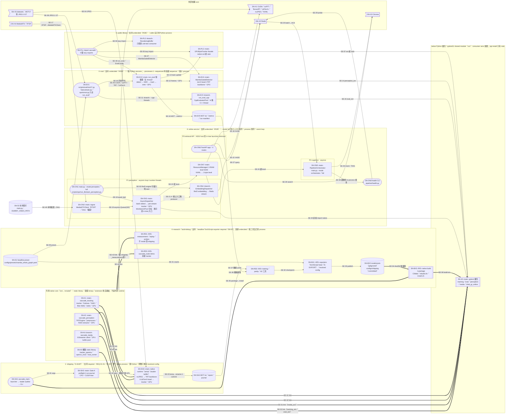

<!-- doc-status: proposed -->
<!-- doc-promotion: none -->
<!-- doc-date: 2026-10-13 -->
<!-- doc-module: cross -->

# 跨 Profile 系統現況總覽與追溯基線（#536 B0.1）

本稿是 [#536](https://github.com/raylei50653/saccade/issues/536) **跨 profile B0.1 現況總覽與追溯基線 checkpoint，包含 B0.4 的初步差異及交接索引**。它提供跨 profile 總圖、短版設計說明與最小追溯索引，把 [#535 ledger](capability_requirements_535.md) 的 CAP／REQ／Profile、[S-SHIP／S-EXPORT 展開圖](ship_export_contracts_536.md) 與 Python tracker／eval／online／research 的實際入口接起來。唯一閱讀入口是 [architecture README](README.md)。

**Source baseline**：`main@8ff04d018ed976a9f37ead1ab6ba60067f2a91d0`（2026-10-12）。圖與表的 `observed as-is` 都是在此 baseline 讀原始碼與建置檔（CMake、import、呼叫點）得到，**沒有執行 runtime、GPU、package 或服務**。`src/saccade/**` 與 `main.py` 自 #535 ledger baseline `60880ce6` 起沒有變動，ledger 的 Python 代表鏈在此 baseline 仍以 source 抽查為準；`shipping/**` 的變動由 S-SHIP 展開圖的實作狀態擁有。

**本稿的設計狀態**：架構差異維持 `proposed`；兩層圖的組織方式已依 [Major 4 圖集組織決策](ship_export_contracts_536.md#decision-536-view-hierarchy)採納，交付為 docs-only Draft PR。本稿**沒有**新增架構行為的 `accepted target`；圖中出現的 accepted／implemented 都引用既有決策（[#535 第一切片](capability_requirements_535.md#decision-535-first-slice)、[#536 第一批設計](ship_export_contracts_536.md#decision-536-first-slice)、#465 shipping boundary、ADR 025），本稿不重述、不擴大。

**交付邊界**：本次沒有完成跨 profile 的 B0.2／B0.3、B1／B2／B3；既有 S-SHIP／S-EXPORT 的 B0／B1 有界成果仍然有效。兩層圖的組織方式與 proposed 架構差異分開裁決；圖集組織獲准，不代表 proposed 架構差異、未決需求或整體 #536 獲批准。支持義務仍只看 #535 的三項限定需求裁決，其餘 19 項維持 candidate。

**本稿不擁有的內容**（只引用）：CAP／REQ、支持義務與批准狀態歸 [#535 ledger](capability_requirements_535.md)；S-SHIP／S-EXPORT 的節點 `N-*`、接口契約卡 `CC-536-*` 與實作狀態歸 [ship_export_contracts_536.md](ship_export_contracts_536.md)；失敗／降級狀態機歸 [#537](https://github.com/raylei50653/saccade/issues/537)，非同步時序與資源所有權歸 [#538](https://github.com/raylei50653/saccade/issues/538)，功能生命週期與退役歸 [#539](https://github.com/raylei50653/saccade/issues/539)；requirement↔check 與 as-built 驗收歸 [#541](https://github.com/raylei50653/saccade/issues/541)；tracker／reorder 的 public surface、compatibility 與 core channel 歸 [#441](https://github.com/raylei50653/saccade/issues/441)，eval／config／detector exports 的支持由 #535／#536 與原 owner 裁決；模型 bundle 與信任根歸 [#549](https://github.com/raylei50653/saccade/issues/549)；發行權利歸 [#547](https://github.com/raylei50653/saccade/issues/547)。

## 1. 狀態用語

設計狀態與驗證狀態分開記，兩者都不等於支持批准（支持義務只看 #535 ledger）。

| 軸 | 值 | 意思 |
|:--|:--|:--|
| 設計 | `observed as-is` | 本 baseline 的 source 現況；不代表「應該這樣」 |
| 設計 | `proposed target` | 本稿或他稿提出、未經 Owner 裁決；§5 的方向欄都屬此類 |
| 設計 | `accepted target` | 引用既有 Owner 決策；本稿不新增 |
| 設計 | `implemented` | 已 merge 的實作；範圍以原契約記的層級為準（例如 source-level） |
| 驗證 | `source-inspected` | 讀 source／建置檔確認，未執行 |
| 驗證 | `runtime evidence (pointer)` | 原契約或 closeout 記錄的執行證據，只在其座標／環境成立 |
| 支持 | `required`／`optional`／`not-supported`／`undecided`／`unknown` | 只引用 #535 ledger；ledger 沒裁決就寫 `undecided`，沒有資料就寫 `unknown` |

## 2. 系統總圖

**讀法**：五個 profile 表示**不同使用入口與執行情境**，不代表彼此一定有 process 隔離；**process／thread 邊界依實際 entrypoint 與啟動模式判定**。public-library 在 caller 的 Python process 內載入，eval 在自己的 process 內直接使用 tracker facade；online 的 `--mode full` 讓 perception 與 orchestrator 共用 process 與 event loop。共用關係包括同一份 native source 編成的 static library（每個 binary 各自連結一份）、同一批 Python 模組（public-library 的 `run_eval`／`EvalConfig`／`MambaGatedDetector` 直接解析到 eval 與 detector 的實作），以及 build／export 期產生的檔案。任何 profile 的證據都不會沿共用節點自動傳到其他 profile。

圖例不只靠顏色：

| 標記 | 意思 |
|:--|:--|
| 圓角框 `([…])` | 入口：process 起點或 caller 可見的 import／CLI |
| 方框 `[…]` | Python 元件 |
| 雙邊框 `[[…]]` | native C++／CUDA 元件 |
| 圓柱 `[(…)]` | 檔案／資料（輸入、產物、持久化） |
| 旗形 `>…]` | 外部依賴（不在本 repo） |
| 標籤 `‹main›`／`‹branch›`／`‹R/D›` | 元件在該 profile **已觀察呼叫路徑**中的角色：主路徑／同 profile 的旁支或可選分支（由 flag、可選依賴或另一個 class 選路）／research・build-debug 工具。這是 source 現況的角色分類，**不是支持義務**，也不是生命週期 |
| 子圖標題 | ①～⑤ 按使用情境分組。「支持」只引用 #535 ledger 對該 profile REQ 的裁決（②③④ 全部 `undecided`，⑤ 只有 S-EXPORT 的 headline TorchScript exporter 是 `required`）；其後是該入口的 process／thread 配置，判定方式見上方讀法。`CORE` 是 build 期 static library 的集合，`PYEXT` 是連結 CORE 的 extension `.so`，`EXT` 內都是外部依賴；子圖框本身不表示獨立 process |
| 標籤 `GPU` | 該元件的主要資料面在 GPU；沒標的是 CPU 端 |
| 實線 `-->` | 執行期呼叫或資料流（`observed as-is`，source-inspected）；⑤ 的工具自己執行時的呼叫也算 |
| 粗線 `==>` | build／install 期的連結或產物交付，**不是**執行期呼叫 |
| 虛線 `-.->` 且標 `✗` | source 上找不到閉合的鏈（gap），不代表執行時一定失敗 |
| 邊標籤 `SE-…` | 穩定邊 ID＋關鍵詞；傳什麼、同步性與限制見 §4.2，不塞進圖上 |

細節展開：

- **S-SHIP／S-EXPORT**：`SN-SH1`～`SN-SH4`、`SN-BX1`～`SN-BX3` 的內部節點（`N-R*`、`N-P*`、`N-X*`）、accepted target `N-T1`～`N-T4` 與實作狀態，見 [S-SHIP／S-EXPORT 展開圖](ship_export_contracts_536.md#1-總圖)（兩者關係見 §7）；本圖只畫到 profile 層。
- **eval 幀循環**：stage 順序見 [README §3](README.md#3-當前主路徑) 與 [pipeline flow](../reference/pipeline_flow.md)；現行 full stack 各機制的角色見 [module interactions](module_interactions.md)。
- **模型 bundle 與 runtime 分離**：見 [ADR 028](../decisions/028-model-bundle-runtime-separation.md) 與 [bundle 契約](model_bundle_contract_549.md)。

## 3. 各 profile 的入口、責任與邊界

支持欄只引用 [#535 ledger](capability_requirements_535.md#requirement--support-matrix)；`undecided` 表示該 REQ 仍是 candidate。

| Profile／CAP | 實際入口（source） | 責任與資料流 | Process／thread／裝置邊界 | 支持（ledger） |
|:--|:--|:--|:--|:--|
| ① shipping／[CAP-01](capability_requirements_535.md#cap-535-01) | [launcher](../../shipping/launcher/saccade_track.sh) → [loader_audit.c](../../shipping/src/loader_audit.c) → [saccade_track.cpp](../../shipping/tools/saccade_track.cpp) | JPEG sequence → MOT txt＋report＋journal；參數只來自 [resolved config](../reference/native_runtime_resolved_config.md)，模型只來自 caller 指定或 bundle manifest | 單一 native process；Gate A 不碰 CUDA，之後才建 stream／nvJPEG／TRT；不載入 Python | [REQ-535-01-01](capability_requirements_535.md#req-535-01-01)、[01-02](capability_requirements_535.md#req-535-01-02) `required`（S-SHIP 範圍） |
| ② public-library／[CAP-02](capability_requirements_535.md#cap-535-02) | [`saccade/__init__.py`](../../src/saccade/__init__.py) `_LAZY` | 五個 export 各自 lazy import：tracker facade、reorder、`run_eval`、`EvalConfig`、`MambaGatedDetector` | caller 的 process；native 擴充（先找已安裝的，再找 build 目錄）缺失時 facade 改用 stub（`is_cuda == False`、stub 的 `update` 回空 list）。facade 的 `update()` 在呼叫 stub 前會先取 `torch.cuda.current_stream()`，依 source 判讀，無 CUDA 的主機會先丟例外，而不是回空結果 | [REQ-535-02-01](capability_requirements_535.md#req-535-02-01)、[02-02](capability_requirements_535.md#req-535-02-02) `undecided`；tracker／reorder API 與 core channel 歸 #441，eval／config／detector exports 歸 #535／#536 與原 owner |
| ③ eval／[CAP-03](capability_requirements_535.md#cap-535-03) | [mot17.py](../../scripts/eval/mot17.py) → [runner.py](../../src/saccade/perception/eval/runner.py)（只 re-export）→ [evaluator.py](../../src/saccade/perception/eval/evaluator.py) `run_eval`；`--cpp-threads` 時 [cpp_runner.py](../../src/saccade/perception/eval/cpp_runner.py) `run_eval_cpp` | dataset＋preset → detector → GMC → tracker facade → MOT lines → motmetrics；run manifest 由 [run_manifest](../../scripts/provenance/run_manifest.py) claim | 一個 Python process；`--processes` 搭配 `--sequences` 時以子 process 分 sequence；relink write 可在背景 thread；`run_eval_cpp` 在 C++ thread pool | [REQ-535-03-01](capability_requirements_535.md#req-535-03-01)、[03-02](capability_requirements_535.md#req-535-03-02)、[02-03](capability_requirements_535.md#req-535-02-03) `undecided` |
| ④ online-service／[CAP-05](capability_requirements_535.md#cap-535-05)～[07](capability_requirements_535.md#cap-535-07) | [main.py](../../main.py) `--mode perception／orchestrator／full`；[run_8stream_perception.py](../../scripts/ops/run_8stream_perception.py)；[api/server.py](../../src/saccade/api/server.py) `app`；[health.py](../../src/saccade/pipeline/health.py) | 本地影片 → DALI，或 RTSP → MediaMTXClient（選路見下文）→ dispatcher → tracker → callback；embedding → Redis stream → orchestrator → Chroma／RAG → ACK；API 查 Redis／Chroma；VRAM level 經 SHM 傳給 orchestrator | P1 perception（asyncio；WorkbenchPool 的 daemon threads 只有測試會建構，8stream `--workbench` 用到未定義的名稱）、P2 cognition（asyncio）、P3 API；`--mode full` 時 P1＋P2 同 process 同 loop；分開啟動時才是跨 process SHM | REQ-535-05-\*、06-\*、07-\* 全部 `undecided`；部署 `unknown` |
| ⑤ research／build-debug／[CAP-04](capability_requirements_535.md#cap-535-04)、[08](capability_requirements_535.md#cap-535-08)、[09](capability_requirements_535.md#cap-535-09) | exporters（[TorchScript](../../scripts/model/export_headline_mamba_head_torchscript.py)、[resolved config](../../scripts/model/export_resolved_shipping_config.py)）、[rebuild.sh](../../scripts/native/rebuild.sh)、[install.sh](../../shipping/package/install.sh)、`shipping/tools/` 的 measurement／probes、training／parity／H2、`saccade_node` | 產生並交付 checkpoint、export 產物、resolved config、extension 與 package；量測工具讀凍結輸入產出證據 | 各工具自己的 process；measurement 用 shipping 函式庫的 `_measurement` 變體（core 照常連結），不 install | [REQ-535-08-02](capability_requirements_535.md#req-535-08-02) `required`（限 S-EXPORT 的 headline TorchScript exporter）；其餘 `undecided` |

**Online 輸入選路（source-inspected）**：`main.py` 讀取 `DUMMY_VIDEO_PATH`（預設 `assets/videos/demo.mp4`）；`os.path.isfile()` 成立時使用 `DALIMediaClient`，否則以 `dummy_video=source_url` 建立 `MediaMTXClient`，由 client 選路，可能使用預設 RTSP。此 env 值不會被當成 `rtsp_url` 傳入。`run_8stream_perception.py` 則明確建構各 stream 的 RTSP URL，以 `rtsp_url=...` 建立 `MediaMTXClient`。圖中 SE-49 與 SE-17 分別標出本地檔案與 RTSP 輸入；DALI 的 `watchdog_loop()` 缺口仍見 SN-ON2，圖線不代表 runtime 已驗證。

## 4. 追溯索引

Evidence 欄只放 pointer，不代表在本 baseline 重新驗證過。驗證欄除非另註，都是 `source-inspected@8ff04d01`。表中的 S-SHIP `N-*`／`L-*` 對應沿用[原文件 ID 索引](ship_export_contracts_536.md#5-id-索引)；它們標示細節的歸屬，不把原圖的歷史 baseline 當成本稿現況，現行設計／實作狀態仍以所連契約卡為準。

### 4.1 節點

| ID | 標籤 | CAP／REQ | 契約／權威 | Implementation entrypoint | Evidence／known limit | 設計｜驗證 | Owner／route |
|:--|:--|:--|:--|:--|:--|:--|:--|
| SN-SH1 | saccade_track 入口 | 01；01-01、01-02 | #465 [shipping boundary](../reference/native_runtime_shipping_boundary.md)；S-SHIP [`N-R1`～`N-R3`、`L-09`／`L-10`](ship_export_contracts_536.md#5-id-索引) | launcher、`loader_audit.c`、`parse_args` | [bundle tests](../../tests/unit/test_shipping_bundle_checks.py)；S-SHIP F3 | accepted＋implemented（#465）｜runtime evidence 見 [closeout](../reference/native_runtime_closeout.md) | CAP-01；#541 |
| SN-SH2 | Gate A＋journal | 01-01、01-02 | S-SHIP `N-R4`、`N-T1`～`N-T3`；[CC-536-01-01](ship_export_contracts_536.md#cc-536-01-01)、[CC-536-01-02](ship_export_contracts_536.md#cc-536-01-02) | `run_preflight`、`RunCompletion` | [preflight test](../../tests/native/test_shipping_preflight.cpp)、[preflight CLI](../../tests/unit/test_saccade_track_preflight_cli.py)；CC-536-01-02 未完成項見原卡 | accepted target；部分 implemented（source-level，見原卡）｜原卡記錄 | CAP-01；#537 狀態語義、#549 信任根 |
| SN-SH3 | native runtime | 01-01、01-02 | S-SHIP `N-R5`～`N-R7`；[resolved config](../reference/native_runtime_resolved_config.md) | `serial_runtime`／`double_buffer_runtime`、[track_driver.hpp](../../shipping/tools/track_driver.hpp) `run_sequences` | [serial](../../tests/native/test_shipping_serial_runtime.cpp)、[double-buffer](../../tests/native/test_shipping_double_buffer_runtime.cpp)；A_L 證據限 #465 同機座標，不等於 headline byte identity | accepted＋implemented（#465）｜closeout 座標 | CAP-01；#538 對 double-buffer 只引用 #465 |
| SN-SH4 | 輸出 | 01-01 | S-SHIP `N-R8`、`N-O1`、`N-T1`；[CC-536-01-01](ship_export_contracts_536.md#cc-536-01-01) | `RunCompletion` journal／report；格式沿用 [S2-1 契約狀態](ship_export_contracts_536.md#cc-536-01-02-status-s2-1) | 同 SN-SH2 | accepted target＋implemented（source-level）｜原卡 | CAP-01；#537 |
| SN-PL1 | lazy exports | 02；02-02 | [ADR 025](../decisions/025-native-extension-delivery.md)（只 tracker delivery） | `saccade.__getattr__` | [dependency surface](../../tests/contract/test_package_dependency_surface.py)；export 總數以外的外部 consumer `unknown` | observed as-is｜source-inspected | CAP-02；tracker／reorder 歸 #441，其餘 exports 歸 #535／#536 與原 owner |
| SN-PL2 | tracker facade | 02；02-01、02-03、02-04 | ADR 025；[package README](../../README.md) 已說明 stub | [tracker_gpu.py](../../src/saccade/perception/tracking/tracker_gpu.py) | [native delivery](../../tests/contract/test_package_native_delivery.py)；stub 回空結果與合法空幀不可區分（ledger E02）；無 CUDA 時 `update()` 先丟例外（§3）；模組 import 了 `eval.cuda_capture` | observed as-is｜source-inspected | CAP-02；#441、#537 |
| SN-PL3 | ReorderingBuffer | 02-02 | — | [reorder.py](../../src/saccade/perception/tracking/reorder.py) | [unit test](../../tests/unit/tracking/test_reorder.py)；timeout 分支是 `pass`；解析時會先載入父套件 `perception/tracking/__init__.py`，它 eager import facade（ledger E02） | observed as-is｜source-inspected；支持 `undecided` | CAP-02；#441、#539 |
| SN-EV1 | MOT17 CLI | 03；03-01 | [headline config](../reference/mot17_default_config.md) | `mot17.py` | [producer wiring](../../tests/contract/test_mot17_producer_wiring.py) | observed as-is｜source-inspected | CAP-03；#541 |
| SN-EV2 | `run_eval` | 03；03-01、03-02、02-03 | [pipeline flow](../reference/pipeline_flow.md)、[module interactions](module_interactions.md) | `evaluator.run_eval`、`stages.py`、`pipeline.py` | [metrics](../../tests/unit/eval/test_metrics.py)；headline 證據不外推到其他 preset／dataset（ledger E03） | observed as-is｜source-inspected | CAP-03；#536 B1、#537 |
| SN-EV3 | C++ eval pool | 03-01 | — | `cpp_runner.run_eval_cpp` → `CppEvaluatorPool` | 支持組合未裁決 | observed as-is｜source-inspected；支持 `undecided` | CAP-03；#535、#539 |
| SN-EV4 | headline detector | 03；02-02 | [ADR 019](../decisions/019-demote-reid-geometry-first-production-tracker.md)（headline ReID off） | [mamba_gated_detector.py](../../src/saccade/perception/temporal_yolo/mamba_gated_detector.py) | 也 import `eval.cuda_capture` | observed as-is｜source-inspected | CAP-03；#549 pairing |
| SN-EV5 | eval 產物 | 03、04 | [run manifest](../../scripts/provenance/run_manifest.py)（ADR 021 AP-2） | `claim_or_join_run` | 正常 eval 輸出不自動成為 accepted evidence（ledger CAP-03/04 邊界） | observed as-is｜source-inspected | CAP-03／04 |
| SN-ON1 | online 入口 | 05 | — | `main.py`、`run_8stream_perception.py` | `main.py` 的 `on_detection_finished` 是 `pass`；8stream `--workbench` 用到未定義的 `WorkbenchPool`（ledger E05） | observed as-is｜source-inspected | CAP-05；#537、#538 |
| SN-ON2 | ingest | 05 | — | [mediamtx_client.py](../../src/saccade/media/mediamtx_client.py)、`dali_pipeline.py` | [media test](../../tests/unit/media/test_mediamtx_client.py)；DALI 分支呼叫未定義的 `watchdog_loop()`（ledger C4） | observed as-is｜source-inspected | CAP-05；#538 |
| SN-ON3 | dispatcher／workbench | 05；02-04、05-01、05-02 | — | [dispatcher.py](../../src/saccade/perception/dispatcher.py) `AsyncDispatcher`、`WorkbenchPool` | [dispatcher test](../../tests/extended/test_dispatcher.py)（mock）；兩支的 queue／drop／callback 行為不同；WorkbenchPool 沒有可達的 in-tree 入口（E05）；見 §5 B0-F02 | observed as-is｜source-inspected | CAP-05；#537、#538 |
| SN-ON4 | embedding → Redis | 06；06-01 | [api_spec](../modules/storage/api_spec.md) | `embedding_dispatcher.py`、`main.on_embeddings_ready` | `main.py run_perception` 在 `TRTFeatureExtractor` 可載入時建立並 `start()` consumer thread（SE-50）；但線上入口沒有 crop producer，只有 benchmark 合成呼叫（SE-21） | observed as-is｜source-inspected；鏈未閉合 | CAP-06；#538、#539 |
| SN-ON5 | orchestrator | 06、07；06-01、07-01 | [cognition architecture](../modules/cognition/architecture.md) | [orchestrator.py](../../src/saccade/cognition/orchestrator.py) | [pipeline test](../../tests/integration/test_pipeline.py)；handler 吃掉錯誤後 batch 仍可 ACK（ledger E06） | observed as-is｜source-inspected | CAP-06；#537、#538 |
| SN-ON6 | retrieval API | 06；06-02 | [api_spec](../modules/storage/api_spec.md) | [server.py](../../src/saccade/api/server.py) `app` | [API test](../../tests/unit/api/test_server.py)；repo 內沒有 uvicorn 啟動點，P3 的 host `unknown` | observed as-is｜source-inspected | CAP-06；#535 |
| SN-ON7 | resource／SHM | 07；07-01、07-02 | [resource degradation](../modules/resource/architecture_degradation.md) | [resource_manager.py](../../src/saccade/resource/resource_manager.py) | NVML 失敗回零、缺 segment 回 NORMAL、無 freshness（ledger E07） | observed as-is｜source-inspected | CAP-07；#537、#538 |
| SN-ON8 | health CLI | 07；07-03 | internal operational contract | [health.py](../../src/saccade/pipeline/health.py)；[saccade_ctl.sh](../../scripts/ops/saccade_ctl.sh) `health` | [health test](../../tests/unit/test_pipeline_health.py)；probe `systemctl --user`、NVML 與 Redis；orchestrator 啟動時也 in-process 執行（SE-48）；`systemctl --user` 與 system units 的差異（ledger 部署段） | observed as-is｜source-inspected | CAP-07；#537 |
| SN-D1 | headline preset | 03、08-E | [headline config](../reference/mot17_default_config.md) | `configs/presets/mamba_whole_graph.yaml` | eval 與 shipping 經不同路徑消費同一 preset（SE-09、SE-31） | observed as-is｜source-inspected | CAP-03 |
| SN-D2 | online 本地影片 | 05；05-01 | — | [main.py](../../main.py) `run_perception`／`run_stream_producer` | `DUMMY_VIDEO_PATH`（預設 `assets/videos/demo.mp4`）；檔案存在才選 DALI（SE-49），runtime 未驗證 | observed as-is｜source-inspected | CAP-05；#538 |
| SN-BX1 | exporters | 08-E；08-02 | TorchScript head 對應 S-SHIP `N-X1`、`N-T4`、[CC-536-08-02](ship_export_contracts_536.md#cc-536-08-02)；resolved config 沿用 [resolved-config 契約](../reference/native_runtime_resolved_config.md) | `run_export`、`export_resolved_shipping_config.py` | [publication tests](../../tests/unit/test_headline_head_export_publication.py)；structural check 不是 MOT parity | 狀態逐 exporter 分開：TorchScript head 為 accepted target＋implemented（#559，REQ-08-02 required）；resolved config exporter 屬 #465 resolved-config 契約（inherited），沒有新 REQ 裁決（ledger C5-4）｜原契約 | CAP-08；#549、#421 |
| SN-BX2 | export 產物 | 08-02、01-02 | S-SHIP `N-X3`、`N-X5` | `models/yolo/`、`configs/shipping/*.json` | `models/yolo/` 是 gitignored | observed as-is｜source-inspected | CAP-08；#549 |
| SN-BX3 | build＋package | 08-B；08-03、01-02 | ADR 025；#465 C3／C4；S-SHIP `N-X6`、`N-P1`～`N-P3` | 根 [CMakeLists.txt](../../CMakeLists.txt)、[shipping CMake](../../shipping/CMakeLists.txt)、`rebuild.sh`、`install.sh` | [package test](../../tests/unit/test_shipping_package.py)；native test toolchain 分支 gap（ledger C5-5） | 部分 accepted＋implemented（#465、ADR 025）｜原契約 | CAP-08；#541、#547 |
| SN-RD1 | measurement 工具 | 04；04-02 | [measurement isolation](../../tests/unit/test_shipping_measurement_surface.py) | `shipping/tools/saccade_track_measurement.cpp` 等 | 與 shipping 共用 `run_sequences`（S-SHIP F5） | accepted＋implemented（#465 隔離）｜原契約 | CAP-04；原 research owner |
| SN-RD2 | training／parity／H2 | 04、08-T；04-01、08-01 | [research contracts](../research/contracts/README.md)、[training protocols](../../scripts/train/temporal_yolo/README.md) | `native_track_parity.py`、`run_h2_measurement.py`、`scripts/train/` | [parity checker](../../tests/unit/test_native_track_parity.py)；完整 research consumers `unknown` | observed as-is｜source-inspected | CAP-04、08；#404、#421 |
| SN-RD3 | native demo | 09；09-01 | — | 根 CMake `saccade_node` → [main.cpp](../../src/main.cpp) | 連結 `saccade_perception`、`saccade_tracking`、`saccade_media`，但 main.cpp 未接 tracker；需 `SACCADE_WITH_OPENCV` | observed as-is｜source-inspected；支持 `undecided` | CAP-09；#539 |
| SN-K1 | tracker core | 01、02、03、05 | [ADR 026](../decisions/026-frozen-input-source-evolution.md)（frozen input） | 根 CMake `saccade_tracking` | CMake 在 configure 時拒絕它連結 `saccade_perception` 或 OpenCV（#465 PR-11） | implemented（依賴限制）｜source-inspected | CAP-01／02；#436 規則 |
| SN-K2 | perception core | 01、03、05、09 | — | 根 CMake `saccade_perception` | `src/perception/trt_engine.cpp` 自 ledger baseline 起有變動（#549 S2-2），由 S-SHIP 實作狀態擁有 | observed as-is｜source-inspected | CAP-01／03；#549 |
| SN-K3 | pybind 擴充 | 02、03、05；08-03 | ADR 025、[install matrix](../reference/runbooks/native_extension_install.md) | 根 CMake `pybind11_add_module`（shared module，連結 CORE 的 static library；SE-41、SE-42、SE-51、SE-52）：`saccade_tracking_ext`、`saccade_eval_ext`（兩者在 `SACCADE_WITH_OPENCV` 下建置並連結 `saccade_opencv_host`）、`saccade_perception_ext`、`saccade_media_ext`、`saccade_cheb_gr_online_ext` | consumer venv 建置；`pip install` 只有 stub | 逐 extension 分開：`saccade_tracking_ext` 的 delivery 為 accepted＋implemented（ADR 025 只涵蓋 tracker delivery）；其他 extension 為 observed as-is，REQ-08-03 `undecided`｜原契約 | CAP-02、08；#441 |
| SN-K4 | media core | 05 | — | 根 CMake `saccade_media`（連結 `saccade_perception`、GStreamer） | 只經 `saccade_media_ext` 進 Python；`MediaMTXClient` 預設不走，需 `SACCADE_MEDIA_USE_CPP=1`；`saccade_node` 也連結它 | observed as-is｜source-inspected | CAP-05；#539 |
| SN-K5 | 輔助 static library | 01、03、09 | — | 根 CMake `saccade_tracker_params`（`saccade_tracking` 與 shipping config 共用的參數 store，純 C++）；`saccade_opencv_host`、`saccade_eval_runner`（只在 `SACCADE_WITH_OPENCV` 下建置） | `opencv_host` 承接從 perception／tracking 拆出的 OpenCV CPU 路徑，`eval_runner` 是 `--cpp-threads` 背後的 C++ runner（#465 PR-11） | observed as-is｜source-inspected | CAP-01、03 |
| SN-X1～X5 | 外部依賴 | — | — | — | 版本／環境見各契約；Redis／Chroma／MediaMTX 的部署 `unknown` | 外部 | — |

### 4.2 邊

邊只標方向、傳什麼與同步性；失敗、時序與退役語義由 §6 的 owner 擁有。

| ID | From → To | 傳什麼／同步性 | CAP／REQ | Evidence／limit |
|:--|:--|:--|:--|:--|
| SE-01～SE-03 | SH1→SH2→SH3→SH4 | argv → plan → MOT／journal；同步、單一 process | 01-01、01-02 | 細節見 S-SHIP `L-09`～`L-16`、`L-T*` |
| SE-04 | X5→SH3 | JPEG sequence 目錄 | 01 | sequence 輸入在 Gate A 檢查（#565） |
| SE-05、SE-06 | PL1→PL2／PL3 | `__getattr__` 首次存取才 import | 02-02 | top-level lazy 不代表每個 export resolve 都不需要 torch／native（E02） |
| SE-46、SE-47 | PL1→EV2／EV4 | 在 caller process 內將 `run_eval`（需 `eval` extra）、`EvalConfig`、`MambaGatedDetector` 直接解析到 eval／detector 實作 | 02-02 | 這三個 export 的 public surface 由 #535／#536 與原 owner 裁決，不屬 #441 |
| SE-07 | PL2→K3 | import `saccade_tracking_ext`；`ImportError` 時改用 stub | 02-01 | 能力缺失與合法空幀不可區分（E02） |
| SE-08、SE-09 | X5／D1→EV1 | dataset＋preset YAML | 03-01 | — |
| SE-10 | EV1→EV2 | `run_eval(**kwargs)`；同步 | 03-01 | `mot17.py` 經 `runner.py` re-export 取得 `run_eval` |
| SE-11 | EV1→EV3 | `--cpp-threads > 0` 才走 | 03-01 | 支持組合未裁決 |
| SE-12、SE-14 | EV2→EV4→K3 | frame tensor → detections；GPU | 03 | — |
| SE-13 | EV2→PL2 | 在同一 eval process 內直接呼叫 facade 的 tracker update | 02-03 | eval 與 library 共用 facade；共用 implementation 不等於共用支持（ledger「共用 implementation」段） |
| SE-15 | EV3→K3 | `saccade_eval_ext` | 03-01 | — |
| SE-16 | EV2→EV5 | MOT lines → motmetrics | 03 | — |
| SE-17 | X4→ON2 | RTSP → MediaMTXClient；8stream 明確傳入各 stream URL；`main.py` 未選 DALI 時交由 client 選路，可能使用預設 RTSP（§3） | 05-01 | 兩個 entrypoint 的來源選路不同；runtime 未驗證 |
| SE-49 | D2→ON2 | 本地影片 → DALIMediaClient；`main.py` 以 `os.path.isfile(source_url)` 選路（§3） | 05-01 | DALI 分支的 `watchdog_loop()` 缺口見 SN-ON2 |
| SE-19 | ON2→ON3 | ingest frame 經 producer 呼叫 `put_frame` → `asyncio.Queue(maxsize=100)`（AsyncDispatcher）；WorkbenchPool 的每 stream `queue.Queue(maxsize=4)` 沒有可達的 in-tree 入口 | 05-01 | drop／backpressure 政策未選 |
| SE-50 | ON1→ON4 | `main.py run_perception` 在 `TRTFeatureExtractor` 可載入時建立 `EmbeddingDispatcher` 並 `start()` consumer thread，同一 extractor 也傳給 `AsyncDispatcher`；載入失敗則退回 IoU-only | 06-01 | consumer 起來但沒有 crop producer（SE-21）；生命週期歸 #538、#539 |
| SE-18 | ON1→ON3 | 建立 dispatcher 並 `await start()` | 05-02 | stop／partial-start 語義未選（E05） |
| SE-20 | ON3→K3 | AsyncDispatcher 直接 import native `GPUByteTracker`；WorkbenchPool 經 Workbench ext 與 facade | 02-04 | 見 §5 B0-F02 |
| SE-21 | ON3⇢ON4 | ✗ 線上入口（`main.py`、8stream、AsyncDispatcher）沒有呼叫 `submit`／`put_crops`；只有 `scripts/benchmarks/` 的合成呼叫 | 05、06-01 | E05；gap，未執行 |
| SE-22 | ON4→X2 | `add_to_stream_batch`（XADD）；async | 06-01 | — |
| SE-23、SE-24 | ON3→ON7→ON5 | 1-byte `DegradationLevel` 經具名 SHM；reader 在每個 event 讀 | 07-01、07-02 | 缺 segment 回 NORMAL，沒有 generation／freshness（E07）；reader 可能停在舊 segment（B0-F07） |
| SE-25 | X2→ON5 | `read_stream_batch` → 背景 task → ACK | 06-01 | handler 錯誤後仍可 ACK（E06） |
| SE-26 | ON5→X3 | Chroma insert；可選 RAG task | 06-01 | RAG feature key 沒找到 production writer（ledger C4） |
| SE-27、SE-28 | ON6→X2／X3 | app lifespan 連 Redis；Chroma 在首次查詢時建立 | 06-02 | external clients `unknown` |
| SE-29、SE-30 | ON8／ON7→X2／X1 | health probe（也 probe NVML 與 `systemctl --user`，圖上只畫 Redis）；NVML 讀取 | 07-01、07-03 | unknown 不得當 healthy（ledger 非目標） |
| SE-48 | ON5→ON8 | `orchestrator.run()` 啟動時 in-process 執行 `HealthChecker` 並印出報告 | 07-03 | 報告不擋啟動（source 判讀） |
| SE-31 | D1→BX1 | resolved config exporter 以 headline preset 執行 oracle | 08-E | 見 [resolved config](../reference/native_runtime_resolved_config.md) |
| SE-32 | RD2→BX1 | checkpoint | 08-T、08-02 | pairing／lineage 歸 #549、#421 |
| SE-33 | BX1→BX2 | TorchScript head：staging → publish；lineage 最後發布 | 08-02 | S-SHIP `L-T7`、`L-T8`；[CC-536-08-02](ship_export_contracts_536.md#cc-536-08-02)（#559）；resolved config 的發布不從此契約繼承 |
| SE-34 | BX2⇒BX3 | `install_model_root.cmake` 逐檔比 sha256 | 08-02、01-02 | S-SHIP `L-04`～`L-06` |
| SE-35 | BX3⇒SH1 | tarball＋MANIFEST → `install.sh` → installed tree | 01-02 | S-SHIP `L-07`、`L-08`；公開發行未批准（#547） |
| SE-36 | BX3⇒K3 | 在 consumer venv 建 extension | 08-03 | ADR 025 |
| SE-37、SE-38 | SH4／EV5→RD2 | 離線讀檔比對 | 04-01 | 比對結果的 admissibility 歸原 research owner |
| SE-39～SE-44、SE-51、SE-52 | CORE⇒SH3／K3／RD1／RD3 | static link（build 期）：把 static library 連進各 native 執行檔與各 extension `.so`，每個連結產物各自一份；K3 本身是 shared module，不屬 CORE。SE-51：`saccade_media` → `saccade_media_ext`；SE-52：`saccade_opencv_host` → `saccade_tracking_ext`／`saccade_eval_ext`，`saccade_eval_runner` → `saccade_eval_ext`。RD1 經 shipping 函式庫的 `_measurement` 變體連結 core；RD3 連結 core 但未使用 tracker | 01、02、04、09 | 同 source 不代表同 runtime 狀態或同參數來源 |
| SE-45 | CORE→X1 | CUDA runtime；cuFFT（`saccade_tracking`、`saccade_perception`）；TensorRT＋LibTorch（`saccade_perception`） | — | 版本 pin 見 #465／#549 契約 |

## 5. 設計說明

### 5.1 分工理由（現況）

下表說明現有邊界**為什麼**存在、由什麼需求支撐，以及目前由什麼機制執行。理由欄只寫有來源的理由；沒有來源的寫 `unknown`，不從現況反推需求。

| ID | 邊界 | 理由與需求 | 設計｜執行點 |
|:--|:--|:--|:--|
| B0-D01 | profiles 區分使用入口與執行情境；process 邊界依 entrypoint／啟動模式判定，可共用 native source、Python 模組與 build 期產物（process 內呼叫見 B0-D07） | 各 profile 的使用者、輸入與支持義務不同（#535 CAP 表）；S-SHIP 的保證不外推到其他路徑（S-SHIP／S-EXPORT 展開圖「為什麼這樣分」） | observed as-is｜S-SHIP 範圍內為 accepted |
| B0-D02 | shipping 是單一 native process，不載入 Python、不讀 env 參數 | #465 shipping boundary；REQ-535-01-01／01-02 | accepted＋implemented｜[config loader sources test](../../tests/unit/test_shipping_config_loader_sources.py)、loader auditor、measurement 隔離 test |
| B0-D03 | tracker core（SN-K1）不連結 perception 或 OpenCV | shipping runtime 連結它，不能經它帶入 perception／OpenCV（#465 PR-11） | implemented｜根 CMake configure 時 `FATAL_ERROR` |
| B0-D04 | S-EXPORT／S-SHIP 的建置與模型交付邊界以檔案傳遞：preset → resolved config、checkpoint → export → attestation → package；eval／public-library 的 process 內共用模組與直接呼叫見 B0-D07、SE-13、SE-46／47 | CC-536-08-02 已核准 export → shipping 的接受條件；REQ-535-08-02 | S-EXPORT 為 accepted＋implemented｜其他交付 observed as-is |
| B0-D05 | Python 套件依賴方向：`perception` → `resource`／`media`／`storage`；`cognition` → `storage`／`resource`／`pipeline`；`api` → `storage`；`storage`、`resource`、`pipeline`、`media` 不 import 其他 `saccade.*` 子套件 | 讓 storage／cognition 不反向影響 perception 熱路徑（README §4.4、§4.6） | observed as-is（本 baseline 的 import 掃描）｜[check_api_layers.py](../../scripts/tools/check_api_layers.py) 只 warn |
| B0-D06 | online 的慢路徑（cognition／API）經 Redis／Chroma／SHM 與 perception 解耦 | README §4.4～§4.6 | observed as-is｜沒有 check；鏈有 gap（SE-21） |
| B0-D07 | eval 與 public-library 在 caller／eval process 內共用 Python 模組及直接呼叫：tracker facade（SN-PL2、SE-13），以及 `run_eval`／`EvalConfig`／`MambaGatedDetector` 三個 export 直接解析到 eval／detector 實作（SE-46、SE-47） | 同一個 tracker wrapper／native core（ledger「共用 implementation」段） | observed as-is｜共用 implementation 不等於共用支持 |

### 5.2 本次追查的發現

依 #536 B3 分類；全部是 `source-inspected`，沒有重現。contract-gap／unverified 的最小 PR 範圍由「處置」欄的去向 Issue 決定，本稿不預先切片。

| ID | 發現 | 分類 | 處置 |
|:--|:--|:--|:--|
| B0-F01 | README §4.5 原本寫 dispatcher 與 orchestrator 是「兩進程獨立啟動」；`main.py --mode full` 實際上在同一 process 的同一 event loop 跑兩者，只有分開以 `--mode perception`／`--mode orchestrator` 啟動時才跨 process | contract-gap（文件漂移） | 本稿同時修正 README §4.5 的敘述，不改程式 |
| B0-F02 | `AsyncDispatcher` 直接 `from saccade_tracking_ext import GPUByteTracker`，不經 facade；擴充缺失時名稱改綁 `typing.Any`。依 source 判讀，建立 tracker 時會丟 `TypeError`。library 的 stub `update()` 本身回空 list，但 facade 在呼叫它前先取 CUDA stream，無 CUDA 時會先丟例外（§3）。兩條路徑的能力缺失行為需分別驗證 | `get_tracker()` 的 `TypeError` 與 facade 兩條路徑已由 [#537 C0](failure_degradation_537.md#2-capabilityfailure-矩陣observed-as-is) 重現（C0-01～C0-03，`main@8350f6f7`）；consumer 層的觸發時間仍是 source 判讀 | 交 REQ-535-02-01／02-04 的裁決與 #537；作為具名失敗語義案例，本稿不選行為 |
| B0-F03 | tracker facade（SN-PL2）與 headline detector（SN-EV4）在 module 層 import `saccade.perception.eval.cuda_capture`；public-library export 因此依賴 eval 子套件 | unverified（影響未評估） | 作為依賴方向與 public surface 的設計輸入：tracker／reorder 交 #441，eval／config／detector 交 #535／#536 與原 owner；跨模組契約交 #536 B1。import 依賴本身不構成搬模組或重寫 facade 的授權 |
| B0-F04 | README §2 的 L1～L6 沒有涵蓋 `shipping/` 樹與 build／export 期交付 | contract-gap（閱讀面） | 本稿在 README §2 加上指向總圖的說明 |
| B0-F05 | repo 內沒有 retrieval API 的 ASGI 啟動點（只有 `app` 物件與 `uvicorn` 依賴）；[yolo-api.service](../../infra/systemd/yolo-api.service) 的 ExecStart 指向 repo 外的 `YOLO_LLM/scripts/run.sh api` | unverified（部署 `unknown`） | 沿用 ledger E06 路由至 #535；沒有 in-tree 啟動點不證明服務不存在，也不授權退役 |
| B0-F06 | ledger E05／E06／E07 已記的 gap（SE-21、8stream `--workbench` 用到未定義的 `WorkbenchPool`、SHM writer 只在 AsyncDispatcher）在本 baseline 仍存在 | already-covered（ledger） | 沿用 ledger 路由 |
| B0-F07 | `VRAMLevelReader` 只在 `_shm is None` 時重新附掛。`--mode full` 先建構 orchestrator（reader）才執行 dispatcher 的 `start()`（writer）；若前次崩潰留下 segment，reader 會先附掛舊 segment，writer 之後 unlink 並重建，依 source 判讀 reader 會一直讀已 unlink 的舊 segment。分開啟動且 orchestrator 先啟動時同理 | SHM 行為與 `--mode full` 建構順序已由 [#537 C0](failure_degradation_537.md#2-capabilityfailure-矩陣observed-as-is) 重現（C0-08，`main@8350f6f7`）；對 orchestrator 事件的影響仍是 source 判讀。屬 ledger E07 的 stale／writer restart 缺口 | 交 #537、#538，建議優先驗證此生命週期案例；本次未執行或授權 runtime 修復，不選 freshness／restart 判準 |

### 5.3 差異方向（proposed，不是批准）

下列方向是 B0 對重要差異的**建議分類**，供 Owner 與各 owner Issue 裁決；任何一項都不授權重構或改 runtime。

| 對象 | 建議方向 | 前置裁決 | 去向 |
|:--|:--|:--|:--|
| S-SHIP 邊界（B0-D02、D03） | 保留 | 已有 #465／#536 決策 | 不動 |
| native 缺失時的 facade stub 與 online 直接 import（SN-PL2、SN-ON3；B0-F02） | 約束：先裁決各 profile 的能力缺失可觀察結果 | REQ-535-02-01、02-03、02-04 | #537 |
| facade 對 eval 子套件的依賴（B0-F03） | 約束或待評估 | #441 public surface | #441、#536 B1 |
| online 事件鏈 gap（SE-21、SN-ON1） | 待裁決：實作、隔離或維持未支持 | REQ-535-05-\*、06-01 | #537、#538、#539 |
| VRAM level SHM（SE-23、SE-24；B0-F07） | 約束：unknown／stale 不得冒充 healthy | REQ-535-07-01、07-02 | #537、#538 |
| C++ eval pool、ReorderingBuffer、demo（SN-EV3、SN-PL3、SN-RD3） | 未決：只標支持 `undecided`；default-off 或缺 consumer 不等於可退役 | REQ-535-03-01、02-02、09-01 | #535、#539 |
| Python 依賴方向（B0-D05） | 約束候選：把 warn-only 稽核升為檢查要先有 Owner 裁決 | — | #541 |

## 6. 給 #537／#538／#539 的共同邊界

本節只指出各 owner 的語義掛在總圖的哪些節點／邊上，不定義那些語義。

| Owner | 掛載點（本圖 ID） | 本稿不做的事 |
|:--|:--|:--|
| [#537](https://github.com/raylei50653/saccade/issues/537) 失敗／fallback／降級 | SE-07、SE-20（能力缺失）；SN-SH2／SN-SH4（run 狀態轉換，接 CC-536-01-01）；SE-23、SE-24、SE-29、SE-30（unknown／stale／healthy）；SE-25（ACK 與失敗） | 不定狀態機、不選 consumer policy |
| [#538](https://github.com/raylei50653/saccade/issues/538) async／ownership | SE-18、SE-19（queue、worker、start／stop）；SE-21、SE-22、SE-25（event 交付與背景 task）；SN-EV2 的 relink 背景 thread、SN-EV3 的 C++ thread；SN-SH3 double-buffer 只引用 #465 證據 | 不定 ordering、drain、cancel、buffer lifetime |
| [#539](https://github.com/raylei50653/saccade/issues/539) 功能生命週期 | 標 `‹branch›` 的節點與 SN-RD3：SN-PL3、SN-EV3、SN-ON4、SN-RD3，以及 ReID／relink 等 optional 分支 | 不做 KEEP／CONSTRAIN／ISOLATE／RETIRE 裁決 |

建議（proposed，待 Owner 裁決）：各 owner 的 profile／行為展開圖引用本稿的 `SN-*`／`SE-*` 或既有 S-SHIP `N-*`／`L-*`／`CC-*` ID；只有改變跨 profile 邊界的節點或邊才補本稿 §4，內部細節由各展開圖維護。視圖共同由 README 導覽，不新增 registry。

## 7. 維護規則與限制

- **更新時機（proposed）**：改變 profile 入口、process／thread 邊界、跨 profile 交付或共用 core 連結方式的 PR，要更新本稿 §2／§4，或在 PR 說明寫「架構無影響」的理由。這是閱讀約定，目前沒有自動檢查；requirement↔check 由 #541 決定。
- **ID 穩定（proposed）**：`SN-*`／`SE-*` 不重編號；刪除的節點保留在表內並標 `removed`／`superseded`，不重用 ID。S-SHIP／S-EXPORT 內部仍用 `N-*`／`L-*`。
- **圖集層級（Major 4 已採納）**：本次三檔修訂採「跨 profile 總覽＋S-SHIP／S-EXPORT 展開圖」，組織規則、Owner 決策來源及舊規則的歷史定位統一記在 [ship_export_contracts_536.md §6](ship_export_contracts_536.md#decision-536-view-hierarchy)。README 只導覽；本稿負責巨觀結構與 §4 的跨層對應；S-SHIP／S-EXPORT 原文件繼續擁有契約與設計狀態。本稿不另維護 shipping 契約或支持義務，圖集組織獲准也不提升 §5 的 proposed 差異。
- **證據邊界**：本稿只做 source 抽查，沒有新增 runtime、GPU、package 或部署證據；V5、installed package 驗證、S2-2／S2-3 與 #547 發行狀態維持原 owner 與原狀態。
- **Checkpoint 範圍**：跨 profile B0.1 現況總覽與追溯基線，包含 B0.4 的初步差異及交接索引。本次沒有完成跨 profile 的 B0.2／B0.3、B1／B2／B3；既有 S-SHIP／S-EXPORT 的 B0／B1 有界成果仍然有效。#536 整體保持 OPEN。
